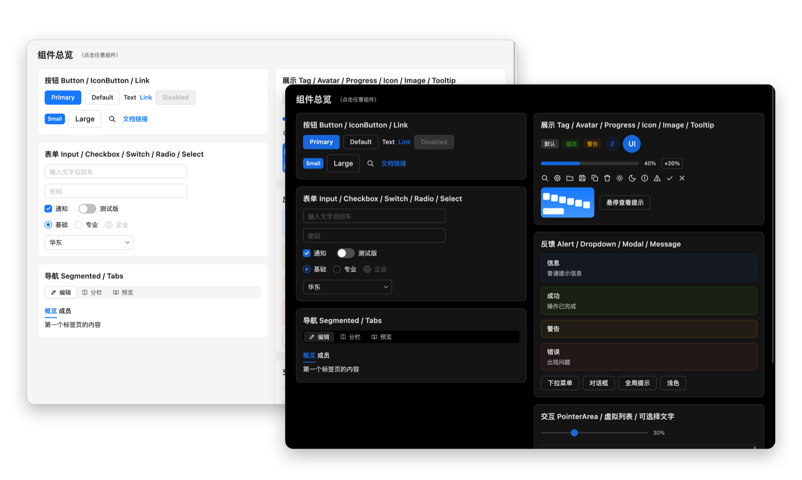
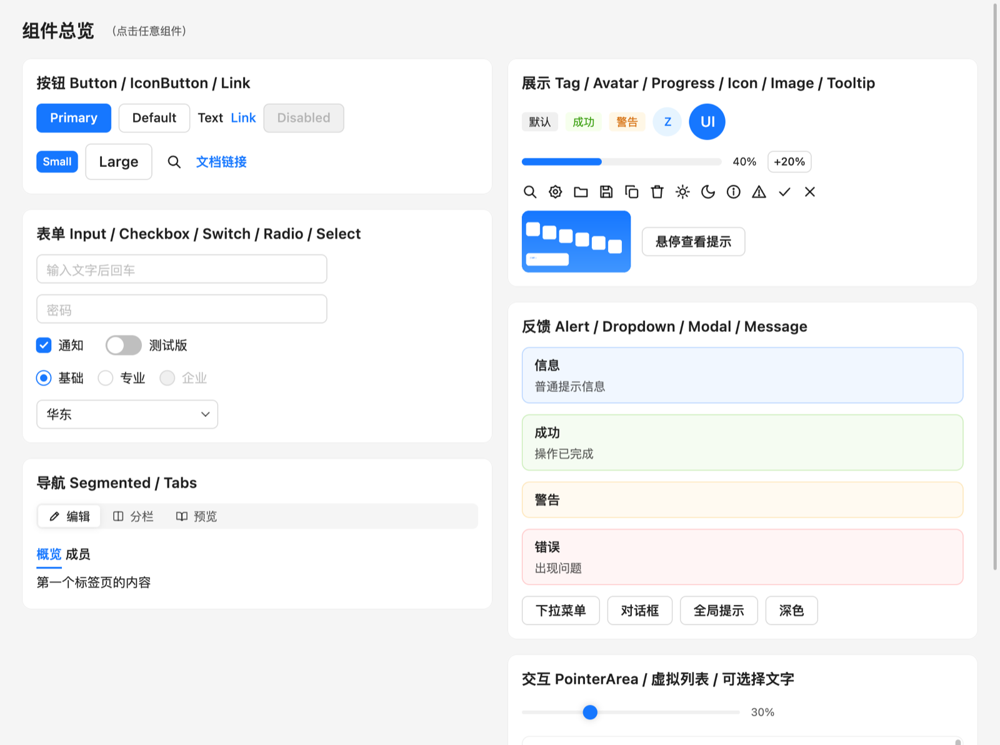
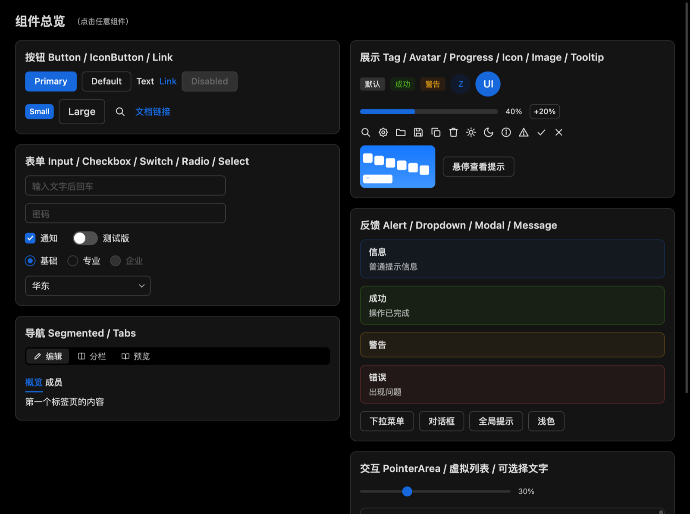
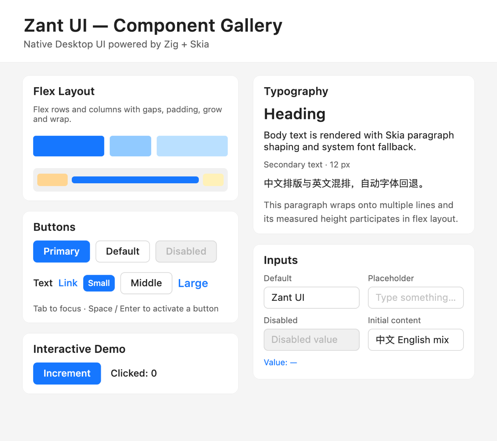
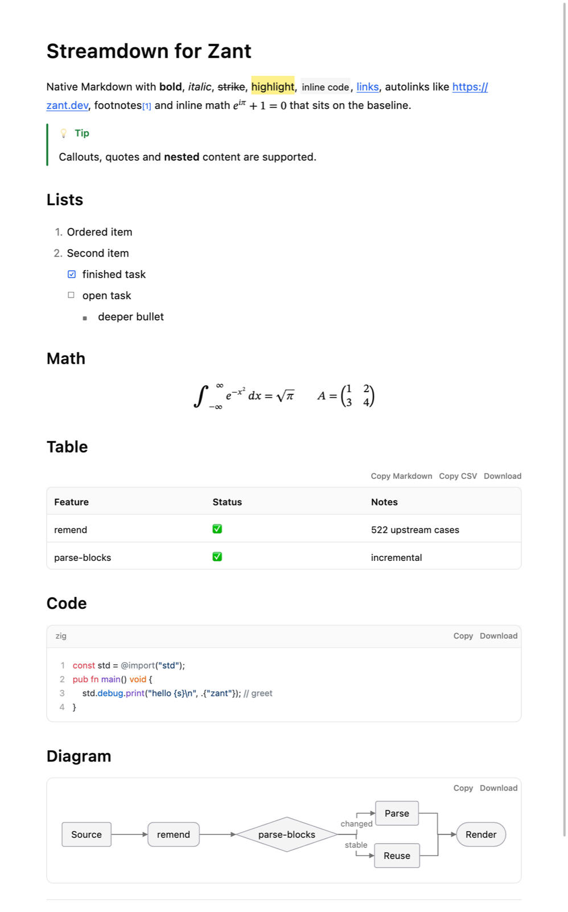
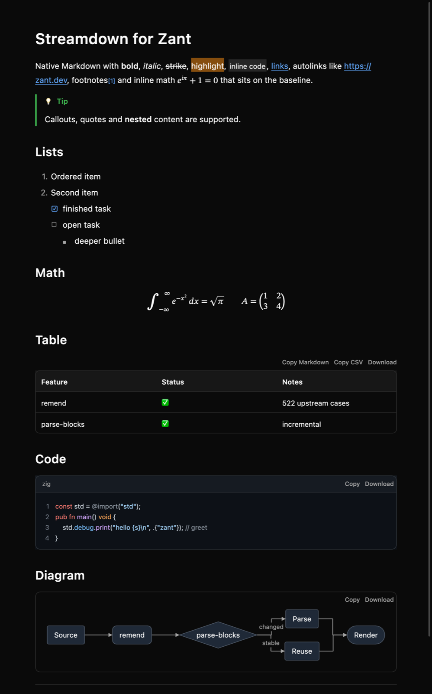
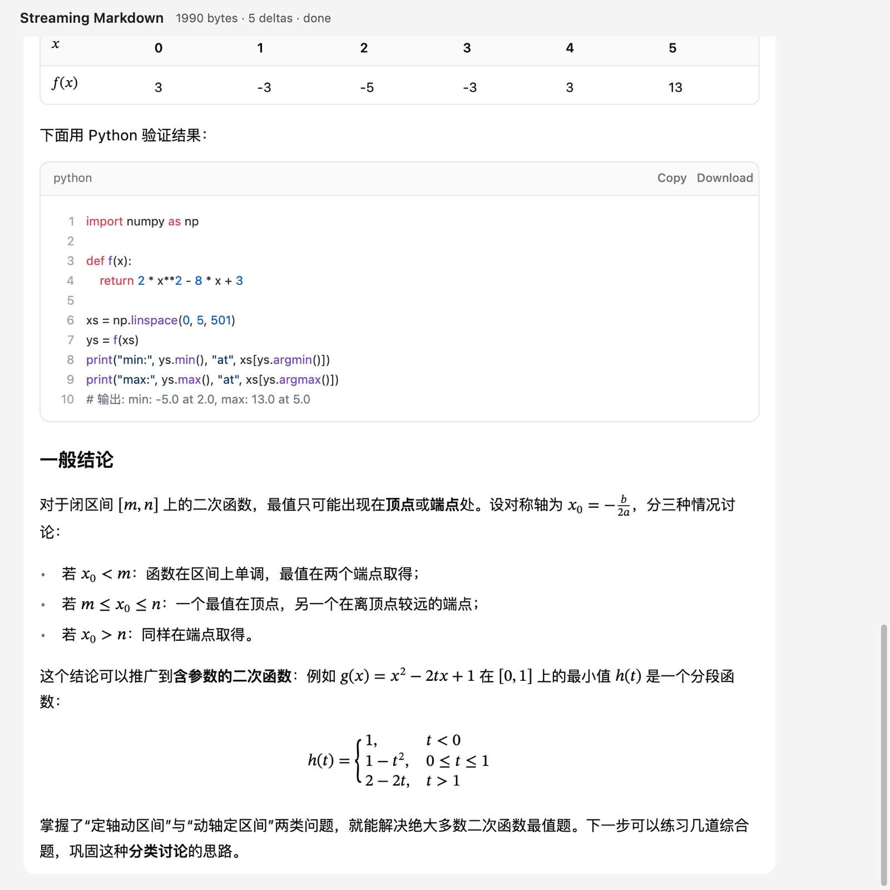
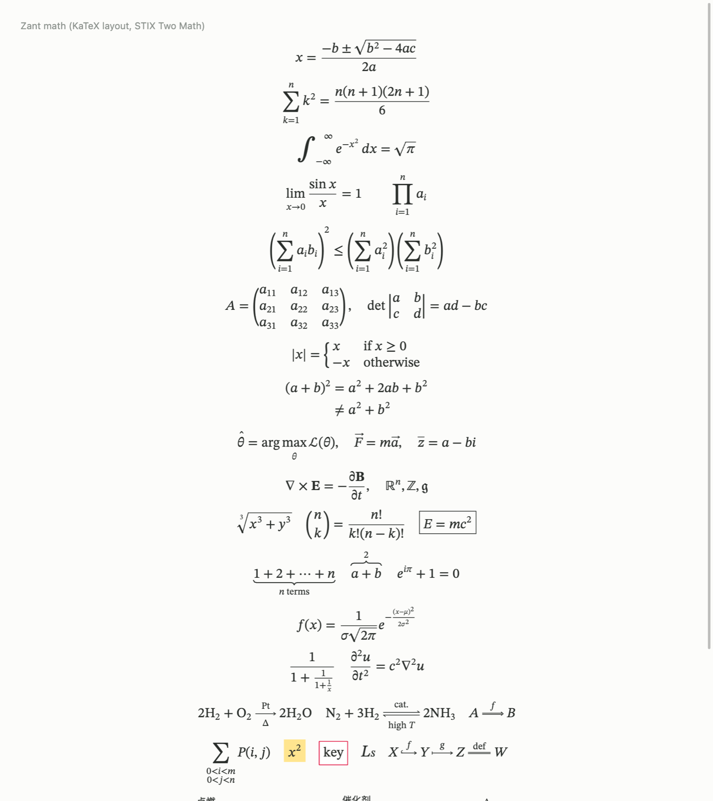
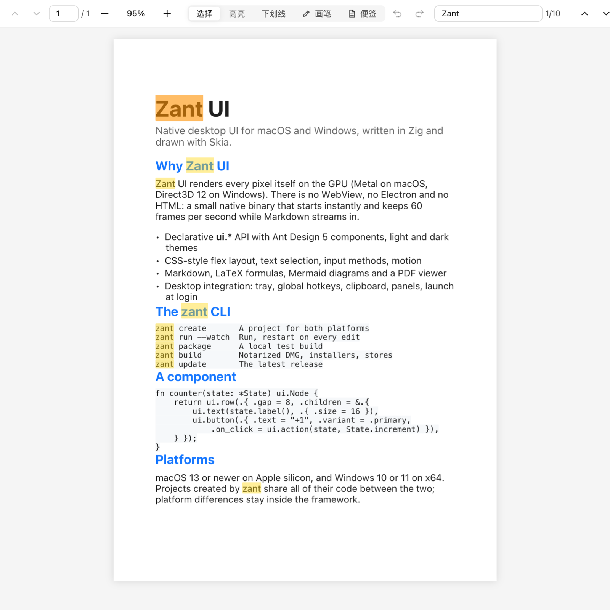
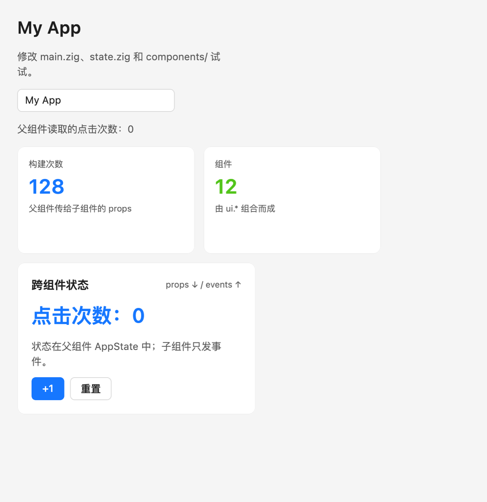

<div align="center">

# Zant UI

**用 Zig + Skia 写原生桌面应用 · macOS 与 Windows 共用一套代码**

[](https://github.com/racall/zant-ui/releases)   [](LICENSE)

[安装](#安装) · [快速上手](#快速上手) · [文档](#文档) · [示例与界面](#示例与界面)



</div>

Zant UI 是一个桌面 UI 框架。界面用声明式的 `ui.*` API 描述，由 Skia 直接在 GPU 上绘制（macOS 用 Metal，Windows 用 Direct3D 12）——**没有 WebView、Electron 或 HTML**，编出来就是一个原生程序。配套的命令行工具 `zant` 负责创建项目、热更新运行，以及签名、公证、打包发布。

## 为什么用 Zant UI

| 特点 | 说明 |
|---|---|
| **原生、轻量** | 一个原生程序，启动快、占用小。一个完整的托盘应用（[ClipHop](https://github.com/racall/cliphop)）的 macOS DMG 约 10 MB，Windows 安装包约 12 MB |
| **一套代码，两个平台** | 同一份代码在 macOS 和 Windows 上编译运行；快捷键（⌘ / Ctrl）、标题栏按钮、数据目录、托盘与菜单栏等差异由框架处理 |
| **完整的组件** | 按 Ant Design 5 实现的按钮、表单、选择器、标签页、对话框、菜单、虚拟列表等，浅色 / 深色主题，antd 风格的过渡动效 |
| **富内容** | Markdown（流式渲染，适合 AI 对话）、LaTeX 公式与化学式、Mermaid 图、代码高亮、可批注的 PDF 阅读器、跨节点选择复制 |
| **桌面能力** | 多窗口与快捷面板、托盘 / 菜单栏、全局快捷键、剪贴板（文字 / 图片 / 文件）、开机启动、单实例、SQLite 持久化 |
| **从开发到发布** | `zant create` 生成项目，`zant run --watch` 热更新，`zant build` 一条命令完成签名、公证、DMG / 安装包，或提交商店 |
| **为 AI 编程准备** | 生成的项目自带 `DESIGN.md`、`AGENTS.md`、`CLAUDE.md`，Codex / Claude Code 按框架约定写代码 |

## 安装

一条命令装好 `zant` 和 Zant UI。下载的是编译好的发布包，**不用克隆源码，也不用编译**。

**macOS**（Apple 芯片，macOS 13+）

```bash
curl -fsSL https://raw.githubusercontent.com/racall/zant-ui/main/install.sh | bash
```

**Windows**（10 / 11 x64，在 PowerShell 里运行）

```powershell
irm https://raw.githubusercontent.com/racall/zant-ui/main/install.ps1 | iex
```

安装脚本做的事：

1. 检查 Zig：已经装了 Zig 0.17.1 就直接用；没有（或版本不同）就下载官方的 Zig 0.17.1 放进安装目录，不影响已有的 Zig；
2. 下载对应平台的发布包并校验，放到 `~/.zant`（Windows 是 `%LOCALAPPDATA%\zant`）；
3. 把 `zant` 加到 PATH（新开的终端里生效）。

| 平台 | 还需要 |
|---|---|
| macOS | Xcode 命令行工具（编译应用要用 macOS SDK；没装时脚本会打开安装窗口） |
| Windows | 不需要别的：发布包自带编译好的 Skia 桥接库和 VC 运行库，**不用装 Visual Studio** |

<details>
<summary>更新、指定版本、卸载</summary>

- 更新到最新版本：`zant update`
- 安装前可设置的环境变量：`ZANT_HOME`（安装目录）、`ZANT_VERSION`（指定版本，如 `v0.1.1`）、`ZANT_BIN_DIR`（macOS 放 `zant` 链接的目录，默认 `~/.local/bin`）、`ZANT_NO_MODIFY_PATH=1`（macOS 不改 shell 配置文件）
- 卸载：删除安装目录和 `~/.local/bin/zant`，并去掉 PATH 里对应的一项

</details>

## 快速上手

### 1. 创建项目

```bash
zant create my-app
cd my-app
```

`zant create` 会问三件事：应用标题、窗口风格（原生标题栏 / 隐藏标题栏 / 无边框）、应用标识（反向域名，如 `com.example.myapp`）。生成的项目两端通用：

```text
my-app/
  app.config.json          标题、应用标识、版本、窗口大小与风格
  build.zig build.zig.zon  构建脚本（引用 Zant UI，一般不用改）
  src/main.zig             入口：持有状态、渲染界面
  src/state.zig            应用状态与动作
  src/components/          自己的组件（示例：展示卡片、计数器、父组件）
  assets/icons/            应用图标、托盘 / 菜单栏图标（两端规范的默认图标，可替换）
  DESIGN.md AGENTS.md CLAUDE.md   给 AI 编程助手的设计与开发规范
```

### 2. 运行与热更新

```bash
zant run              # 编译并运行
zant run --watch      # 改代码后自动重新编译、重启
```

### 3. 写界面

界面是普通的 Zig 函数：读状态、返回节点树；按钮等控件通过回调调用状态的方法，状态一变界面自动更新。

```zig
const zant = @import("zant");
const ui = zant.ui;

const State = struct {
    clicks: u32 = 0,

    pub fn increment(self: *State) void {
        self.clicks += 1;
    }
};

fn render(state: *State) ui.Node {
    return ui.column(.{
        .gap = 12,
        .padding = ui.inset(24),
        .children = &.{
            ui.heading("Hello Zant", .{ .level = 1 }),
            ui.textFmt("点击次数：{d}", .{state.clicks}, .{ .size = 20 }),
            ui.button(.{ .text = "+1", .variant = .primary, .on_click = ui.action(state, State.increment) }),
        },
    });
}
```

更多写法见下文 [声明式 API](#声明式-api) 和 [组件文档](docs/components/README.md)。

### 4. 打包与发布

```bash
zant package          # 本机测试：macOS 生成 .app，Windows 生成程序目录
zant build            # 发布：缺的设置（证书、公证帐户等）会逐项询问，可保存到 build.config.json
zant build --yes      # CI：不提问，密钥从环境变量读取
```

| 平台 | `zant build` 的结果 |
|---|---|
| macOS | Developer ID 签名、带背景的 DMG，可选 Apple 公证；或 .pkg 提交 Mac App Store |
| Windows | 签名的安装包（中文 / 英文界面）；或 MSIX 提交 Microsoft Store；或免安装 zip |

证书、公证帐户、商店信息怎么获取和设置，见 [发布构建](docs/build.md)。

### 常用命令

| 命令 | 作用 |
|---|---|
| `zant create <名字>` | 生成项目 |
| `zant run [--watch] [--release]` | 编译并运行；`--watch` 热更新 |
| `zant compile [--release]` | 只编译 |
| `zant package` | 本机测试用的 .app / 程序目录 |
| `zant build [配置文件] [--yes]` | 发布构建：签名、公证、DMG、安装包或提交商店 |
| `zant sync` | 只重新生成 `src/app_config.zig`、Info.plist 等生成文件 |
| `zant update` | 更新 zant 和 Zant UI |

## 文档

| 主题 | 文档 |
|---|---|
| 脚手架、图标、项目结构 | [docs/scaffold.md](docs/scaffold.md) |
| 窗口与 app.config.json | [docs/window-config.md](docs/window-config.md) |
| 发布构建（签名、公证、安装包、商店、CI） | [docs/build.md](docs/build.md) |
| 组件 | [docs/components/README.md](docs/components/README.md) |
| 桌面集成（多窗口、托盘、快捷键、剪贴板） | [docs/desktop.md](docs/desktop.md) |
| 状态管理 / SQLite 持久化 | [docs/state.md](docs/state.md)、[docs/database.md](docs/database.md) |
| Markdown 与数学 | [docs/markdown.md](docs/markdown.md) |
| Flex 布局与 CSS 对照 | [docs/flex.md](docs/flex.md) |
| 动效 | [docs/motion.md](docs/motion.md) |
| 架构 / 开发与测试 | [docs/architecture.md](docs/architecture.md)、[docs/development.md](docs/development.md) |

## 功能一览

<details>
<summary>已完成的模块（点开查看）</summary>

| 模块 | 状态 |
|---|---|
| macOS AppKit 窗口（原生 / 隐藏标题栏 / 无边框，自定义标题栏高度） | ✅ |
| Windows Win32 窗口（同三种风格；隐藏标题栏时框架绘制 Windows 11 标题按钮，支持贴靠布局） | ✅ |
| Skia Ganesh + Metal / Direct3D 12（默认），CPU 光栅回退（`ZANT_RENDERER=raster`） | ✅ |
| 每显示器 DPI（Windows PerMonitorV2）、IMM32 输入法（微软拼音已端到端验证） | ✅ |
| Flex 布局（wrap、百分比、order、align-self、绝对定位 / anchor） | ✅ |
| 文本：中文、自动换行、富文本、单行省略号截断、输入法 | ✅ |
| antd 组件：Button、Input、Checkbox / Switch / Radio、Select、Tabs、Tooltip、Card、Tag、Alert、Avatar、Progress、Dropdown 菜单、Segmented、Modal、Message、Icon | ✅ |
| 浅色 / 深色主题（运行时切换） | ✅ |
| 动效：antd 缓动与时长、进场 / 退场、FLIP 布局过渡、按刷新率出帧（CADisplayLink / D3D12 垂直同步）、减少动态效果 | ✅ |
| Markdown（Streamdown 移植）+ LaTeX 公式（KaTeX 算法）+ 化学式 `\ce`（mhchem 移植）+ Mermaid + HTML 导出 | ✅ |
| 流式渲染（块缓存、生长中的块保留节点、文字排版双宽度缓存），真实 SSE 实测稳定 60 帧 | ✅ |
| 文字选择与复制（`selectable` 容器，跨节点拖选、双击 / 三击，公式复制为 LaTeX） | ✅ |
| PDF 阅读器（连续滚动、缩放、选择复制、搜索、链接、批注与带批注导出，参照 EmbedPDF） | ✅ |
| 指针区域（拖动捕获、多击、滚轮）、内存图片、后台线程唤醒 UI | ✅ |
| 虚拟列表（只构建可见条目，聊天贴底跟随，参照 GPUI）、容器悬停样式、对话框焦点范围 | ✅ |
| 桌面集成（`zant.desktop`）：多窗口与快捷面板、托盘 / 菜单栏、全局快捷键、剪贴板监听（文字 / 图片 / 文件）、开机启动、单实例 | ✅ |
| 编译后脚手架 `zant`、app.config.json、App Sandbox | ✅ |
| 发布构建 `zant build`：Developer ID 签名 + 公证 + DMG / Mac App Store；Windows 签名安装包 / MSIX | ✅ |
| 平台快捷键（`zant.keys`：⌘ / Ctrl 与按键文字）、应用数据目录（`zant.paths`） | ✅ |

</details>

## 声明式 API

```zig
const ui = zant.ui;

fn render(self: *State) ui.Node {
    return ui.column(.{
        .gap = 16,
        .padding = ui.inset(24),
        .children = &.{
            ui.heading("Settings", .{ .level = 1 }),
            ui.input(.{
                .value = self.name(),
                .placeholder = "Project name",
                .on_change = ui.textAction(self, State.onName),
            }),
            ui.checkbox(.{
                .label = "Notifications",
                .checked = self.notifications,
                .on_change = ui.boolAction(self, State.onNotify),
            }),
            ui.button(.{
                .text = "Save Changes",
                .variant = .primary,
                .on_click = ui.action(self, State.save),
            }),
        },
    });
}

try zant.launch.run(init.gpa, State.init(), render, .{
    .title = "My App",
    .window = .{ .width = 560, .height = 420 },
});
```

Zig 没有闭包；回调统一用 `ui.action` / `ui.textAction` / `ui.boolAction` / `ui.indexAction` / `ui.rangeAction` / `ui.inputKeyAction` 包装，`ctx` 通常是 `*State`。

`zant.launch.run` 会识别状态类型上的可选钩子：`theme`（运行时主题，深色模式）、`onKey`（应用快捷键）、`onCloseRequest`（关窗 / ⌘W / ⌘Q，Windows 上为关闭按钮 / Ctrl+W / Alt+F4，前确认未保存修改）、`onQuitRequest`（退出应用时代替 `onCloseRequest`），以及桌面集成用的 `onStart`、`onAppEvent`（托盘、全局快捷键、剪贴板变化）、`onWake`（后台线程 `ui.postWake()` 之后），见 [桌面集成](docs/desktop.md)。

命令式辅助（在动作回调或 render 中调用）：

- `ui.focus(key)`、`ui.scrollIntoView(key)`：下一次布局后聚焦 / 平滑滚动到节点。
- `ui.wakeAfter(ms)`、`ui.nowMs()`：定时重建（如轻提示到期消失）。
- `ui.documentEdited(bool)`：文档类应用的未保存状态（macOS 关闭按钮圆点，Windows 窗口标题前加 `*`）。
- `ui.keyBounds(key)`：上一帧某个 key 节点的位置，浮层（菜单、气泡）据此跟随按钮。
- `ui.titlebarInsets()`：自绘标题栏要让出的宽度（macOS 左侧红绿灯，Windows 右侧标题栏按钮）。

## 组件

Text / Heading / Paragraph、Button / Link、Input（单行、多行编辑器）、Checkbox、Switch、Radio Group、Select、Tabs、Tooltip、Image、Row / Column / Space / Divider、Card、Tag、Alert、Avatar、Progress、Icon / IconButton、Dropdown 菜单、Segmented、Modal、Message、ShortcutList、DismissLayer、PointerArea（拖动 / 画布 / 分隔条）、List（虚拟列表）、PDF 阅读器（`zant.pdf.view`）与单页预览、Markdown 编辑器 / 预览。

每个组件一份文档：[组件文档](docs/components/README.md)。统一样式覆盖使用 `ui.styled`，见 [样式覆盖](docs/components/style.md)。通用组件一律放在框架里，应用只写业务组件。

## Markdown 与公式

```zig
const md = zant.markdown;

// 预览：块级缓存，只重新解析变化的块；流式模式自动修复未闭合语法
md.streamdown(&state.md_cache, source, .{ .render = .{ .theme = md.theme.light() } })

// 编辑器：编辑 / 分栏 / 预览
md.editor(.{ .value = source, .mode = .split, .cache = &state.md_cache, .on_change = ... })

// 单独排版公式
zant.math.block("\\int_0^1 x^2\\,dx = \\frac{1}{3}", .{ .size = 18 })
```

预览默认可拖选复制；`block_renderers` 按围栏语言渲染自定义块，`image_loader` 加载远程图片，`ParseOptions.latex_delimiters` 支持模型常用的 `\( \)` / `\[ \]`；公式支持 `\ce{…}` / `\pu{…}`。见 [Markdown 与数学](docs/markdown.md)。

## PDF

```zig
var viewer = zant.pdf.Viewer.init(gpa);
try viewer.open("manual.pdf");
zant.pdf.view(&viewer, .{ .key = "pdf", .labels = .zh, .annotation_tools = true }) // render 里
try viewer.saveAnnotated("out.pdf");
```

见 [PDF 阅读器](docs/components/pdf.md)。

## 动效

所有交互组件都有 antd 风格的状态过渡；弹层、模态、提示有进场 / 退场动画；分段控制器滑块和标签页下划线通过 FLIP 平滑移动。动画帧只重绘、不重建。

```zig
ui.styled(panel, .{ .motion = .slide_up, .motion_origin = .top_right }) // panel 自己带 .key = "menu"
```

见 [动效](docs/motion.md)。

## 状态与持久化

共享或异步状态用 Zustand 风格的 `zant.store.Store`（见 [状态管理](docs/state.md)）；本地持久化用内置的 `zant.db`（系统 SQLite：macOS libsqlite3，Windows winsqlite3；键值 + 集合，见 [SQLite 持久化](docs/database.md)）：

```zig
var store = try zant.db.open(allocator, "app.data");
defer store.close();
try store.setBool("dark", true);
var notes = try store.collection(Note);
const id = try notes.add(.{ .body = "hello" });
```

## 设计规范

所有界面与交互遵循 [DESIGN.md](DESIGN.md)（UI/UX 设计指导原则，最高优先级）；组件外观以Ant Design 5 为准。脚手架生成的每个项目都自带同一份 `DESIGN.md`，并在 `AGENTS.md` / `CLAUDE.md` 中声明其优先级。

## 从源码构建

开发 Zant UI 本身时用源码。要求：Zig 0.17.1，以及

- macOS 13+、Xcode 命令行工具；或
- Windows 10/11 x64、Visual Studio 2022+（或 Build Tools）的「使用 C++ 的桌面开发」工作负载。

```bash
./scripts/fetch_skia.sh                                      # macOS
powershell -ExecutionPolicy Bypass -File scripts/fetch_skia_windows.ps1   # Windows
zig build
zig build run             # 声明式示例
zig build run-gallery     # 命令式组件画廊
zig build run-markdown    # Markdown 渲染画廊（ZANT_DARK=1 深色）
zig build run-math        # 公式画廊
zig build run-components  # 全部组件总览（ZANT_DARK=1 深色）
zig build run-pdf -- a.pdf  # PDF 阅读器（滚动、缩放、选择复制、搜索、批注）
zig build run-md-stream   # 流式 Markdown 基准（聊天 + 模拟 / 真实 SSE，帧统计）
zig build bench           # 无窗口帧基准：打开长对话、流式、打字、光标、悬停、缩放、滚动
zig build test            # 测试（164 项，含 remend 522 条上游用例、mhchem 823 条用例）
```

用源码开发框架时，构建后把这份 `zant` 放到 PATH（普通使用见上面的「安装 zant」）：

```bash
ln -sfn "$PWD/zig-out/bin/zant" ~/.local/bin/zant     # macOS
# Windows：把 <XyUI>\zig-out\bin 加到用户 PATH（zig 也需要在 PATH 上）
zant update               # 源码版：拉取新代码（工作区干净时）、检查依赖并重新编译 CLI
```

## 架构

- 平台层是一套 C ABI（`src/platform/platform.h`）：macOS 用 `NSWindow` / `NSView`（`window.m`），Windows 用 Win32（`window.c`）。Skia 桥接层是可移植 C++，平台部分（CoreText + Metal、DirectWrite + Direct3D 12）分文件实现；Windows 上桥接层与 Skia 一起编成 `zant_skia.dll`。
- `ui.*` 每帧在 arena 中构造轻量节点，Runtime 按 key 协调到保留树；`ui.memo` 跳过未变子树。
- 节点被移除后释放并复用槽位；运行时对已释放节点的引用会被清理。
- 只在状态变化时重绘；动画由“正在动画的节点列表”驱动，按屏幕刷新出帧（macOS CADisplayLink，Windows 交换链 / DwmFlush 垂直同步）。
- 文本用 Skia Paragraph 与系统字体回退；排版按宽度缓存（保留最近两个宽度），宽度变化时复用已整形的文字只重新断行，测量自然宽度不丢弃已排好的版。长列表用 `ui.list` 只构建可见条目。公式与图表是保留式矢量绘制。
- 后台线程（PDF 页面渲染、下载解码）通过 `ui.postWake()` 唤醒 UI；`zant.sync` 提供互斥锁与条件变量。

见 [架构](docs/architecture.md) 和 [开发](docs/development.md)。

## 已知限制

- Windows 输入法用 IMM32（覆盖微软拼音等主流输入法）；TSF 的重新转换等高级功能未实现。
- Windows 只支持 x64；ARM64 需要对应的 Skia 预编译包（脚本已预留）。
- 多行输入框每次编辑重新排版全文，超大文档会变慢。
- 含脚注 / 引用式链接的 Markdown 文档按单块处理（与 Streamdown 一致）。
- 尚未暴露系统无障碍 API；系统菜单栏只有退出与关闭窗口。

## 项目结构

```text
src/ui.zig                 声明式 builders、ui.styled、命令式辅助
src/ui_runtime.zig         协调器、事件、焦点、IME、动画、帧调度
src/launch.zig             最小启动入口（theme / onKey / onCloseRequest / onStart / onAppEvent / onWake 等钩子）
src/desktop.zig            桌面集成：多窗口、托盘、全局快捷键、剪贴板、开机启动、单实例
src/core/                  节点、树、Flex 布局、几何、事件、图标、矢量绘制
src/components/            按钮、输入、开关、Select、菜单、Segmented、Modal、Message …
src/motion/                缓动曲线、Animated、presence 预设
src/markdown/              Streamdown 移植：remend、parser、blocks、cache、render、editor、html
src/math/                  LaTeX 公式（KaTeX 排版算法，STIX Two Math）
src/renderer/skia/         C ABI + Skia 桥（可移植核心 + mac / win 平台文件）
src/platform/platform.h    平台 C ABI（窗口、事件、剪贴板、对话框）
src/platform/macos/        AppKit 窗口、NSTextInputClient、PDFKit
src/platform/windows/      Win32 窗口、IMM32、标题栏、对话框、PDFium、清单
scripts/win/               Windows 构建（MSVC 桥接 DLL）、测试机同步、桌面自动化测试
src/store.zig, src/db/     Zustand 风格状态、SQLite 持久化
tools/zant/                编译后的脚手架 CLI
scaffold/template/         生成项目模板（含 DESIGN.md / AGENTS.md / CLAUDE.md）
examples/                  示例：declarative、gallery、components（全部组件）、markdown、markdown_stream、math、pdf
tests/                     布局 / 组件 / 运行时 / 动效 / Markdown / 数学测试
docs/                      文档、截图与 showcase.md
```

## 示例与界面

下面的界面都由 Zant UI 绘制（截图来自 macOS；Windows 上外观相同）。示例程序在源码里运行：`zig build run`、`run-gallery`、`run-components`、`run-markdown`、`run-math`、`run-pdf -- a.pdf`、`run-md-stream`。

### 全部组件（`run-components`）

浅色与深色主题，点击任意组件可以交互：

| 浅色 | 深色 |
|---|---|
|  |  |

### 声明式示例（`run`）与组件画廊（`run-gallery`）

| 声明式示例 | 组件画廊 |
|---|---|
|  |  |

### Markdown（`run-markdown`）

提示块、列表、任务、行内公式、表格（复制 Markdown / CSV、下载）、代码高亮、Mermaid 图：

| 浅色 | 深色 |
|---|---|
|  |  |

### 流式对话（`run-md-stream`）与公式（`run-math`）

| 流式 Markdown（AI 对话场景，含表格、代码、公式） | 公式画廊（KaTeX 排版算法、化学式） |
|---|---|
|  |  |

### PDF 阅读器（`run-pdf`）

连续滚动、缩放、搜索（图中搜索「Zant」）、选择复制，以及高亮、下划线、画笔、便签批注：



### zant create 生成的项目



### 用 Zant UI 写的应用

**still.**：Markdown 写作应用（编辑 / 分栏 / 预览、查找替换、大纲、导出 HTML、专注模式、深浅色）。下图是它的预览模式，展示了 [`docs/showcase.md`](docs/showcase.md) 中全部 Markdown 与公式渲染：

| 预览（上半部分） | 预览（下半部分） |
|---|---|
|  |  |

分栏模式（深色）：


**[ClipHop](https://github.com/racall/cliphop)**：Mac 与 Windows 之间的局域网剪贴板同步工具，常驻托盘 / 菜单栏，全局快捷键打开历史面板，文字、图片、文件都能同步。Zant UI 桌面集成功能的完整示例。
<br clear="left">

## License

MIT。Skia（BSD-3-Clause，含 HarfBuzz / ICU / libpng 等）、Windows 上的 PDFium、mhchem（Apache-2.0）、EmbedPDF（MIT）、数学字体 STIX Two Math（OFL）与 Streamdown / KaTeX 相关说明见 [THIRD_PARTY_NOTICES.md](THIRD_PARTY_NOTICES.md)。
