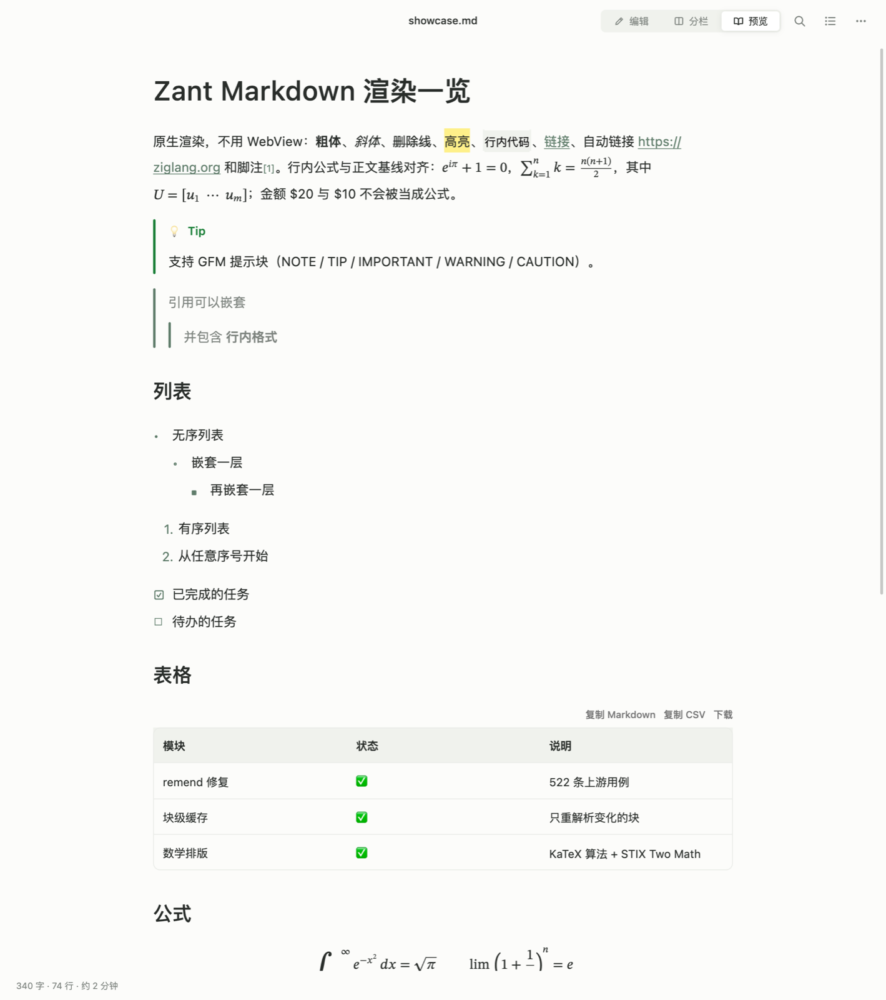
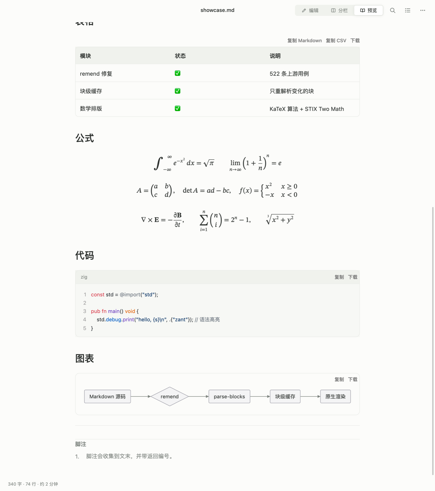
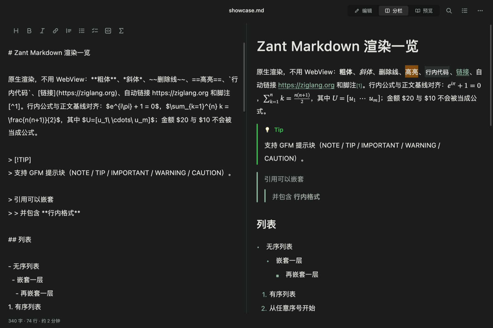

# Zant UI

**用 Zig + Skia 构建原生 macOS 桌面 UI。**

保留模式树、CSS 风格 Flex 布局、声明式 `ui.*` API、Ant Design 5 风格组件（浅色 / 深色）、
antd 动效系统、原生 Markdown 与 LaTeX 公式渲染、Zustand 风格状态、SQLite 持久化、
Metal GPU 渲染，以及一个编译后的项目脚手架。不使用 WebView / Electron / HTML。

## 示例应用：still.

`still.` 是用 Zant UI 脚手架生成的 Markdown 写作应用（编辑 / 分栏 / 预览、查找替换、大纲、
导出 HTML、专注模式、深浅色）。下图是它的预览模式，展示了 [`docs/showcase.md`](docs/showcase.md)
中全部 Markdown 与公式渲染：

| 预览（上半部分） | 预览（下半部分） |
|---|---|
|  |  |

分栏模式（深色）：



## 状态

| 模块 | 状态 |
|---|---|
| macOS AppKit 窗口（原生 / 隐藏标题栏 / 无边框，自定义标题栏高度） | ✅ |
| Skia Ganesh + Metal（默认），CPU 光栅回退（`ZANT_RENDERER=raster`） | ✅ |
| Flex 布局（wrap、百分比、order、align-self、绝对定位 / anchor） | ✅ |
| 文本：中文、自动换行、富文本、单行省略号截断、输入法 | ✅ |
| antd 组件：Button、Input、Checkbox / Switch / Radio、Select、Tabs、Tooltip、Card、Tag、Alert、Avatar、Progress、Dropdown 菜单、Segmented、Modal、Message、Icon | ✅ |
| 浅色 / 深色主题（运行时切换） | ✅ |
| 动效：antd 缓动与时长、进场 / 退场、FLIP 布局过渡、CADisplayLink、减少动态效果 | ✅ |
| Markdown（Streamdown 移植）+ LaTeX 公式（KaTeX 算法）+ Mermaid + HTML 导出 | ✅ |
| 编译后脚手架 `zant`、app.config.json、App Sandbox + Developer ID 签名 | ✅ |
| Windows | ⏳ 二期，未实现 |

## 设计规范

所有界面与交互遵循 [DESIGN.md](DESIGN.md)（UI/UX 设计指导原则，最高优先级）；组件外观以
Ant Design 5 为准。脚手架生成的每个项目都自带同一份 `DESIGN.md`，并在 `AGENTS.md` /
`CLAUDE.md` 中声明其优先级。

## 快速开始

要求：macOS 13+、Xcode 命令行工具、Zig 0.17.1。

```bash
./scripts/fetch_skia.sh
zig build
zig build run             # 声明式示例
zig build run-gallery     # 命令式组件画廊
zig build run-markdown    # Markdown 渲染画廊（ZANT_DARK=1 深色）
zig build run-math        # 公式画廊
zig build test            # 测试（123 项，含 remend 522 条上游用例）
```

## 全局 CLI 与脚手架

构建后把 `zant` 链接到 PATH，之后在任意目录都可以 `zant create`：

```bash
ln -sfn "$PWD/zig-out/bin/zant" ~/.local/bin/zant
zant update               # 框架代码更新后重新编译 CLI
```

```bash
zant create my-app        # 交互式：标题、窗口风格、Bundle ID、沙盒、签名身份
cd my-app
zant run                  # 生成配置代码、编译并运行
zant run --watch          # 重启式热更新
zant build --release
zant package              # 生成并签名 .app
```

生成项目包含 `app.config.json`、`src/state.zig`（`AppState`）、父子组件示例、
`DESIGN.md`、`AGENTS.md` / `CLAUDE.md`。详见 [脚手架](docs/scaffold.md) 和
[窗口配置](docs/window-config.md)。

## 声明式 API

```zig
const ui = zant.ui;

fn render(self: *State) ui.Node {
    return ui.column(.{
        .gap = 16,
        .padding = ui.inset(24),
        .children = &.{
            ui.heading("Settings", .{ .level = 1 }),
            ui.input(.{
                .value = self.name(),
                .placeholder = "Project name",
                .on_change = ui.textAction(self, State.onName),
            }),
            ui.checkbox(.{
                .label = "Notifications",
                .checked = self.notifications,
                .on_change = ui.boolAction(self, State.onNotify),
            }),
            ui.button(.{
                .text = "Save Changes",
                .variant = .primary,
                .on_click = ui.action(self, State.save),
            }),
        },
    });
}

try zant.launch.run(init.gpa, State.init(), render, .{
    .title = "My App",
    .window = .{ .width = 560, .height = 420 },
});
```

Zig 没有闭包；回调统一用 `ui.action` / `ui.textAction` / `ui.boolAction` /
`ui.indexAction` / `ui.rangeAction` / `ui.inputKeyAction` 包装，`ctx` 通常是 `*State`。

`zant.launch.run` 会识别状态类型上的可选钩子：`theme`（运行时主题，深色模式）、
`onKey`（应用快捷键）、`onCloseRequest`（关窗 / ⌘W / ⌘Q 前确认未保存修改）。

命令式辅助（在动作回调或 render 中调用）：

- `ui.focus(key)`、`ui.scrollIntoView(key)`：下一次布局后聚焦 / 平滑滚动到节点。
- `ui.wakeAfter(ms)`、`ui.nowMs()`：定时重建（如轻提示到期消失）。
- `ui.documentEdited(bool)`：文档类应用的未保存状态（关闭按钮圆点）。

## 组件

Text / Heading / Paragraph、Button / Link、Input（单行、多行编辑器）、Checkbox、Switch、
Radio Group、Select、Tabs、Tooltip、Image、Row / Column / Space / Divider、Card、Tag、
Alert、Avatar、Progress、Icon / IconButton、Dropdown 菜单、Segmented、Modal、Message、
ShortcutList、DismissLayer、PDF 预览、Markdown 编辑器 / 预览。

每个组件一份文档：[组件文档](docs/components/README.md)。统一样式覆盖使用 `ui.styled`，
见 [样式覆盖](docs/components/style.md)。通用组件一律放在框架里，应用只写业务组件。

## Markdown 与公式

```zig
const md = zant.markdown;

// 预览：块级缓存，只重新解析变化的块；流式模式自动修复未闭合语法
md.streamdown(&state.md_cache, source, .{ .render = .{ .theme = md.theme.light() } })

// 编辑器：编辑 / 分栏 / 预览
md.editor(.{ .value = source, .mode = .split, .cache = &state.md_cache, .on_change = ... })

// 单独排版公式
zant.math.block("\\int_0^1 x^2\\,dx = \\frac{1}{3}", .{ .size = 18 })
```

见 [Markdown 与数学](docs/markdown.md)。

## 动效

所有交互组件都有 antd 风格的状态过渡；弹层、模态、提示有进场 / 退场动画；分段控制器滑块和
标签页下划线通过 FLIP 平滑移动。动画帧只重绘、不重建。

```zig
ui.styled(panel, .{ .key = "menu", .motion = .slide_up, .motion_origin = .top_right })
```

见 [动效](docs/motion.md)。

## 状态与持久化

共享或异步状态用 Zustand 风格的 `zant.store.Store`（见 [状态管理](docs/state.md)）；
本地持久化用内置的 `zant.db`（系统 libsqlite3，键值 + 集合，见 [SQLite 持久化](docs/database.md)）：

```zig
var store = try zant.db.open(allocator, "app.data");
defer store.close();
try store.setBool("dark", true);
var notes = try store.collection(Note);
const id = try notes.add(.{ .body = "hello" });
```

## 架构

- 原生 `NSWindow` / `NSView`；Skia C ABI 桥接层用 Objective-C++；Metal 通过 Skia Ganesh。
- `ui.*` 每帧在 arena 中构造轻量节点，Runtime 按 key 协调到保留树；`ui.memo` 跳过未变子树。
- 节点被移除后释放并复用槽位；运行时对已释放节点的引用会被清理。
- 只在状态变化时重绘；动画由“正在动画的节点列表”驱动，并由 CADisplayLink 按屏幕刷新出帧。
- 文本用 Skia Paragraph 与系统字体回退；公式与图表是保留式矢量绘制。

见 [架构](docs/architecture.md) 和 [开发](docs/development.md)。

## 已知限制

- Windows 未实现，规划在二期。
- 多行输入框每次编辑重新排版全文，超大文档会变慢。
- 含脚注 / 引用式链接的 Markdown 文档按单块处理（与 Streamdown 一致）。
- 尚未暴露系统无障碍 API；系统菜单栏只有退出与关闭窗口。

## 项目结构

```text
src/ui.zig                 声明式 builders、ui.styled、命令式辅助
src/ui_runtime.zig         协调器、事件、焦点、IME、动画、帧调度
src/launch.zig             最小启动入口（theme / onKey / onCloseRequest 钩子）
src/core/                  节点、树、Flex 布局、几何、事件、图标、矢量绘制
src/components/            按钮、输入、开关、Select、菜单、Segmented、Modal、Message …
src/motion/                缓动曲线、Animated、presence 预设
src/markdown/              Streamdown 移植：remend、parser、blocks、cache、render、editor、html
src/math/                  LaTeX 公式（KaTeX 排版算法，STIX Two Math）
src/renderer/skia/         C ABI + Skia/Metal 桥
src/platform/macos/        AppKit 窗口、NSTextInputClient、PDFKit、对话框
src/store.zig, src/db/     Zustand 风格状态、SQLite 持久化
tools/zant/                编译后的脚手架 CLI
scaffold/template/         生成项目模板（含 DESIGN.md / AGENTS.md / CLAUDE.md）
examples/                  示例与画廊
tests/                     布局 / 组件 / 运行时 / 动效 / Markdown / 数学测试
docs/                      文档、截图与 showcase.md
```

## License

MIT。Skia 使用 BSD-3-Clause；见 `third_party/skia/skia-binaries/LICENSE_SKIA`；
数学字体与 Streamdown / KaTeX 相关说明见 [THIRD_PARTY_NOTICES.md](THIRD_PARTY_NOTICES.md)。
