English | [简体中文](README.zh-CN.md)

<div align="center">

# Zant UI

**Native desktop apps with TSX + Rust · One codebase for macOS and Windows**

[](https://github.com/racall/zant-ui/releases)    [](LICENSE)

[Installation](#installation) · [Quick start](#quick-start) · [Documentation](#documentation) · [Examples and screenshots](#examples-and-screenshots)

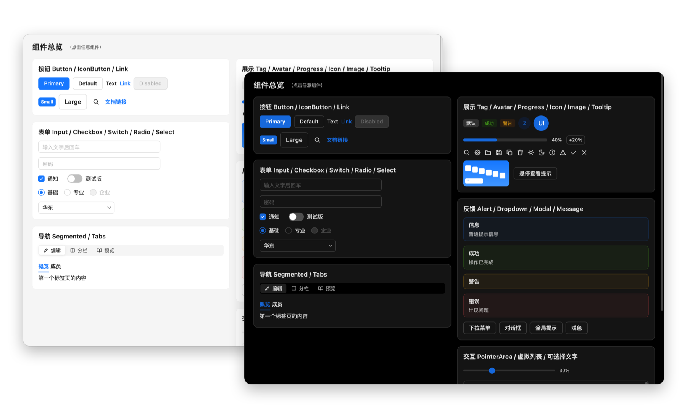

</div>

Zant UI is a native desktop UI framework. Write your interface in **TSX**, which `zant-tsx` compiles to **Rust** at build time. Skia renders directly on the GPU through Metal on macOS and Direct3D 12 on Windows. There is **no WebView, Electron, JavaScript runtime, or HTML rendering**. Implement capabilities such as networking, databases, and clipboard engines in Rust modules under `native/`. The `zant` CLI handles project creation, hot reload, packaging, signing, and release builds.

## Why Zant UI

| Feature | What it provides |
|---|---|
| **Native rendering** | AppKit / Win32 windows and Skia rendering, with no bundled browser or JavaScript runtime |
| **One codebase, two platforms** | Shared app code; the framework handles ⌘ / Ctrl shortcuts, titlebar controls, data directories, and tray / menu bar integration |
| **React-style TSX** | Function components, props, callbacks, `useState`, `useEffect`, and `useMemo`; compiled to static Rust with no virtual DOM |
| **Components and themes** | Ant Design 5-style controls, forms, menus, modals, virtual lists, light / dark themes, and state transitions |
| **Rich content** | Streaming Markdown, LaTeX and chemistry, Mermaid diagrams, syntax highlighting, PDF annotations, and text selection across nodes |
| **Desktop integration** | Multiple windows and panels, global shortcuts, clipboard text / images / files, launch at login, single instance, and SQLite persistence |
| **Development to release** | `zant create`, in-place hot reload with `zant run`, and platform packaging / signing with `zant build` |
| **AI coding guidance** | Generated projects include `DESIGN.md`, `AGENTS.md`, and `CLAUDE.md` with design and development conventions |

## Installation

Install the prebuilt `zant` CLI, framework sources, and prebuilt dependencies without cloning this repo. Installation does not compile the framework; building your apps still requires Rust and platform build tools.

**macOS** — Apple silicon, macOS 13+

```bash
curl -fsSL https://raw.githubusercontent.com/racall/zant-ui/main/install.sh | bash
```

**Windows** — Windows 10 / 11 x64, PowerShell

```powershell
irm https://raw.githubusercontent.com/racall/zant-ui/main/install.ps1 | iex
```

The installers check platform prerequisites, install rustup if missing, ensure the toolchain specified by the shipped `rust-toolchain.toml` (currently Rust `1.94.1`, with rustfmt and clippy; apps created by `zant create` use the same release), verify the release archive's SHA-256 checksum, and install into `~/.zant` on macOS or `%LOCALAPPDATA%\zant` on Windows. They add `zant` to PATH; open a new terminal afterward. An existing default Rust toolchain is kept; a default is set if none exists.

| Platform | Required build tools |
|---|---|
| macOS | Xcode Command Line Tools and the macOS SDK. If missing, the script opens the installer; rerun after installation. |
| Windows | Visual Studio / Build Tools with the Desktop development with C++ workload, including the MSVC linker and Windows SDK. Install these before running the script. |

The release includes framework / native sources and prebuilt Skia; Windows also includes PDFium. A bundled prebuilt native library avoids compiling the C / C++ bridge when compatible; sources remain available as a fallback.

<details>
<summary>Updates, installation options, and removal</summary>

- Update the installed release: `zant update`.
- Set environment variables before installation: `ZANT_HOME` (directory), `ZANT_VERSION` (release tag), `ZANT_DOWNLOAD` (download base URL), or `ZANT_FORCE=1` (download again).
- macOS also supports `ZANT_BIN_DIR` (symlink directory, default `~/.local/bin`) and `ZANT_NO_MODIFY_PATH=1` (leave shell configuration unchanged).
- Remove the installation directory, the macOS `~/.local/bin/zant` symlink if used, and the corresponding PATH entry to uninstall Zant. Rust is installed separately by rustup.

</details>

## Quick start

```bash
zant create my-app
cd my-app
zant run
```

`zant create` asks for the app title, window style (`native`, `hidden-titlebar`, or `borderless`), and reverse-domain app identifier, such as `com.example.myapp`. The generated TSX app works on both platforms:

```text
my-app/
  src/App.tsx                Main window, local state, and an Open settings button
  src/components/*.tsx       Parent/child props, callbacks, and profile preview
  src/stores/profile.ts      Shared profile store (createStore / useStore)
  src/windows/SettingsWindow.tsx  Second window (createWindow)
  native/system.ts           Native module spec: types and declared functions
  native/system.rs           Rust implementation of that spec
  native/main.rs             Generated-entry macro: zant::app!();
  native/build.rs            Build helper: zant_build::tsx_app()
  app.config.json            App metadata, window defaults, and platform settings
  Cargo.toml                 App package with zant / zant-build path dependencies
  rust-toolchain.toml         Rust toolchain
  assets/icons/              Default app and tray / menu bar icons
  zant.d.ts / tsconfig.json   Editor types and configuration; no React/npm required
  DESIGN.md / AGENTS.md / CLAUDE.md  Design and development guidance
```

The starter passes a counter down through props and updates it through child callbacks. A profile store is shared between components and the settings window. Its button opens or activates that window; closing settings hides it for reuse.

Edit `app.config.json` for the title, identifier, version, description, company, copyright, and window settings. New projects start at 680 × 700 with a 600 × 620 minimum. `window.remember: true` restores the main and `createWindow` windows' positions and sizes; `center` applies when no saved frame exists. See [Scaffolding](docs/scaffold.md) and [Window configuration](docs/window-config.md) (Chinese). Generated Rust stays in Cargo's `OUT_DIR`.

## Running and hot reload

```bash
zant run              # In-place hot reload for TSX projects
zant run --watch      # Legacy rebuild-and-restart mode
zant run --no-hot     # Build and run once; use for App Sandbox testing
zant run --release    # Use the release profile
```

| Edited files | Default `zant run` behavior |
|---|---|
| `.tsx` / `.ts` under `src/`, `.rs` / `.ts` under `native/` except `native/build.rs`, and imported assets unless listed below | Refresh the app in place |
| `Cargo.toml`, `Cargo.lock`, `app.config.json`, `native/build.rs`, `rust-toolchain.toml`, and files under `assets/icons/` unless ignored | Restart `zant run` itself |
| `tsconfig.json`, `README.md`, `docs/`, `.git/`, `target/`, dotfiles / hidden directories, editor temporary / backup files, and other unmatched files | Ignore |

In-place refresh keeps the host process and native windows. Compatible root and component-local state is restored, along with scroll, focus, cursor, and selection state attached to stable keys. Incompatible fields reset individually. Restarts attempt to preserve state too. Global stores, arbitrary Rust globals, background threads, and external resources are not automatically serialized. Compile errors appear over the running UI and clear after a successful refresh.

Hot reload uses a development host. Use `--no-hot` to verify macOS App Sandbox permissions. See [Hot reload rules](docs/scaffold.md#热更新) and [Development and verification](docs/development.md#热刷新验证) (Chinese).

| Command | Purpose |
|---|---|
| `zant compile [--release]` | Compile only |
| `zant package` | Local-test app bundle / program directory |
| `zant build [config-file] [--yes]` | Release build |
| `zant sync` | Regenerate platform files such as Info.plist and applicable entitlements |
| `zant update` | Update the installed release; in a source checkout, check dependencies and rebuild the CLI, pulling only when the working tree is clean and a remote branch is available |

## Writing UI with TSX

TSX is the recommended app API: a statically compiled subset with React-style semantics, not a JavaScript runtime. Put your root component in `src/App.tsx` and reusable app components in `src/components/`. Keep state in one place: props flow down, callbacks report events up.

```tsx
import { useState, View, Heading, Text, Button } from "zant";

interface CounterProps {
  count: number;
  onIncrement: () => void;
}

function Counter({ count, onIncrement }: CounterProps) {
  return (
    <View gap={12}>
      <Text>Clicks: {count}</Text>
      <Button variant="primary" onClick={onIncrement}>+1</Button>
    </View>
  );
}

export default function App() {
  const [clicks, setClicks] = useState(0);
  return (
    <View gap={16} padding={24}>
      <Heading level={1}>Hello Zant</Heading>
      <Counter count={clicks} onIncrement={() => setClicks(prev => prev + 1)} />
    </View>
  );
}
```

Event handlers read the current render's state snapshot; use a functional setter when an update needs the latest value. Use `useTheme()` and theme tokens for colors, and `View` / `Row` / `Column` for layout. See [TSX syntax and hooks](docs/tsx.md) (Chinese).

### Multiple windows

The generated `src/windows/SettingsWindow.tsx` exports a window handle. Import it into `src/App.tsx` and call `settingsWindow.activate()` from a button:

```tsx
import { createWindow, View, Heading } from "zant";

export function SettingsWindow() {
  return <View padding={24}><Heading level={2}>Settings</Heading></View>;
}

export const settingsWindow = createWindow(SettingsWindow, {
  title: "Settings",
  style: "native",
  width: 440,
  height: 320,
  center: true,
});
```

`activate()` opens the window the first time and brings it forward afterward. The starter additionally uses `useCloseRequest` and `hide()` to reuse the settings window. See [Desktop integration](docs/desktop.md) (Chinese).

### Native modules

Define types and `export declare function` signatures in `native/<name>.ts`, then implement the generated trait in `native/<name>.rs`. The compiler registers modules and checks the Rust implementation against the spec. TSX calls become direct Rust calls, without serialization. For example, the generated `native/system.ts` + `native/system.rs` module is used from a component like this:

```tsx
import { Text } from "zant";
import { info } from "native/system";

export function SystemSummary() {
  const system = info();
  return <Text>Platform: {system.os}, CPUs: {system.cpus}</Text>;
}
```

Keep slow work off the render path: run it in a Rust worker thread, wake the UI when finished, and read results with `useWake`. See [Native module specs and implementations](docs/tsx-native.md) (Chinese).

For advanced integrations and framework development, hand-written Rust UI is also available through `zant::ui` builders and the `ui::App` trait. Most apps can stay with TSX and native modules.

## Packaging and release

```bash
zant package          # Local testing: macOS .app / Windows program directory
zant build            # Release: prompts for missing settings
zant build --yes      # CI: no prompts; supply secrets through environment variables
```

Release settings live in `build.config.json`, separate from app metadata in `app.config.json`. Missing settings can be entered interactively and saved.

| Platform | Release targets |
|---|---|
| macOS | Developer ID distribution as DMG or zip, optional Apple notarization; or a .pkg for Mac App Store submission |
| Windows | Inno Setup installer with optional code signing, MSIX for Microsoft Store, or portable zip |

Signing, notarization, and store distribution require the appropriate certificates / accounts and configuration. See [Release builds](docs/build.md) (Chinese).

## Documentation

The detailed documentation is currently in Chinese.

| Topic | Document |
|---|---|
| TSX syntax, hooks, and components | [TSX](docs/tsx.md) |
| Native module specs and Rust implementations | [Native modules](docs/tsx-native.md) |
| Project generation, icons, and hot reload | [Scaffolding](docs/scaffold.md) |
| App metadata and window settings | [Window configuration](docs/window-config.md) |
| Signing, notarization, installers, stores, and CI | [Release builds](docs/build.md) |
| Components and styling | [Component index](docs/components/README.md), [Style overrides](docs/components/style.md) |
| Windows, tray, shortcuts, and clipboard | [Desktop integration](docs/desktop.md) |
| State and SQLite persistence | [State](docs/state.md), [Database](docs/database.md) |
| Markdown and mathematics | [Markdown](docs/markdown.md) |
| Layout and animation | [Flex layout](docs/flex.md), [Motion](docs/motion.md) |
| Framework internals and testing | [Architecture](docs/architecture.md), [Development](docs/development.md) |

## Feature overview

<details>
<summary>Implemented modules</summary>

- AppKit and Win32 windows with native, hidden-titlebar, and borderless styles; custom titlebar height and platform controls.
- Skia Ganesh with Metal / Direct3D 12, plus CPU raster fallback (`ZANT_RENDERER=raster`); per-monitor DPI on Windows.
- Flex layout with horizontal wrapping, percentages, order, align-self, absolute positioning, and anchors.
- Skia Paragraph text layout, font fallback, rich text, wrapping, ellipsis, IME input, and selection / copying across nodes.
- Ant Design-style controls, light / dark themes, state transitions, presence animation, FLIP layout transitions, and reduced-motion support.
- Streamdown-based Markdown with block caching, KaTeX-style math layout, mhchem chemistry, Mermaid diagrams, syntax highlighting, and HTML export.
- PDF viewing with background tile rendering, continuous scrolling, zoom, search, links, selection, annotations, and annotated export.
- Pointer capture and wheel input, memory-backed images, virtual lists, and dialog focus scopes.
- Multi-window / panel support, tray / menu bar, global shortcuts, clipboard monitoring, launch at login, single instance, and SQLite storage.
- TSX-to-Rust compilation, native modules checked at compile time, project scaffolding, hot reload, and platform release tooling.

</details>

## Components

Text / Heading / Paragraph, Button / Link, Input and multiline editing, Checkbox / Switch / Radio, Select, Tabs, Tooltip, Image, View / Row / Column / Space / Divider, Card, Tag, Alert, Avatar, Progress, Icon / IconButton, DropdownMenu, Segmented, Modal, Message, ShortcutList, DismissLayer, PointerArea, virtual List, PdfViewer / PdfPreview, and Markdown editor / preview.

Use component props and style overrides in TSX. Shared general-purpose components belong in the framework; apps compose them with business data. See the [Component index](docs/components/README.md) and [Style overrides](docs/components/style.md) (Chinese).

## Markdown and mathematics

```tsx
import { Markdown } from "zant";

interface ReplyProps {
  reply: string;
  busy: boolean;
}

export function Reply({ reply, busy }: ReplyProps) {
  return <Markdown source={reply} streaming={busy} />;
}
```

Streaming previews cache blocks and reparse changed content. Math supports LaTeX, including chemistry commands `\ce{…}` and `\pu{…}`. Preview text is selectable by default, and formulas copy as LaTeX. See [Markdown and mathematics](docs/markdown.md) (Chinese).

## PDF

```tsx
import { PdfViewer } from "zant";

interface DocumentProps {
  path: string;
}

export function Document({ path }: DocumentProps) {
  return <PdfViewer src={path} toolbar annotationTools height={600} />;
}
```

The viewer supports scrolling, zoom, text selection, search, links, annotations, and annotated export. Keep it outside other scrolling containers. Scanned PDFs without a text layer cannot be searched or selected. For programmatic document operations, use a Rust native module. See [PDF viewer](docs/components/pdf.md) (Chinese).

## Motion

Interactive controls use Ant Design-style state transitions. Menus, modals, and messages have entrance / exit animation; segmented controls and tab indicators use FLIP transitions. Animation frames repaint without rebuilding the app's UI tree. Reduced-motion settings disable animations. See [Motion](docs/motion.md) (Chinese).

## State and persistence

Use `useState` for local state and `createStore` / `useStore` for state shared across components or windows. The starter uses this pattern:

```tsx
// src/stores/profile.ts
import { createStore } from "zant";

interface Profile {
  displayName: string;
  accent: boolean;
}

export const profile = createStore<Profile>({ displayName: "Developer", accent: false });
```

```tsx
// src/components/ProfileName.tsx
import { useStore, Input } from "zant";
import { profile } from "../stores/profile";

export function ProfileName() {
  const user = useStore(profile);
  return (
    <Input value={user.displayName}
      onChange={(name) => profile.update({ displayName: name })} />
  );
}
```

Update shared state on the UI thread. Stores are in-memory state; for persistence, use the built-in SQLite key/value and object-collection APIs from a Rust native module. See [State management](docs/state.md) and [SQLite](docs/database.md) (Chinese).

## Design guidelines

[DESIGN.md](DESIGN.md) defines the UI / UX guidelines and takes precedence over other project conventions. Components follow Ant Design 5 styling. Generated projects carry the same design guidelines and reference them from `AGENTS.md` / `CLAUDE.md`.

## Building from source

Use a source checkout to develop the framework itself. Requirements: Rust 1.94+ (the repo selects the `stable` channel), plus the platform build tools listed above. Fetch Skia for your platform first:

```bash
./scripts/fetch_skia.sh
```

```powershell
powershell -ExecutionPolicy Bypass -File scripts/fetch_skia_windows.ps1
```

```bash
cargo build --workspace
cargo test --workspace
cargo run -p zant-examples --bin zant-components
cargo run -p zant-examples --bin zant-markdown
cargo run -p zant-examples --bin zant-math
cargo run -p zant-examples --bin zant-pdf -- manual.pdf
cargo run -p zant-examples --bin zant-md-stream
cargo build --release --workspace
```

In sandboxed / AI environments where `~/.cargo` is not writable, use `./scripts/cargo.sh` instead of `cargo`; it uses the repo-local `.cargo-home/`. Native bridge and platform sources are built through `crates/zant-sys/build.rs`. Put `target/debug/zant` (Windows: `zant.exe`) on PATH to use the source-built CLI. See [Development](docs/development.md) (Chinese).

## Architecture

- The TSX compiler generates Rust at build time; there is no JavaScript runtime or virtual DOM.
- The runtime reconciles UI descriptions into a retained tree by key, skipping unchanged memoized subtrees.
- Rendering is event-driven. Active animations schedule repaints at the display refresh rate.
- Text layout caches recent widths and reuses shaped text when rewrapping. Virtual lists build visible rows.
- Platform C ABI implementations provide AppKit / Win32 windows; Skia bridges handle Metal / Direct3D 12 rendering.
- Background workers render PDF tiles and perform other slow operations, waking the UI when results are ready.

See [Architecture](docs/architecture.md) and [Development](docs/development.md) (Chinese).

## Known limitations

- The shipped macOS dependencies target Apple silicon; Windows supports x64.
- Windows IME uses IMM32; TSF-specific features such as reconversion are not implemented.
- Vertical flex wrapping, wrap-reverse, and auto/calc sizing are not supported.
- Multiline inputs re-layout the full text after edits, which can be slow for very large documents.
- Markdown containing footnotes / reference links is handled as one block, following Streamdown.
- System accessibility APIs are not exposed; the app menu currently provides quit and close-window actions.

## Project layout

```text
crates/zant-sys/       Native C ABI bindings, Skia bridges, and native builds
crates/zant/           Framework: runtime, components, desktop, TSX, Markdown, math, PDF, SQLite
crates/zant-macros/    TsxProps and Table derive macros
crates/zant-base/      Platform-free pieces shared by runtime and compiler (hash, locales, plurals, RegExp checks)
crates/zant-tsx/       TSX-to-Rust compiler and TypeScript declarations (does not link the framework)
crates/zant-tables/    Generators of the checked-in tag table and zant.d.ts
crates/zant-build/     App build helper: TSX, icons, Windows resources
crates/zant-cli/       create / run / compile / package / build / sync / update
crates/zant-examples/  Component, Markdown, streaming, math, and PDF demos
scaffold/template-ts/ TSX app template with components, store, windows, and native modules
scripts/              Dependencies, Cargo wrapper, benchmarks, releases, Windows testing
docs/                 Chinese documentation and screenshots
third_party/          Prebuilt dependencies (not committed)
```

## Examples and screenshots

These screenshots were taken on macOS. Run the repository demos with `cargo run -p zant-examples --bin <name>` (or `./scripts/cargo.sh` in a sandbox), or launch the binaries after building.

### Components (`zant-components`)

Interactive controls in both themes:

| Light | Dark |
|---|---|
| 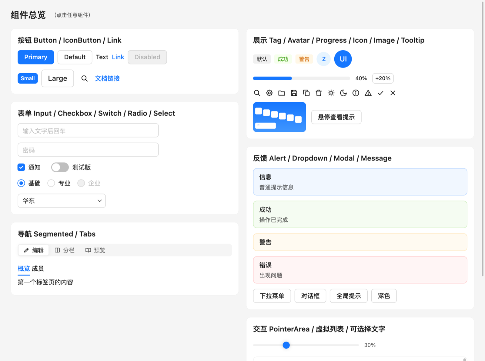 |  |

### Declarative demo and gallery (`zant-demo`, `zant-gallery`)

| Declarative demo | Component gallery |
|---|---|
| 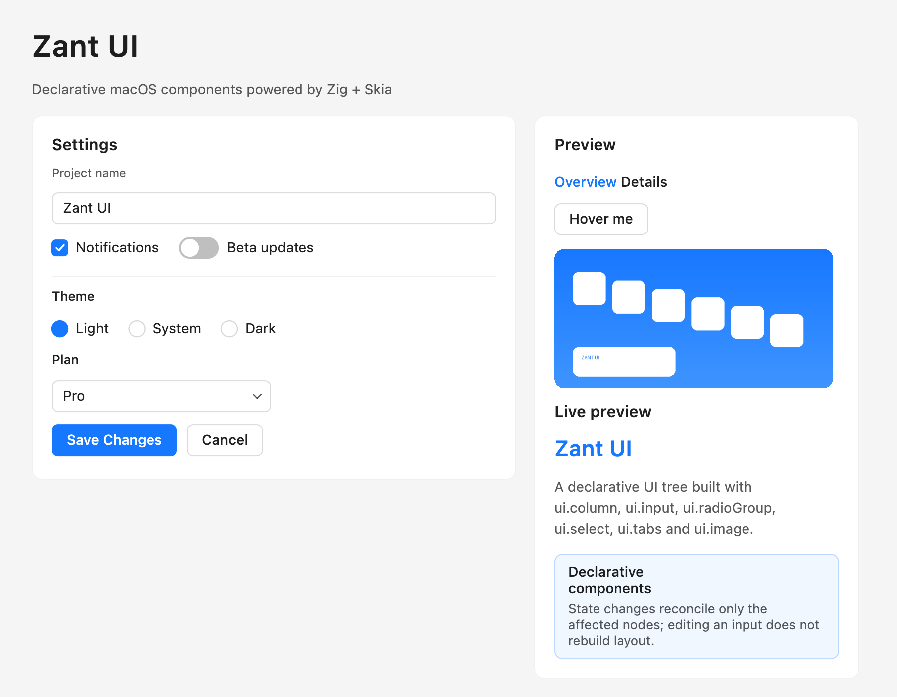 | 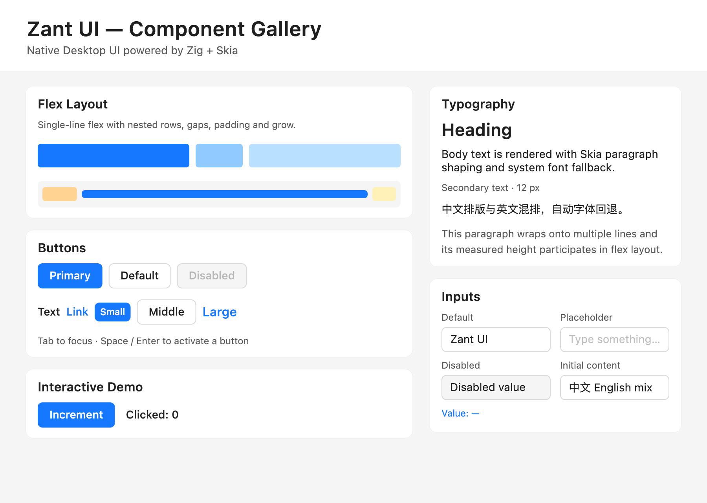 |

### Markdown (`zant-markdown`)

Callouts, lists, tasks, inline math, tables with copy / download actions, syntax highlighting, and Mermaid diagrams:

| Light | Dark |
|---|---|
| 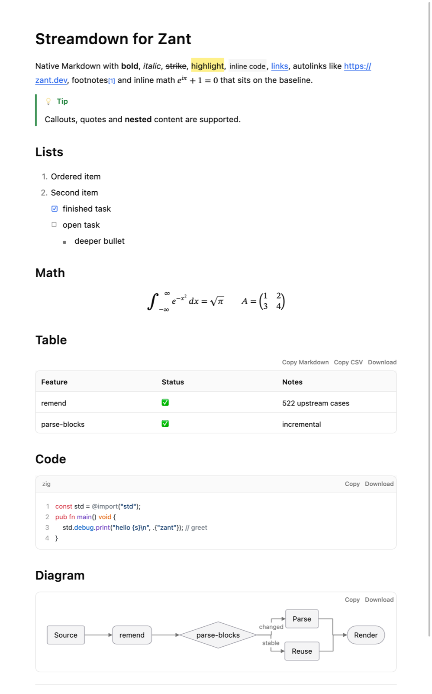 | 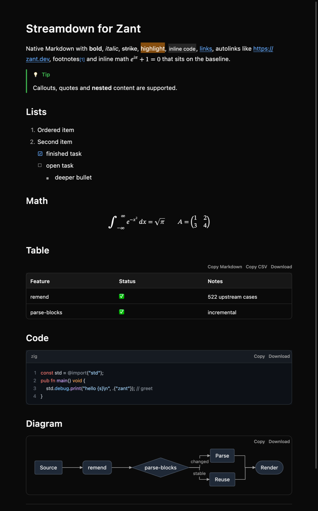 |

### Streaming chat and math (`zant-md-stream`, `zant-math`)

| Streaming Markdown | Math and chemistry |
|---|---|
| 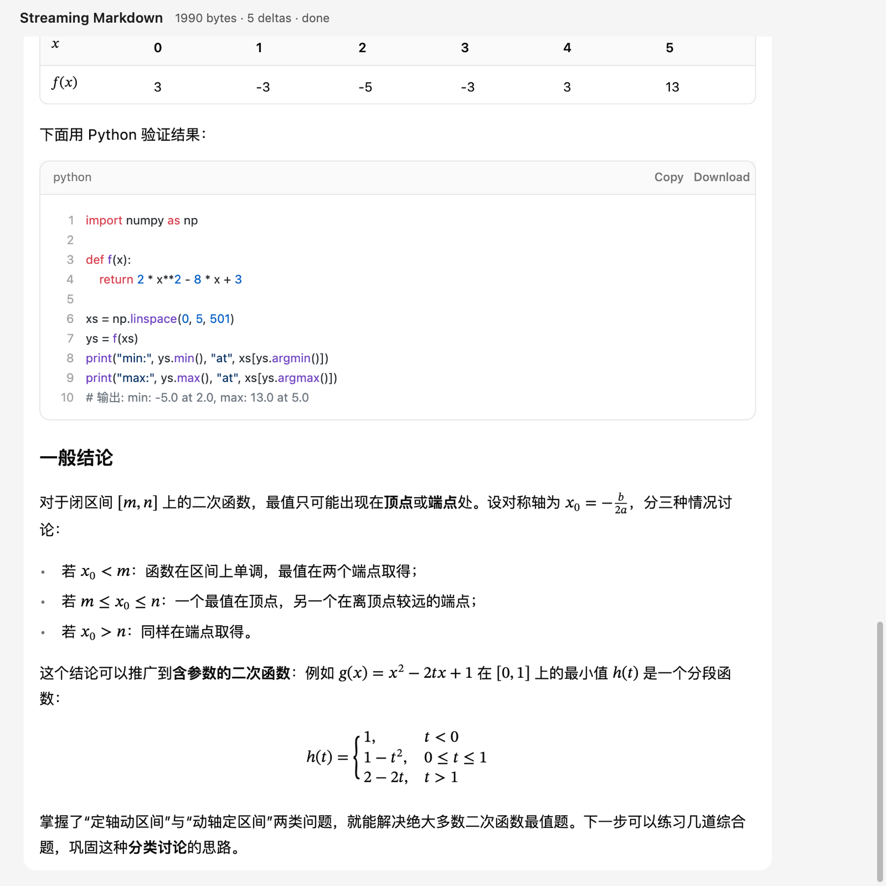 |  |

### PDF viewer (`zant-pdf`)

Continuous scrolling, zoom, search, selection, and annotations:

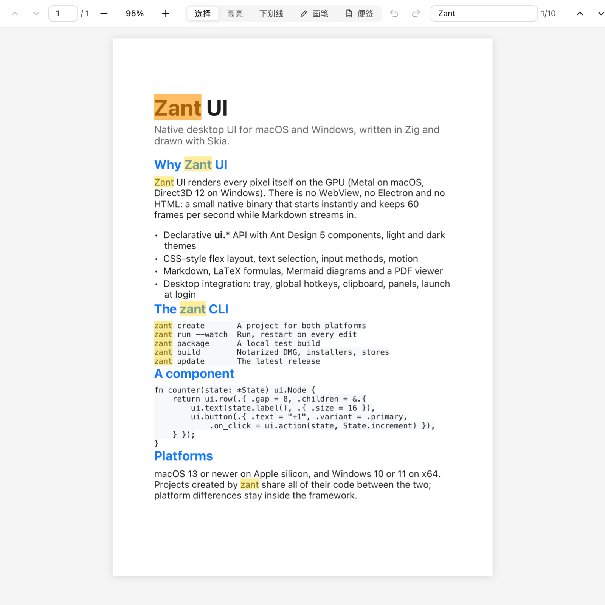

### Generated TSX app

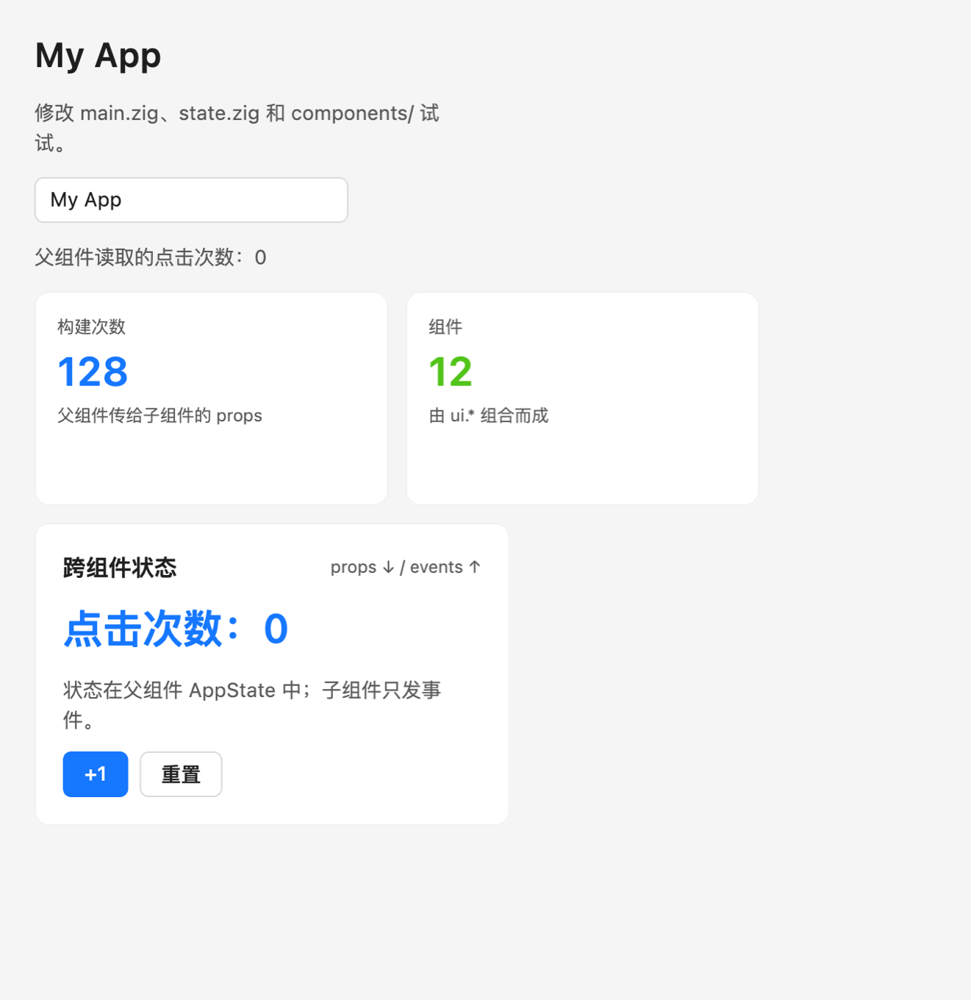

### Apps built with Zant UI

**still.** is a Markdown writing app with editing / split / preview modes, find and replace, an outline, HTML export, focus mode, and light / dark themes. Its previews show the Markdown and math in [docs/showcase.md](docs/showcase.md) (Chinese):

| Preview, upper part | Preview, lower part |
|---|---|
| 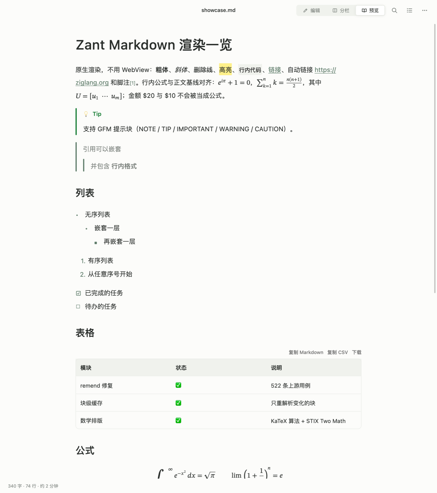 |  |

Split editing in dark mode:

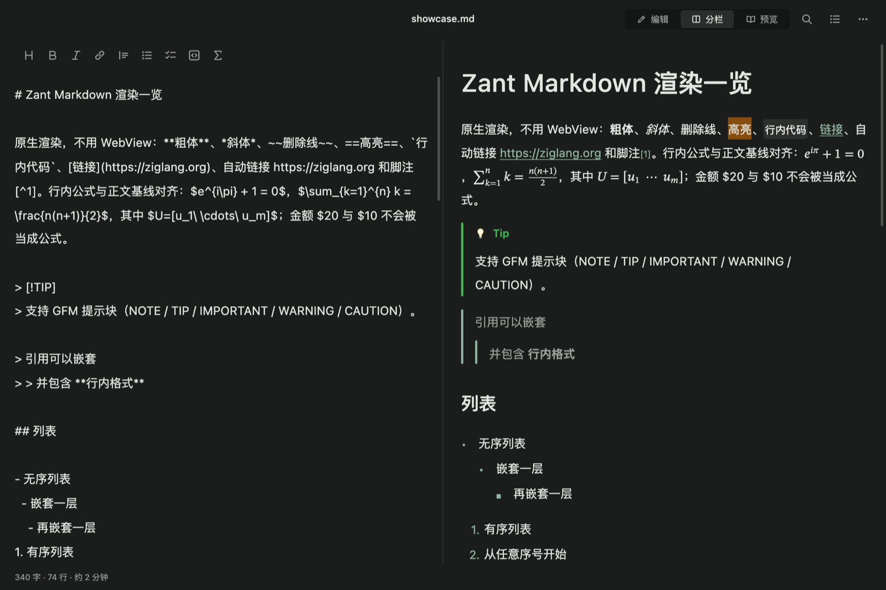

## License

[MIT](LICENSE). Third-party licenses and attributions for Skia and its dependencies, PDFium, Streamdown, KaTeX / mhchem, EmbedPDF, and STIX Two Math are listed in [THIRD_PARTY_NOTICES.md](THIRD_PARTY_NOTICES.md).
