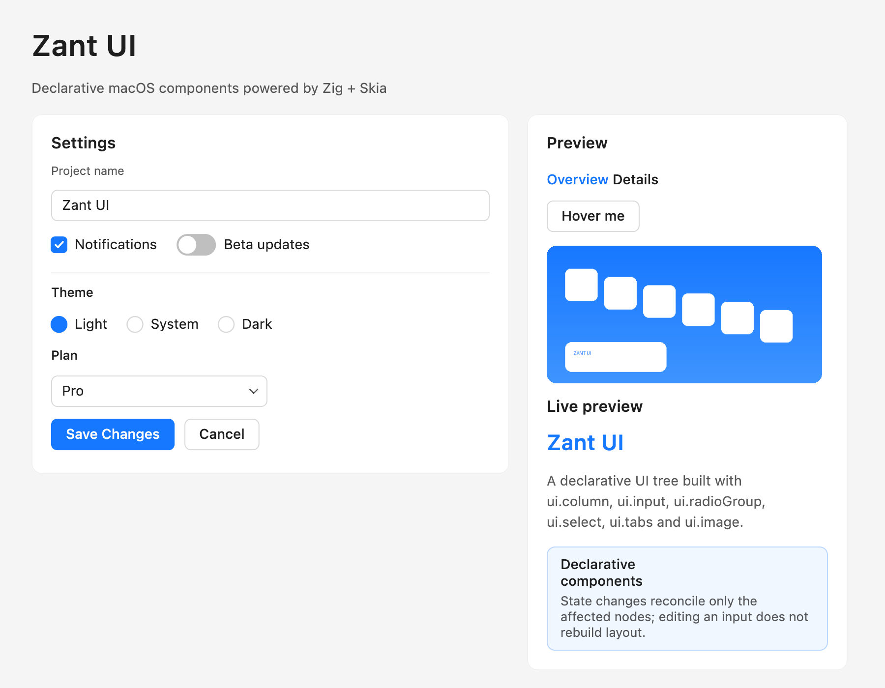

# Zant UI

**用 Zig + Skia 构建原生 macOS 桌面 UI。**

保留模式树、单行 Flex 布局、声明式 `ui.*` API、Zustand 风格状态、
Ant Design 5 风格主题、Metal GPU 渲染，以及一个编译后的项目脚手架。



## 状态

| 模块 | 状态 |
|---|---|
| macOS AppKit 窗口 | ✅ 已验证 |
| Skia Ganesh + Metal | ✅ 已验证（默认） |
| CPU 光栅回退 | ✅ 已验证（`ZANT_RENDERER=raster`） |
| Flex 布局 | ✅ 已验证 |
| 文本 / 中文 / 自动换行 | ✅ 已验证 |
| Button / Input | ✅ 已验证 |
| Checkbox / Switch / Radio | ✅ 已实现并渲染 |
| Select / Tabs / Tooltip / Image | ✅ 已实现并渲染 |
| 编译后脚手架 `zant` | ✅ 已验证 |
| app.config.json 窗口配置 | ✅ 已验证 |
| App Sandbox + Developer ID 签名 | ✅ 已验证 |
| Windows | ⏳ 二期，未实现 |
| 深色模式 | ⏳ 未实现 |

## 全局 CLI

构建后把 `zant` 链接到 PATH：

```bash
ln -sfn "$PWD/zig-out/bin/zant" ~/.local/bin/zant
```

之后在任意目录都可以执行 `zant create`。框架代码更新后：

```bash
zant update        # 重新编译框架，全局链接自动指向新二进制
```

## 快速开始

要求：macOS 13+、Xcode 命令行工具、Zig 0.17.1。

```bash
./scripts/fetch_skia.sh
zig build
zig build run
```

- `zig build run`：声明式示例。
- `zig build run-gallery`：命令式组件画廊。
- `zig build test`：运行测试。

## 创建项目（编译后的脚手架）

先构建框架：

```bash
cd /path/to/zant-ui
zig build
```

然后：

```bash
cd /path/to/work
/path/to/zant-ui/zig-out/bin/zant create my-app
```

`zant create` 会询问：

1. 应用标题
2. 窗口风格：原生 / 隐藏标题栏 / 无边框
3. Apple Bundle ID
4. 是否启用 App Sandbox
5. 签名开发者账号（自动列出 keychain 中的 codesign 身份）

运行、构建、打包全部通过脚手架完成，不需要手动调用 `zig build`：

```bash
cd my-app
/path/to/zant-ui/zig-out/bin/zant run
/path/to/zant-ui/zig-out/bin/zant build --release
/path/to/zant-ui/zig-out/bin/zant package
```

生成项目包含：

- `app.config.json`：窗口尺寸、最小尺寸、标题栏、背景色、沙盒、签名账号等。
- `src/app_config.zig`：由 CLI 根据 JSON 生成。
- `src/state.zig`：共享状态 `AppState` 和动作。
- `src/components/stat_card.zig`：展示组件，父传子 props。
- `src/components/counter_card.zig`：子组件，props + 事件回调。
- `src/components/dashboard.zig`：父组件，组合子组件。
- `src/main.zig`：状态入口与布局。
- `AGENTS.md` / `CLAUDE.md`：Codex、Claude Code 项目规范。

详见 [脚手架](docs/scaffold.md) 和 [窗口配置](docs/window-config.md)。

## 窗口配置

`app.config.json` 提供默认值；代码里的 `WindowOptions` 优先级更高：

```zig
var window = cfg.window;
window.always_on_top = true;      // 代码覆盖配置
window.background = 0xff1f1f1f;   // 窗口背景色

try zant.launch.run(init.gpa, State.init(), State.render, .{
    .title = cfg.title,
    .window = window,
    .theme = zant.tokens.antLight(),
});
```

支持 `style`、`width`、`height`、`min_width`、`min_height`、`background`、
`resizable`、`always_on_top`、`movable_by_background`、`center`。
完整说明见 [窗口配置文档](docs/window-config.md)。

## 声明式 API

```zig
const ui = zant.ui;

fn render(self: *State) ui.Node {
    return ui.column(.{
        .gap = 16,
        .padding = ui.inset(24),
        .children = &.{
            ui.heading("Settings", .{ .level = 1 }),
            ui.input(.{
                .value = self.name(),
                .placeholder = "Project name",
                .on_change = ui.textAction(self, State.onName),
            }),
            ui.checkbox(.{
                .label = "Notifications",
                .checked = self.notifications,
                .on_change = ui.boolAction(self, State.onNotify),
            }),
            ui.button(.{
                .text = "Save Changes",
                .variant = .primary,
                .on_click = ui.action(self, State.save),
            }),
        },
    });
}
```

Zig 没有闭包；回调统一使用：

- `ui.action(ctx, fn)`
- `ui.textAction(ctx, fn)`
- `ui.boolAction(ctx, fn)`
- `ui.indexAction(ctx, fn)`

`ctx` 通常是 `*State` 或 `*zant.store.Store(T)`。

## 最小启动

```zig
try zant.launch.run(init.gpa, State.init(), State.render, .{
    .title = "My App",
    .window = .{ .width = 560, .height = 420, .style = .native },
});
```

## 可选 Zustand 风格 Store

共享状态或异步状态使用 `zant.store.Store`：

```zig
const AppStore = zant.store.Store(State);
const store = try AppStore.init(allocator, State.init());

fn save(context: *AppStore) void {
    store.update(.{ .saved = store.get().saved + 1 });
}

try store.subscribe(runtime, Runtime.invalidateCallback);
```

见 [状态管理](docs/state.md)。

## 组件

Text、Heading、Paragraph、Button、Link、Input、Checkbox、Switch、Radio Group、
Select、Tabs、Tooltip、Image、Row/Column、Space、Divider、Card、Tag、Alert、
Avatar、Progress、PDF 预览。

每个组件一份文档：[组件文档](docs/components/README.md)。
统一样式覆盖使用 `ui.styled`，见 [样式覆盖](docs/components/style.md)。

## SQLite 持久化

内置 `zant.db`，无需安装额外依赖（使用系统 libsqlite3）：

```zig
const Note = struct {
    id: i64 = 0,
    body: []const u8,
};

var db = try zant.db.Database.open(allocator, "app.sqlite");
defer db.close();
var notes = db.table(Note);
try notes.create();
const id = try notes.insert(.{ .body = "hello" });
const note = (try notes.get(id)).?;
defer notes.free(note);
```

见 [SQLite 持久化](docs/database.md)。

## Flex

支持横向 wrap、百分比、order、align-self、align-content 等；详见 [Flex 与 CSS](docs/flex.md)。

## 架构

- 原生 `NSWindow` / `NSView`，不使用 WebView / Electron / HTML。
- Skia C ABI 桥接层使用 Objective-C++。
- Metal 通过 Skia Ganesh；每个 drawable 包装成 Skia render target。
- Zig 实现单行 Flex 布局，并有确定性测试。
- 文本使用 Skia Paragraph 和系统字体回退。
- 声明式渲染按 key/index 协调到保留树，保留焦点、光标、选区和 Hover。
- 事件驱动重绘：静态窗口不做无意义刷新。

见 [架构](docs/architecture.md) 和 [开发](docs/development.md)。

## 已知限制

- Windows 未实现，规划在二期。
- 目前只有浅色主题。
- 不支持 Flex wrap 和百分比尺寸。
- Select/Tabs 为基础实现；Tabs 只挂载当前内容，持久状态放 Store。
- 删除的声明式节点会先脱离，树销毁时释放。
- 真实 macOS 输入法（拼音候选）流程已接入，但未做自动化端到端验证。
- 尚未暴露系统无障碍 API。

## 项目结构

```text
src/app.zig, src/gallery.zig      命令式画廊
src/ui.zig                        声明式 UI builders
src/ui_runtime.zig                协调器、事件、帧调度
src/store.zig                     Zustand 风格状态
src/core/                         几何、节点、树、Flex、事件
src/components/                   文本、按钮、输入、开关、Select、图片
src/renderer/skia/                C ABI + Skia/Metal 桥
src/platform/macos/               AppKit 窗口 + NSTextInputClient
tools/zant/                       编译后的脚手架 CLI
scaffold/template/                生成项目模板
tests/                            布局/组件/Store 测试
docs/components/                  每个组件一份文档
```

## License

MIT。Skia 使用 BSD-3-Clause；见 `third_party/skia/skia-binaries/LICENSE_SKIA`。
