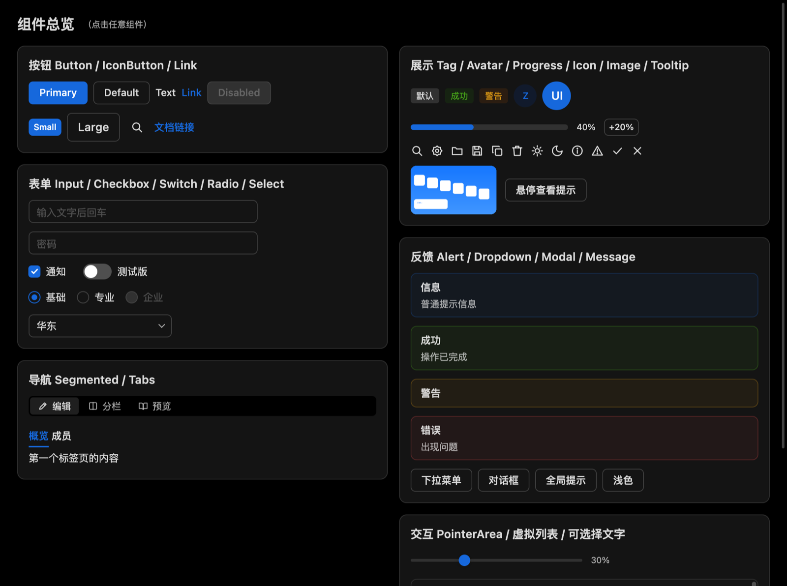
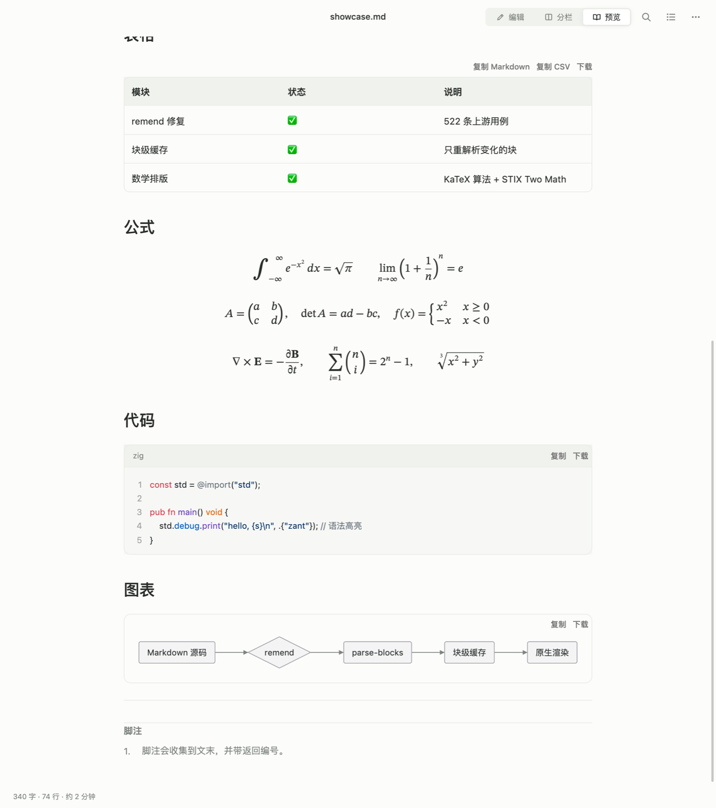

<div align="center">

# Zant UI

**用 TSX + Rust 写原生桌面应用 · macOS 与 Windows 共用一套代码**

[](https://github.com/racall/zant-ui/releases)    [](LICENSE)

[安装](#安装) · [快速上手](#快速上手) · [文档](#文档) · [示例与界面](#示例与界面)


</div>

Zant UI 是一个原生桌面 UI 框架。界面用 **TSX** 写，在编译期由 `zant-tsx` 转成 **Rust**，由 Skia 直接在 GPU 上绘制（macOS 用 Metal，Windows 用 Direct3D 12）——**没有 WebView、Electron、JS 运行时或 HTML**，编出来就是一个原生程序；底层能力（网络、数据库、剪贴板引擎）用 Rust 写在 `native/` 里。配套的命令行工具 `zant` 负责创建项目、热更新运行，以及签名、公证、打包发布。

## 为什么用 Zant UI

| 特点 | 说明 |
|---|---|
| **原生、轻量** | 一个原生程序，启动快、占用小。一个完整的托盘应用（[ClipHop](https://github.com/racall/cliphop)）的 macOS DMG 约 10 MB，Windows 安装包约 12 MB |
| **一套代码，两个平台** | 同一份代码在 macOS 和 Windows 上编译运行；快捷键（⌘ / Ctrl）、标题栏按钮、数据目录、托盘与菜单栏等差异由框架处理 |
| **像 React 一样写** | `useState` / `useEffect` / `useMemo`，组件 = 函数 + 状态，父组件传 props、子组件发事件；编译期生成静态 Rust，没有虚拟 DOM |
| **完整的组件** | 按 Ant Design 5 实现的按钮、表单、选择器、标签页、对话框、菜单、虚拟列表等，浅色 / 深色主题，antd 风格的过渡动效 |
| **富内容** | Markdown（流式渲染，适合 AI 对话）、LaTeX 公式与化学式、Mermaid 图、代码高亮、可批注的 PDF 阅读器、跨节点选择复制 |
| **桌面能力** | 多窗口与快捷面板、托盘 / 菜单栏、全局快捷键、剪贴板（文字 / 图片 / 文件）、开机启动、单实例、SQLite 持久化 |
| **从开发到发布** | `zant create` 生成项目，`zant run --watch` 热更新，`zant build` 一条命令完成签名、公证、DMG / 安装包，或提交商店 |
| **为 AI 编程准备** | 生成的项目自带 `DESIGN.md`、`AGENTS.md`、`CLAUDE.md`，Codex / Claude Code 按框架约定写代码 |

## 安装

一条命令装好 `zant` 和 Zant UI。下载的是编译好的发布包，**不用克隆源码，也不用编译框架**。

**macOS**（Apple 芯片，macOS 13+）

```bash
curl -fsSL https://raw.githubusercontent.com/racall/zant-ui/main/install.sh | bash
```

**Windows**（10 / 11 x64，在 PowerShell 里运行）

```powershell
irm https://raw.githubusercontent.com/racall/zant-ui/main/install.ps1 | iex
```

安装脚本做的事：

1. 检查 Rust：有 rustup 就安装 `rust-toolchain.toml` 固定的工具链（stable），没有就先装 rustup；不影响已有的 Rust 项目；
2. 下载对应平台的发布包并校验，放到 `~/.zant`（Windows 是 `%LOCALAPPDATA%\zant`）；
3. 把 `zant` 加到 PATH（新开的终端里生效）。

| 平台 | 还需要 |
|---|---|
| macOS | Xcode 命令行工具（链接 Skia、编译原生桥接要用 macOS SDK；没装时脚本会打开安装窗口） |
| Windows | Visual Studio 2022+ 或 Build Tools 的「使用 C++ 的桌面开发」工作负载（链接预编译的 Skia） |

<details>
<summary>更新、指定版本、卸载</summary>

- 更新到最新版本：`zant update`
- 安装前可设置的环境变量：`ZANT_HOME`（安装目录）、`ZANT_VERSION`（指定版本，如 `v0.1.1`）、`ZANT_BIN_DIR`（macOS 放 `zant` 链接的目录，默认 `~/.local/bin`）、`ZANT_NO_MODIFY_PATH=1`（macOS 不改 shell 配置文件）
- 卸载：删除安装目录和 `~/.local/bin/zant`，并去掉 PATH 里对应的一项

</details>

## 快速上手

### 1. 创建项目

```bash
zant create my-app
cd my-app
```

`zant create` 会问三件事：应用标题、窗口风格（原生标题栏 / 隐藏标题栏 / 无边框）、应用标识（反向域名，如 `com.example.myapp`）。生成的是 TSX 应用，两端通用：

```text
my-app/
  app.config.json          标题、应用标识、版本、窗口大小与风格
  Cargo.toml               单个 Cargo package（zant / zant-build 是相对路径依赖）
  build.rs                 zant_build::tsx_app()：TSX → OUT_DIR/app.rs
  rust-toolchain.toml      stable 工具链
  src/main.rs              入口：include 生成的组件树、注册原生模块、启动
  src/App.tsx              根组件：界面和业务逻辑都用 TSX
  src/components/*.tsx     业务组件（props + 回调）
  src/app_config.rs        由 zant 从 app.config.json 生成，不要手改
  native/system.ts         原生模块规范（类型 + export declare function）
  native/system.rs         原生模块的 Rust 实现
  native/lib.rs            原生模块清单与注册
  assets/icons/            应用图标、托盘 / 菜单栏图标（两端规范的默认图标，可替换）
  zant.d.ts tsconfig.json  import … from "zant" 的类型与补全
  DESIGN.md AGENTS.md CLAUDE.md   给 AI 编程助手的设计与开发规范
```

### 2. 运行与热更新

```bash
zant run              # 编译并运行
zant run --watch      # 改代码后自动重新编译、重启
```

### 3. 写界面

界面是普通的 TSX 函数组件：读状态、返回节点树；按钮等控件通过回调修改状态，状态一变界面自动更新。

```tsx
import { useState, View, Heading, Text, Button } from "zant";

export default function App() {
  const [clicks, setClicks] = useState(0);
  return (
    <View gap={12} padding={24}>
      <Heading level={1}>Hello Zant</Heading>
      <Text size={20}>点击次数：{clicks}</Text>
      <Button variant="primary" onClick={() => setClicks(clicks + 1)}>+1</Button>
    </View>
  );
}
```

更多写法见 [TSX 组件](docs/tsx.md)和 [组件文档](docs/components/README.md)；需要手写 Rust 时用
`zant::ui` 的 builder（见下文 [声明式 API](#声明式-api)）。

### 4. 打包与发布

```bash
zant package          # 本机测试：macOS 生成 .app，Windows 生成程序目录
zant build            # 发布：缺的设置（证书、公证帐户等）会逐项询问，可保存到 build.config.json
zant build --yes      # CI：不提问，密钥从环境变量读取
```

| 平台 | `zant build` 的结果 |
|---|---|
| macOS | Developer ID 签名、带背景的 DMG，可选 Apple 公证；或 .pkg 提交 Mac App Store |
| Windows | 签名的安装包（中文 / 英文界面）；或 MSIX 提交 Microsoft Store；或免安装 zip |

证书、公证帐户、商店信息怎么获取和设置，见 [发布构建](docs/build.md)。

### 常用命令

| 命令 | 作用 |
|---|---|
| `zant create <名字>` | 生成 TSX 项目 |
| `zant run [--watch] [--release]` | 编译并运行；`--watch` 热更新 |
| `zant compile [--release]` | 只编译 |
| `zant package` | 本机测试用的 .app / 程序目录 |
| `zant build [配置文件] [--yes]` | 发布构建：签名、公证、DMG、安装包或提交商店 |
| `zant sync` | 只重新生成 `src/app_config.rs`、Info.plist 等生成文件 |
| `zant update` | 更新 zant 和 Zant UI |

沙箱 / AI 执行环境里 `~/.cargo` 不可写，仓库内的命令统一走 `./scripts/cargo.sh`
（把 `CARGO_HOME` 指到 `.cargo-home/`），例如 `./scripts/cargo.sh test -p zant`。

## 文档

| 主题 | 文档 |
|---|---|
| TSX 语法、hooks、组件标签、应用 hooks | [docs/tsx.md](docs/tsx.md) |
| 原生模块（`native/*.ts` 规范 + `native/*.rs` 实现） | [docs/tsx-native.md](docs/tsx-native.md) |
| 脚手架、图标、项目结构 | [docs/scaffold.md](docs/scaffold.md) |
| 窗口与 app.config.json | [docs/window-config.md](docs/window-config.md) |
| 发布构建（签名、公证、安装包、商店、CI） | [docs/build.md](docs/build.md) |
| 组件 | [docs/components/README.md](docs/components/README.md) |
| 桌面集成（多窗口、托盘、快捷键、剪贴板） | [docs/desktop.md](docs/desktop.md) |
| 状态管理 / SQLite 持久化 | [docs/state.md](docs/state.md)、[docs/database.md](docs/database.md) |
| Markdown 与数学 | [docs/markdown.md](docs/markdown.md) |
| Flex 布局与 CSS 对照 | [docs/flex.md](docs/flex.md) |
| 动效 | [docs/motion.md](docs/motion.md) |
| 架构 / 开发与测试 | [docs/architecture.md](docs/architecture.md)、[docs/development.md](docs/development.md) |
| Rust 迁移（计划、契约、进度） | [docs/rust-port/](docs/rust-port/) |

## 功能一览

<details>
<summary>已完成的模块（点开查看）</summary>

| 模块 | 状态 |
|---|---|
| macOS AppKit 窗口（原生 / 隐藏标题栏 / 无边框，自定义标题栏高度） | ✅ |
| Windows Win32 窗口（同三种风格；隐藏标题栏时框架绘制 Windows 11 标题按钮，支持贴靠布局） | ✅ |
| Skia Ganesh + Metal / Direct3D 12（默认），CPU 光栅回退（`ZANT_RENDERER=raster`） | ✅ |
| 每显示器 DPI（Windows PerMonitorV2）、IMM32 输入法（微软拼音已端到端验证） | ✅ |
| Flex 布局（wrap、百分比、order、align-self、绝对定位 / anchor） | ✅ |
| 文本：中文、自动换行、富文本、单行省略号截断、输入法 | ✅ |
| antd 组件：Button、Input、Checkbox / Switch / Radio、Select、Tabs、Tooltip、Card、Tag、Alert、Avatar、Progress、Dropdown 菜单、Segmented、Modal、Message、Icon | ✅ |
| 浅色 / 深色主题（运行时切换） | ✅ |
| 动效：antd 缓动与时长、进场 / 退场、FLIP 布局过渡、按刷新率出帧（CADisplayLink / D3D12 垂直同步）、减少动态效果 | ✅ |
| Markdown（Streamdown 移植）+ LaTeX 公式（KaTeX 算法）+ 化学式 `\ce`（mhchem 移植）+ Mermaid + HTML 导出 | ✅ |
| 流式渲染（块缓存、生长中的块保留节点、文字排版双宽度缓存），真实 SSE 实测稳定 60 帧 | ✅ |
| 文字选择与复制（`selectable` 容器，跨节点拖选、双击 / 三击，公式复制为 LaTeX） | ✅ |
| PDF 阅读器（连续滚动、缩放、选择复制、搜索、链接、批注与带批注导出，参照 EmbedPDF） | ✅ |
| 指针区域（拖动捕获、多击、滚轮）、内存图片、后台线程唤醒 UI | ✅ |
| 虚拟列表（只构建可见条目，聊天贴底跟随，参照 GPUI）、容器悬停样式、对话框焦点范围 | ✅ |
| 桌面集成（`zant::desktop`）：多窗口与快捷面板、托盘 / 菜单栏、全局快捷键、剪贴板监听（文字 / 图片 / 文件）、开机启动、单实例 | ✅ |
| TSX 编译器（`.tsx` → Rust，编译期完成，无 JS 运行时）与 Rust 脚手架 `zant` | ✅ |
| 发布构建 `zant build`：Developer ID 签名 + 公证 + DMG / Mac App Store；Windows 签名安装包 / MSIX | ✅ |
| 平台快捷键（`zant::core::keys`：⌘ / Ctrl 与按键文字）、应用数据目录（`zant::core::paths`） | ✅ |

</details>

## 声明式 API

TSX 是推荐的写法（React 语义，编译期转成 Rust）。需要手写 Rust 时，框架提供同一套
`zant::ui` builder：每帧构造 `ui::Node`，回调用 `ui::action` / `ui::text_action` 等闭包，
状态由 `ui::App` trait 的 `render(&mut self)` 读取。

```rust
use zant::ui;

struct State {
    name: zant::Str,
    notifications: bool,
}

impl State {
    fn on_name(&mut self, value: &str) {
        self.name = zant::Str::copy(value);
    }

    fn save(&mut self) {
        // …
    }
}

impl ui::App for State {
    fn render(&mut self) -> ui::Node {
        ui::column(ui::BoxOptions {
            gap: 16.0,
            padding: ui::inset(24.0),
            children: zant::nodes![
                ui::heading("Settings", ui::HeadingOptions { level: 1, ..Default::default() }),
                ui::input(ui::InputOptions {
                    value: Some(self.name.clone()),
                    placeholder: "Project name".into(),
                    on_change: Some(ui::text_action(|s: &mut State, value| s.on_name(value))),
                    ..Default::default()
                }),
                ui::checkbox(ui::ToggleOptions {
                    label: "Notifications".into(),
                    checked: self.notifications,
                    on_change: Some(ui::bool_action(|s: &mut State, on: bool| s.notifications = on)),
                    ..Default::default()
                }),
                ui::button(ui::ButtonOptions {
                    text: "Save Changes".into(),
                    variant: zant::core::node::ButtonType::Primary,
                    on_click: Some(ui::action(|s: &mut State| s.save())),
                    ..Default::default()
                }),
            ],
            ..Default::default()
        })
    }
}

fn main() -> zant::Result<()> {
    ui::run(
        State { name: "Zant".into(), notifications: true },
        ui::RunOptions {
            title: "My App".into(),
            window: zant::WindowOptions { width: 560.0, height: 420.0, ..Default::default() },
            ..Default::default()
        },
    )
}
```

Rust 有闭包，所以回调直接写闭包，不需要额外的上下文包装；TSX 里这些都由编译器生成。
`variant` 等枚举在 Rust 里是 `zant::core::node::ButtonType` 这类 PascalCase 枚举（TSX 里写字符串）。
`ui::App` trait 的可选钩子：`theme`（运行时主题、深色模式）、`on_key`（应用快捷键）、
`on_close_request`（关窗 / ⌘W / ⌘Q，Windows 上为关闭按钮 / Ctrl+W / Alt+F4，可确认未保存修改）、
`on_quit_request`（退出应用时代替 `on_close_request`），以及桌面集成用的 `on_start`、
`on_app_event`（托盘、全局快捷键、剪贴板变化）、`on_wake`（后台线程 `ui::post_wake()` 之后）、
`on_exit`，见 [桌面集成](docs/desktop.md)。TSX 里对应 `useCloseRequest` / `useQuitRequest` /
`useKeyDown` / `useTray` / `useHotkey` / `useWake` / `useAppExit`。

命令式辅助（在动作回调或 render 中调用）：

- `ui::focus(key)`、`ui::scroll_into_view(key)`：下一次布局后聚焦 / 平滑滚动到节点。
- `ui::wake_after(ms)`、`ui::now_ms()`：定时重建（如轻提示到期消失）。
- `ui::document_edited(bool)`：文档类应用的未保存状态（macOS 关闭按钮圆点，Windows 窗口标题前加 `*`）。
- `ui::key_bounds(key)`：上一帧某个 key 节点的位置，浮层（菜单、气泡）据此跟随按钮。
- `ui::titlebar_insets()`：自绘标题栏要让出的宽度（macOS 左侧红绿灯，Windows 右侧标题栏按钮）。
- `ui::post_wake()`：后台线程请求 UI 线程重建一次（线程安全）。

## 组件

Text / Heading / Paragraph、Button / Link、Input（单行、多行编辑器）、Checkbox、Switch、Radio Group、Select、Tabs、Tooltip、Image、Row / Column / Space / Divider、Card、Tag、Alert、Avatar、Progress、Icon / IconButton、Dropdown 菜单、Segmented、Modal、Message、ShortcutList、DismissLayer、PointerArea（拖动 / 画布 / 分隔条）、List（虚拟列表）、PDF 阅读器（`PdfViewer`）与单页预览、Markdown 编辑器 / 预览。

每个组件一份文档：[组件文档](docs/components/README.md)。统一样式覆盖使用 `ui::styled`，见 [样式覆盖](docs/components/style.md)。通用组件一律放在框架里，应用只写业务组件。

## Markdown 与公式

```tsx
<Markdown source={reply} streaming={busy} />        // 预览：块级缓存，只重新解析变化的块
<Markdown>{reply}</Markdown>                        // 也可以直接写子节点
```

需要手写 Rust 时用 `zant::markdown`：

```rust
use zant::markdown;

// 预览：块级缓存，只重新解析变化的块；流式模式自动修复未闭合语法
markdown::streamdown(&mut cache, source, markdown::ViewProps {
    mode: markdown::cache::Mode::Streaming,
    render: markdown::RenderOptions {
        is_animating: busy,
        caret: markdown::Caret::Block,
        ..Default::default()
    },
    ..Default::default()
});

// 单独排版公式（返回保留式矢量绘制，交给 ui::vector 显示）
let drawing = zant::math::layout::layout(
    "\\int_0^1 x^2\\,dx = \\frac{1}{3}",
    zant::math::layout::Options { size: 18.0, ..Default::default() },
);
```

公式块的 UI 包装（`math::block`）当前由 `zant-math` 示例内部实现（偏差记录见
`docs/rust-port/status.md`）。

预览默认可拖选复制；渲染选项的 `block_renderers` 按围栏语言渲染自定义块，`image_loader` 加载远程图片，
`ParseOptions.latex_delimiters` 支持模型常用的 `\( \)` / `\[ \]`；公式支持 `\ce{…}` / `\pu{…}`。
见 [Markdown 与数学](docs/markdown.md)。

## PDF

TSX 用 `<PdfViewer src={path} toolbar annotationTools height={600} />`。需要程序控制（跳页、保存批注）时由应用持有 `zant::pdf::Viewer`：

```rust
let viewer = zant::pdf::Viewer::new();
viewer.open("manual.pdf")?;
// render 里：
zant::pdf::view(&viewer, zant::pdf::ViewOptions {
    key: "pdf".into(),
    labels: zant::pdf::Labels::ZH,
    annotation_tools: true,
    ..Default::default()
});
viewer.save_annotated("out.pdf").expect("save annotated");
```

见 [PDF 阅读器](docs/components/pdf.md)。

## 动效

所有交互组件都有 antd 风格的状态过渡；弹层、模态、提示有进场 / 退场动画；分段控制器滑块和标签页下划线通过 FLIP 平滑移动。动画帧只重绘、不重建。

弹层默认带 presence（`DropdownMenu` 为 slide-up，`Modal` 为 zoom-big，`Message` 为 move-up）；
手写 Rust 时用 `ui::styled` 指定进场 / 退场预设：

```rust
ui::styled(panel, ui::Style {
    motion: Some(zant::motion::motion::Presence::SlideUp),
    motion_origin: Some(zant::motion::motion::Origin::TopRight),
    ..Default::default()
}) // panel 自己带 key
```

见 [动效](docs/motion.md)。

## 状态与持久化

共享或异步状态用 Zustand 风格的 `zant::store::Store<T>`（见 [状态管理](docs/state.md)）；本地持久化用内置的 `zant::db`（SQLite：macOS 链接 `libsqlite3`，Windows 链接 `winsqlite3`；键值 + 对象集合，见 [SQLite 持久化](docs/database.md)）：

```rust
let store = zant::db::open("app.data")?;
store.set_bool("dark", true)?;
let notes = store.collection::<Note>()?;
let id = notes.add(&Note { id: 0, body: "hello".into() })?;
```

TSX 侧对应 `createStore` / `useStore`；原生模块里直接调 `zant::db`。

## 设计规范

所有界面与交互遵循 [DESIGN.md](DESIGN.md)（UI/UX 设计指导原则，最高优先级）；组件外观以Ant Design 5 为准。脚手架生成的每个项目都自带同一份 `DESIGN.md`，并在 `AGENTS.md` / `CLAUDE.md` 中声明其优先级。

## 从源码构建

开发 Zant UI 本身时用源码。要求：Rust 1.94+（仓库的 `rust-toolchain.toml` 固定为 stable channel），以及

- macOS 13+、Xcode 命令行工具；或
- Windows 10/11 x64、Visual Studio 2022+（或 Build Tools）的「使用 C++ 的桌面开发」工作负载。

```bash
./scripts/fetch_skia.sh                                      # macOS
powershell -ExecutionPolicy Bypass -File scripts/fetch_skia_windows.ps1   # Windows
cargo build --workspace          # 构建框架、示例和 zant CLI
cargo test --workspace           # 全部测试
cargo run -p zant-examples --bin zant-demo         # 声明式示例
cargo run -p zant-examples --bin zant-gallery      # 命令式组件画廊
cargo run -p zant-examples --bin zant-markdown     # Markdown 渲染画廊（ZANT_DARK=1 深色）
cargo run -p zant-examples --bin zant-math         # 公式画廊
cargo run -p zant-examples --bin zant-components   # 全部组件总览（ZANT_DARK=1 深色）
cargo run -p zant-examples --bin zant-pdf -- a.pdf # PDF 阅读器（滚动、缩放、选择复制、搜索、批注）
cargo run -p zant-examples --bin zant-md-stream    # 流式 Markdown 基准（聊天 + 模拟 / 真实 SSE，帧统计）
cargo build --release --workspace                  # Release（看性能、打包用）
```

沙箱里 `~/.cargo` 不可写时用 `./scripts/cargo.sh`（见上）；原生代码（Skia 桥接、平台层、PDF）
由 `crates/zant-sys/build.rs` 编译并链接进可执行文件（Windows 用 MSVC，不再有 `zant_skia.dll`）。

用源码开发框架时，构建后把这份 `zant` 放到 PATH（普通使用见上面的「安装 zant」）：

```bash
ln -sfn "$PWD/target/debug/zant" ~/.local/bin/zant     # macOS
# Windows：把 <XyUI>\target\debug 加到用户 PATH（cargo 也需要在 PATH 上）
zant update               # 源码版：拉取新代码（工作区干净时）、检查依赖并重新编译 CLI
```

Zig → Rust 迁移的历史记录与验证数字见 [`docs/rust-port/status.md`](docs/rust-port/status.md)。

## 架构

- 工作区是 Cargo workspace：`zant-sys`（原生 FFI / Skia 桥）、`zant`（框架）、`zant-macros`（`derive(TsxProps)` / `derive(Table)`）、`zant-tsx`（TSX → Rust 编译器）、`zant-build`（应用 `build.rs` 辅助）、`zant-cli`（`zant` 命令）、`zant-examples`（示例程序）。
- 平台层是一套 C ABI（`crates/zant-sys/native/platform/platform.h`）：macOS 用 `NSWindow` / `NSView`，Windows 用 Win32；Skia 桥接层是可移植 C++（`crates/zant-sys/native/skia/`），平台部分（CoreText + Metal、DirectWrite + Direct3D 12）分文件实现。
- `ui.*` 每帧构造轻量节点，Runtime 按 key 协调到保留树；`ui::memo` 跳过未变子树。
- 节点被移除后释放并复用槽位；运行时对已释放节点的引用会被清理。
- 只在状态变化时重绘；动画由“正在动画的节点列表”驱动，按屏幕刷新出帧（macOS CADisplayLink，Windows 交换链 / DwmFlush 垂直同步）。
- 文本用 Skia Paragraph 与系统字体回退；排版按宽度缓存（保留最近两个宽度），宽度变化时复用已整形的文字只重新断行，测量自然宽度不丢弃已排好的版。长列表用 `ui::list` 只构建可见条目。公式与图表是保留式矢量绘制。
- 后台线程（PDF 页面渲染、下载解码）通过 `ui::post_wake()` 唤醒 UI；`std::sync::{Mutex, Condvar}` 用于工作线程。

见 [架构](docs/architecture.md) 和 [开发](docs/development.md)。

## 已知限制

- Windows 输入法用 IMM32（覆盖微软拼音等主流输入法）；TSF 的重新转换等高级功能未实现。
- Windows 只支持 x64；ARM64 需要对应的 Skia 预编译包（脚本已预留）。
- 多行输入框每次编辑重新排版全文，超大文档会变慢。
- 含脚注 / 引用式链接的 Markdown 文档按单块处理（与 Streamdown 一致）。
- 尚未暴露系统无障碍 API；系统菜单栏只有退出与关闭窗口。

## 项目结构

```text
crates/zant-sys/            Skia / 平台 C ABI 绑定（bindgen 签入）与原生代码构建
crates/zant/                框架：ui、运行时、组件、桌面集成、Markdown、数学、PDF、SQLite
  src/ui/                   声明式 builders、选项结构体、ui::styled、命令式辅助
  src/runtime/              协调器、事件、焦点、IME、动画、帧调度
  src/components/           antd 风格组件（按钮、输入、菜单、Segmented、Modal、Message …）
  src/desktop/              桌面集成：多窗口、托盘、全局快捷键、剪贴板、开机启动、单实例
  src/tsx/                  TSX 生成的 Rust 代码调用的运行时（hooks、字符串、定时器、窗口）
  src/markdown/             Streamdown 移植：remend、parser、blocks、cache、render、editor、html
  src/math/                 LaTeX 公式（KaTeX 排版算法，STIX Two Math）
  src/pdf/                  PDF 阅读器（原生文档句柄 + 后台分块渲染 + 文字几何 + 批注）
  src/db/                   SQLite：键值 + `#[derive(Table)]` 对象集合
  src/store.rs              Zustand 风格 Store
crates/zant-macros/         proc macro：`#[derive(TsxProps)]`、`#[derive(Table)]`
crates/zant-tsx/            TSX → Rust 编译器（lexer / parser / hooks / codegen / tags / d.ts）
crates/zant-build/          应用 build.rs 的辅助（TSX 编译、图标、Windows manifest）
crates/zant-cli/            `zant` 命令：create / run / compile / package / build / sync / update
crates/zant-examples/       示例：demo、gallery、components、markdown、stream、math、pdf
scaffold/template-ts/       生成项目的模板（Cargo.toml + build.rs + src/App.tsx + native/）
scripts/                    Skia 依赖、cargo 包装、parity 对照、发布打包、Windows 测试机脚本
docs/                       中文文档、截图与 showcase.md；Rust 迁移在 rust-port/
third_party/                Skia 预编译依赖（不提交到 Git）
```

## 示例与界面

下面的界面都由 Zant UI 绘制（截图来自 macOS；Windows 上外观相同）。示例程序在源码里运行：
`cargo run -p zant-examples --bin <名字>`，或构建后用 `target/release/<名字>`。

### 全部组件（`zant-components`）

浅色与深色主题，点击任意组件可以交互：

| 浅色 | 深色 |
|---|---|
|  |  |

### 声明式示例（`zant-demo`）与组件画廊（`zant-gallery`）

| 声明式示例 | 组件画廊 |
|---|---|
|  |  |

### Markdown（`zant-markdown`）

提示块、列表、任务、行内公式、表格（复制 Markdown / CSV、下载）、代码高亮、Mermaid 图：

| 浅色 | 深色 |
|---|---|
|  |  |

### 流式对话（`zant-md-stream`）与公式（`zant-math`）

| 流式 Markdown（AI 对话场景，含表格、代码、公式） | 公式画廊（KaTeX 排版算法、化学式） |
|---|---|
|  |  |

### PDF 阅读器（`zant-pdf`）

连续滚动、缩放、搜索（图中搜索「Zant」）、选择复制，以及高亮、下划线、画笔、便签批注：


### zant create 生成的项目


### 用 Zant UI 写的应用

**still.**：Markdown 写作应用（编辑 / 分栏 / 预览、查找替换、大纲、导出 HTML、专注模式、深浅色）。下图是它的预览模式，展示了 [`docs/showcase.md`](docs/showcase.md) 中全部 Markdown 与公式渲染：

| 预览（上半部分） | 预览（下半部分） |
|---|---|
|  |  |

分栏模式（深色）：


**[ClipHop](https://github.com/racall/cliphop)**：Mac 与 Windows 之间的局域网剪贴板同步工具，常驻托盘 / 菜单栏，全局快捷键打开历史面板，文字、图片、文件都能同步。Zant UI 桌面集成功能的完整示例。
<br clear="left">

## License

MIT。Skia（BSD-3-Clause，含 HarfBuzz / ICU / libpng 等）、Windows 上的 PDFium、mhchem（Apache-2.0）、EmbedPDF（MIT）、数学字体 STIX Two Math（OFL）与 Streamdown / KaTeX 相关说明见 [THIRD_PARTY_NOTICES.md](THIRD_PARTY_NOTICES.md)。
