[English](README.md) | 简体中文

<div align="center">

# Zant UI

**用 TSX + Rust 写原生桌面应用 · macOS 与 Windows 共用一套代码**

[](https://github.com/racall/zant-ui/releases)    [](LICENSE)

[安装](#安装) · [快速上手](#快速上手) · [文档](#文档) · [示例与界面](#示例与界面)

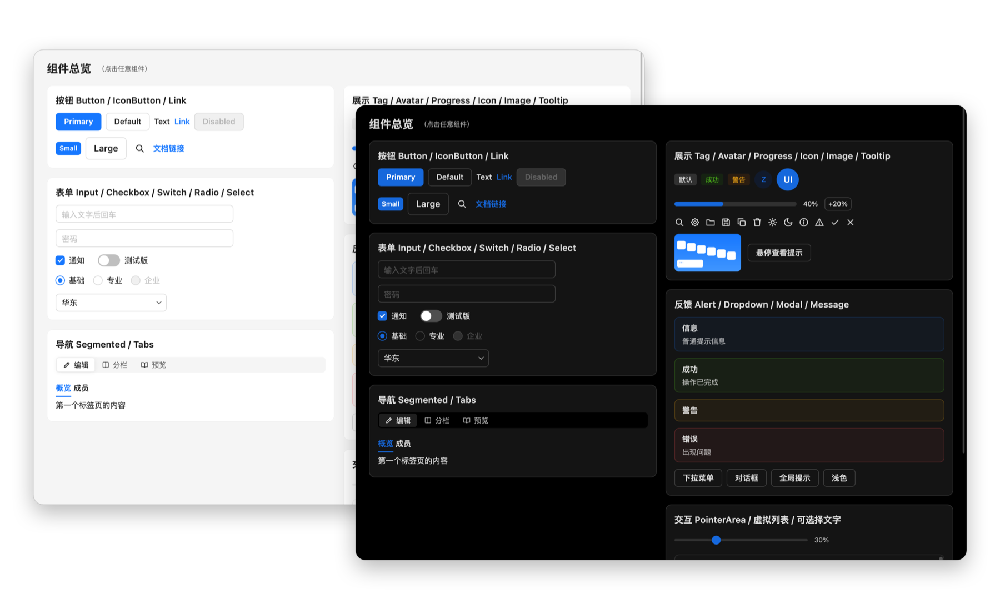

</div>

Zant UI 是一个原生桌面 UI 框架。界面用 **TSX** 写，在编译期由 `zant-tsx` 转成 **Rust**；Skia 通过 macOS 的 Metal 和 Windows 的 Direct3D 12 直接在 GPU 上绘制，**没有 WebView、Electron、JavaScript 运行时或 HTML 渲染**。网络、数据库、剪贴板引擎等底层能力用 Rust 写在 `native/` 里。配套的 `zant` CLI 负责创建项目、热更新、打包、签名和发布构建。

## 为什么用 Zant UI

| 特点 | 说明 |
|---|---|
| **原生渲染** | AppKit / Win32 窗口与 Skia 绘制，无需内嵌浏览器或 JavaScript 运行时 |
| **一套代码，两个平台** | 共用应用代码；框架处理 ⌘ / Ctrl 快捷键、标题栏按钮、数据目录和托盘 / 菜单栏集成 |
| **像 React 一样写 TSX** | 函数组件、props、回调、`useState`、`useEffect` 和 `useMemo`，编译为静态 Rust，没有虚拟 DOM |
| **组件与主题** | Ant Design 5 风格的控件、表单、菜单、模态框、虚拟列表，浅 / 深色主题与状态过渡 |
| **富内容** | 流式 Markdown、LaTeX 与化学式、Mermaid 图、代码高亮、PDF 批注、跨节点文字选择 |
| **桌面能力** | 多窗口与快捷面板、全局快捷键、剪贴板文字 / 图片 / 文件、开机启动、单实例和 SQLite 持久化 |
| **从开发到发布** | `zant create` 创建项目，`zant run` 原地热刷新，`zant build` 完成平台打包与签名 |
| **AI 编程指导** | 生成的项目包含 `DESIGN.md`、`AGENTS.md`、`CLAUDE.md`，提供设计与开发约定 |

## 安装

安装预编译的 `zant` CLI、框架源码与预编译依赖，无需克隆本仓库。安装过程不编译框架；构建自己的应用仍需要 Rust 和平台构建工具。

**macOS** — Apple 芯片，macOS 13+

```bash
curl -fsSL https://raw.githubusercontent.com/racall/zant-ui/main/install.sh | bash
```

**Windows** — Windows 10 / 11 x64，PowerShell

```powershell
irm https://raw.githubusercontent.com/racall/zant-ui/main/install.ps1 | iex
```

安装脚本检查平台依赖，没有 rustup 时先安装它，再确保发布包 `rust-toolchain.toml` 指定的工具链可用（目前为 Rust `1.94.1`，含 rustfmt 和 clippy；`zant create` 新建的应用使用同一版本），校验发布包的 SHA-256，安装到 macOS 的 `~/.zant` 或 Windows 的 `%LOCALAPPDATA%\zant`。脚本会把 `zant` 加入 PATH，安装后请新开终端。已有的默认 Rust 工具链会保留，仅在没有默认工具链时设置一个。

| 平台 | 必需的构建工具 |
|---|---|
| macOS | Xcode 命令行工具与 macOS SDK。未安装时脚本会打开安装窗口，装好后重新运行脚本。 |
| Windows | Visual Studio / Build Tools 的「使用 C++ 的桌面开发」工作负载，包含 MSVC 链接器和 Windows SDK；请先安装再运行脚本。 |

发布包包含框架 / 原生源码与预编译 Skia，Windows 还包含 PDFium。兼容时使用包内预编译的原生库，免去 C / C++ 桥接代码的编译；源码保留作为回退。

<details>
<summary>更新、安装选项与卸载</summary>

- 更新安装版：`zant update`。
- 安装前可设置环境变量：`ZANT_HOME`（目录）、`ZANT_VERSION`（发布标签）、`ZANT_DOWNLOAD`（下载基地址）、`ZANT_FORCE=1`（重新下载）。
- macOS 还支持 `ZANT_BIN_DIR`（符号链接目录，默认 `~/.local/bin`）和 `ZANT_NO_MODIFY_PATH=1`（不修改 shell 配置）。
- 卸载 Zant 时删除安装目录、使用过的 macOS `~/.local/bin/zant` 符号链接，并移除对应 PATH 项。Rust 由 rustup 单独安装。

</details>

## 快速上手

```bash
zant create my-app
cd my-app
zant run
```

`zant create` 会询问应用标题、窗口风格（`native`、`hidden-titlebar` 或 `borderless`）、反向域名应用标识（如 `com.example.myapp`）。生成的 TSX 应用两端通用：

```text
my-app/
  src/App.tsx                主窗口、本地状态和「打开设置窗口」按钮
  src/components/*.tsx       父子 props、回调与资料预览
  src/stores/profile.ts      共享资料 store（createStore / useStore）
  src/windows/SettingsWindow.tsx  第二个窗口（createWindow）
  native/system.ts           原生模块规范：类型与函数声明
  native/system.rs           该规范的 Rust 实现
  native/main.rs             生成入口宏：zant::app!();
  native/build.rs            构建辅助：zant_build::tsx_app()
  app.config.json            应用元数据、窗口默认值与平台设置
  Cargo.toml                 应用 package，通过路径依赖 zant / zant-build
  rust-toolchain.toml         Rust 工具链
  assets/icons/              默认应用与托盘 / 菜单栏图标
  zant.d.ts / tsconfig.json   编辑器类型与配置，无需 React/npm
  DESIGN.md / AGENTS.md / CLAUDE.md  设计与开发指导
```

初始项目通过 props 向下传递计数，子组件通过回调更新它。资料 store 在组件与设置窗口间共享；按钮会打开或激活设置窗口，关闭设置时仅隐藏窗口以便复用。

在 `app.config.json` 修改标题、应用标识、版本、简介、公司、版权和窗口设置。新项目初始尺寸为 680 × 700，最小 600 × 620。`window.remember: true` 会恢复主窗口与 `createWindow` 副窗口的位置和尺寸；没有已保存的窗口位置时使用 `center`。见 [脚手架](docs/scaffold.md)和 [窗口配置](docs/window-config.md)。生成的 Rust 代码留在 Cargo 的 `OUT_DIR` 中。

## 运行与热更新

```bash
zant run              # TSX 项目原地热刷新
zant run --watch      # 旧的重编译并重启模式
zant run --no-hot     # 编译并运行一次；验证 App Sandbox 时使用
zant run --release    # 使用 release profile
```

| 改动文件 | 默认 zant run 行为 |
|---|---|
| `src/` 下的 `.tsx` / `.ts`、`native/` 下除 `native/build.rs` 外的 `.rs` / `.ts`、导入的资源（下列项除外） | 原地热刷新应用 |
| `Cargo.toml`、`Cargo.lock`、`app.config.json`、`native/build.rs`、`rust-toolchain.toml`、`assets/icons/` 下的文件（忽略项除外） | `zant run` 重启自身 |
| `tsconfig.json`、`README.md`、`docs/`、`.git/`、`target/`、点开头的文件 / 隐藏目录、编辑器临时 / 备份文件及其他未匹配文件 | 忽略 |

原地刷新保留宿主进程与原生窗口，恢复兼容的根组件和组件本地状态，以及绑定稳定 key 的滚动、焦点、光标和选区。不兼容字段单独重置，重启时也会尽量保留状态。全局 store、任意 Rust 全局变量、后台线程和外部资源不会自动序列化。编译错误显示在仍运行的 UI 上，刷新成功后清除。

热刷新使用开发宿主；验证 macOS App Sandbox 权限请用 `--no-hot`。见 [热更新规则](docs/scaffold.md#热更新)和 [开发与验证](docs/development.md#热刷新验证)。

| 命令 | 作用 |
|---|---|
| `zant compile [--release]` | 只编译 |
| `zant package` | 本机测试用的应用包 / 程序目录 |
| `zant build [配置文件] [--yes]` | 发布构建 |
| `zant sync` | 重新生成 Info.plist 和适用的 entitlements 等平台文件 |
| `zant update` | 更新安装版；源码版检查依赖、重新编译 CLI，仅在工作区干净且存在远程分支时拉取代码 |

## 用 TSX 写界面

TSX 是推荐的应用 API：具有 React 风格语义的静态编译子集，没有 JavaScript 运行时。根组件放在 `src/App.tsx`，可复用的业务组件放在 `src/components/`。状态只保留一个来源：props 向下传递，回调向上报告事件。

```tsx
import { useState, View, Heading, Text, Button } from "zant";

interface CounterProps {
  count: number;
  onIncrement: () => void;
}

function Counter({ count, onIncrement }: CounterProps) {
  return (
    <View gap={12}>
      <Text>点击次数：{count}</Text>
      <Button variant="primary" onClick={onIncrement}>+1</Button>
    </View>
  );
}

export default function App() {
  const [clicks, setClicks] = useState(0);
  return (
    <View gap={16} padding={24}>
      <Heading level={1}>Hello Zant</Heading>
      <Counter count={clicks} onIncrement={() => setClicks(prev => prev + 1)} />
    </View>
  );
}
```

事件处理函数读到的是本帧的状态快照；更新依赖最新值时使用函数式 setter。颜色通过 `useTheme()` 读取主题 token，布局使用 `View` / `Row` / `Column`。见 [TSX 语法与 hooks](docs/tsx.md)。

### 多窗口

生成的 `src/windows/SettingsWindow.tsx` 导出窗口句柄，在 `src/App.tsx` 中导入后，通过按钮调用 `settingsWindow.activate()`：

```tsx
import { createWindow, View, Heading } from "zant";

export function SettingsWindow() {
  return <View padding={24}><Heading level={2}>设置</Heading></View>;
}

export const settingsWindow = createWindow(SettingsWindow, {
  title: "设置",
  style: "native",
  width: 440,
  height: 320,
  center: true,
});
```

`activate()` 首次打开窗口，之后将已有窗口带到前面。初始项目还通过 `useCloseRequest` 和 `hide()` 复用设置窗口。见 [桌面集成](docs/desktop.md)。

### 原生模块

在 `native/<名字>.ts` 中声明类型与 `export declare function` 签名，在 `native/<名字>.rs` 中实现生成的 trait。编译器注册模块，并检查 Rust 实现是否符合规范。TSX 调用直接编译为 Rust 调用，无需序列化。例如，生成的 `native/system.ts` + `native/system.rs` 模块在组件中这样使用：

```tsx
import { Text } from "zant";
import { info } from "native/system";

export function SystemSummary() {
  const system = info();
  return <Text>平台：{system.os}，CPU 核心：{system.cpus}</Text>;
}
```

耗时工作放在 Rust 工作线程中，完成后唤醒 UI，通过 `useWake` 读取结果，不要阻塞渲染路径。见 [原生模块规范与实现](docs/tsx-native.md)。

高级集成与框架开发也可以使用 `zant::ui` builder 和 `ui::App` trait 手写 Rust UI。多数应用使用 TSX 与原生模块即可。

## 打包与发布

```bash
zant package          # 本机测试：macOS .app / Windows 程序目录
zant build            # 发布：询问缺失设置
zant build --yes      # CI：不提问，通过环境变量提供密钥
```

发布设置在 `build.config.json` 中，与 `app.config.json` 的应用元数据分开。缺失设置可以在终端交互填写并保存。

| 平台 | 发布目标 |
|---|---|
| macOS | Developer ID 分发的 DMG 或 zip，可选 Apple 公证；或用于 Mac App Store 提交的 .pkg |
| Windows | Inno Setup 安装包（可选代码签名）、Microsoft Store 的 MSIX，或免安装 zip |

签名、公证和商店分发需要相应的证书 / 账号与配置。见 [发布构建](docs/build.md)。

## 文档

详细文档目前为中文。

| 主题 | 文档 |
|---|---|
| TSX 语法、hooks 与组件 | [TSX](docs/tsx.md) |
| 原生模块规范与 Rust 实现 | [原生模块](docs/tsx-native.md) |
| 项目生成、图标与热更新 | [脚手架](docs/scaffold.md) |
| 应用元数据与窗口设置 | [窗口配置](docs/window-config.md) |
| 签名、公证、安装包、商店与 CI | [发布构建](docs/build.md) |
| 组件与样式 | [组件索引](docs/components/README.md)、[样式覆盖](docs/components/style.md) |
| 窗口、托盘、快捷键与剪贴板 | [桌面集成](docs/desktop.md) |
| 状态与 SQLite 持久化 | [状态管理](docs/state.md)、[数据库](docs/database.md) |
| Markdown 与数学 | [Markdown](docs/markdown.md) |
| 布局与动效 | [Flex 布局](docs/flex.md)、[动效](docs/motion.md) |
| 框架内部与测试 | [架构](docs/architecture.md)、[开发](docs/development.md) |

## 功能一览

<details>
<summary>已实现的模块</summary>

- AppKit 与 Win32 窗口，支持原生标题栏、隐藏标题栏、无边框、自定义标题栏高度和平台窗口按钮。
- Skia Ganesh + Metal / Direct3D 12，以及 CPU 光栅回退（`ZANT_RENDERER=raster`）；Windows 每显示器 DPI。
- Flex 布局，支持横向换行、百分比、order、align-self、绝对定位和 anchor。
- Skia Paragraph 文字排版、字体回退、富文本、换行、省略号、输入法、跨节点选择复制。
- Ant Design 风格控件、浅 / 深色主题、状态过渡、进退场动画、FLIP 布局过渡和减少动态效果支持。
- 基于 Streamdown 的 Markdown，支持块缓存、KaTeX 风格数学排版、mhchem 化学式、Mermaid 图、代码高亮和 HTML 导出。
- PDF 阅读器，支持后台分块渲染、连续滚动、缩放、搜索、链接、选择、批注与带批注导出。
- 指针捕获与滚轮输入、内存图片、虚拟列表和对话框焦点范围。
- 多窗口 / 面板、托盘 / 菜单栏、全局快捷键、剪贴板监听、开机启动、单实例和 SQLite 存储。
- TSX → Rust 编译、编译期检查的原生模块、项目脚手架、热更新和平台发布工具。

</details>

## 组件

Text / Heading / Paragraph、Button / Link、Input 与多行编辑、Checkbox / Switch / Radio、Select、Tabs、Tooltip、Image、View / Row / Column / Space / Divider、Card、Tag、Alert、Avatar、Progress、Icon / IconButton、DropdownMenu、Segmented、Modal、Message、ShortcutList、DismissLayer、PointerArea、虚拟 List、PdfViewer / PdfPreview、Markdown 编辑器 / 预览。

在 TSX 中通过组件属性和样式覆盖调整外观。通用组件放在框架里，应用结合业务数据进行组合。见 [组件索引](docs/components/README.md)和 [样式覆盖](docs/components/style.md)。

## Markdown 与公式

```tsx
import { Markdown } from "zant";

interface ReplyProps {
  reply: string;
  busy: boolean;
}

export function Reply({ reply, busy }: ReplyProps) {
  return <Markdown source={reply} streaming={busy} />;
}
```

流式预览缓存块，只重新解析变化的内容。数学支持 LaTeX，包括化学命令 `\ce{…}` 和 `\pu{…}`。预览文字默认可选择，公式复制为 LaTeX。见 [Markdown 与数学](docs/markdown.md)。

## PDF

```tsx
import { PdfViewer } from "zant";

interface DocumentProps {
  path: string;
}

export function Document({ path }: DocumentProps) {
  return <PdfViewer src={path} toolbar annotationTools height={600} />;
}
```

阅读器支持滚动、缩放、文字选择、搜索、链接、批注与带批注导出，不要放在其他滚动容器内。没有文本层的扫描 PDF 无法搜索或选择文字。需要通过程序操作文档时，使用 Rust 原生模块。见 [PDF 阅读器](docs/components/pdf.md)。

## 动效

交互控件使用 Ant Design 风格的状态过渡。菜单、模态框和提示带进退场动画，分段控制器和标签页指示器使用 FLIP 过渡。动画帧只重绘，不重建应用 UI 树。减少动态效果设置会关闭动画。见 [动效](docs/motion.md)。

## 状态与持久化

本地状态用 `useState`，跨组件或窗口共享的状态用 `createStore` / `useStore`。初始项目采用以下模式：

```tsx
// src/stores/profile.ts
import { createStore } from "zant";

interface Profile {
  displayName: string;
  accent: boolean;
}

export const profile = createStore<Profile>({ displayName: "开发者", accent: false });
```

```tsx
// src/components/ProfileName.tsx
import { useStore, Input } from "zant";
import { profile } from "../stores/profile";

export function ProfileName() {
  const user = useStore(profile);
  return (
    <Input value={user.displayName}
      onChange={(name) => profile.update({ displayName: name })} />
  );
}
```

共享状态只在 UI 线程修改。Store 是内存状态；需要持久化时，在 Rust 原生模块中使用内置 SQLite 键值与对象集合 API。见 [状态管理](docs/state.md)和 [SQLite](docs/database.md)。

## 设计规范

[DESIGN.md](DESIGN.md) 定义 UI / UX 指导原则，优先于其他项目约定。组件外观遵循 Ant Design 5。生成项目带有同一份设计规范，并在 `AGENTS.md` / `CLAUDE.md` 中引用。

## 从源码构建

开发框架本身时使用源码 checkout。要求 Rust 1.94+（仓库选择 `stable` channel），以及前述平台构建工具。先获取当前平台的 Skia：

```bash
./scripts/fetch_skia.sh
```

```powershell
powershell -ExecutionPolicy Bypass -File scripts/fetch_skia_windows.ps1
```

```bash
cargo build --workspace
cargo test --workspace
cargo run -p zant-examples --bin zant-components
cargo run -p zant-examples --bin zant-markdown
cargo run -p zant-examples --bin zant-math
cargo run -p zant-examples --bin zant-pdf -- manual.pdf
cargo run -p zant-examples --bin zant-md-stream
cargo build --release --workspace
```

沙箱 / AI 环境中 `~/.cargo` 不可写时，用 `./scripts/cargo.sh` 代替 `cargo`，它使用仓库内的 `.cargo-home/`。原生桥接和平台源码由 `crates/zant-sys/build.rs` 构建。将 `target/debug/zant`（Windows 为 `zant.exe`）加入 PATH 即可使用源码构建的 CLI。见 [开发指南](docs/development.md)。

## 架构

- TSX 编译器在构建期生成 Rust，没有 JavaScript 运行时或虚拟 DOM。
- 运行时按 key 将 UI 描述协调到保留树，跳过未变的 memo 子树。
- 采用事件驱动渲染，活跃动画按显示器刷新率安排重绘。
- 文字排版缓存最近使用的宽度，重新断行时复用已整形文字；虚拟列表只构建可见行。
- 平台 C ABI 实现提供 AppKit / Win32 窗口，Skia 桥接处理 Metal / Direct3D 12 渲染。
- 后台线程渲染 PDF 分块并执行其他耗时操作，结果就绪时唤醒 UI。

见 [架构](docs/architecture.md)和 [开发](docs/development.md)。

## 已知限制

- 发布的 macOS 依赖面向 Apple 芯片，Windows 支持 x64。
- Windows 输入法使用 IMM32，尚未实现 TSF 的重新转换等专有能力。
- 不支持纵向 Flex 换行、wrap-reverse、auto/calc 尺寸。
- 多行输入框编辑后会重新排版全文，超大文档可能变慢。
- 含脚注 / 引用式链接的 Markdown 按单块处理，与 Streamdown 一致。
- 尚未暴露系统无障碍 API，应用菜单目前提供退出与关闭窗口操作。

## 项目结构

```text
crates/zant-sys/       原生 C ABI 绑定、Skia 桥接与原生构建
crates/zant/           框架：运行时、组件、桌面、TSX、Markdown、数学、PDF、SQLite
crates/zant-macros/    TsxProps 与 Table 派生宏
crates/zant-tsx/       TSX → Rust 编译器与 TypeScript 声明
crates/zant-build/     应用构建辅助：TSX、图标、Windows 资源
crates/zant-cli/       create / run / compile / package / build / sync / update
crates/zant-examples/  组件、Markdown、流式、数学与 PDF 示例
scaffold/template-ts/ TSX 应用模板，含组件、store、窗口和原生模块
scripts/              依赖、Cargo 包装、基准、发布与 Windows 测试
docs/                 中文文档与截图
third_party/          预编译依赖（不提交到 Git）
```

## 示例与界面

以下截图来自 macOS。在仓库中通过 `cargo run -p zant-examples --bin <名字>`（沙箱里用 `./scripts/cargo.sh`）运行示例，或构建后直接启动二进制。

### 全部组件（`zant-components`）

两种主题下的可交互控件：

| 浅色 | 深色 |
|---|---|
| 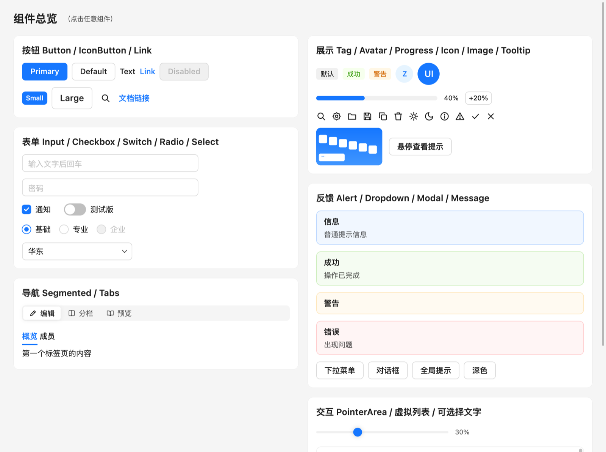 | 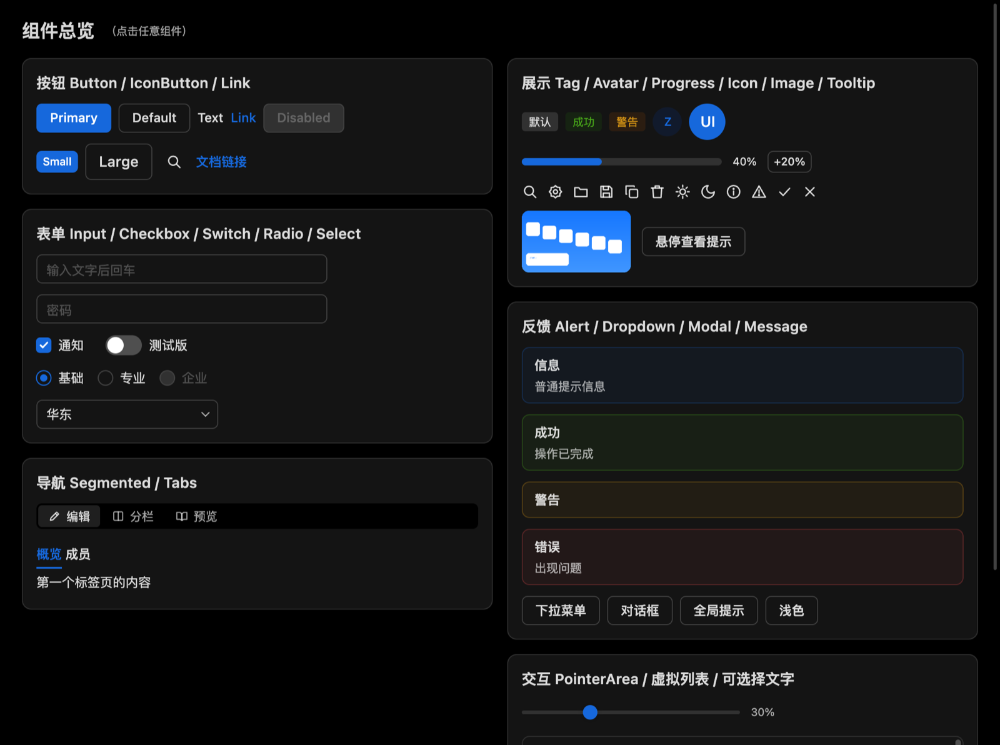 |

### 声明式示例与画廊（`zant-demo`、`zant-gallery`）

| 声明式示例 | 组件画廊 |
|---|---|
| 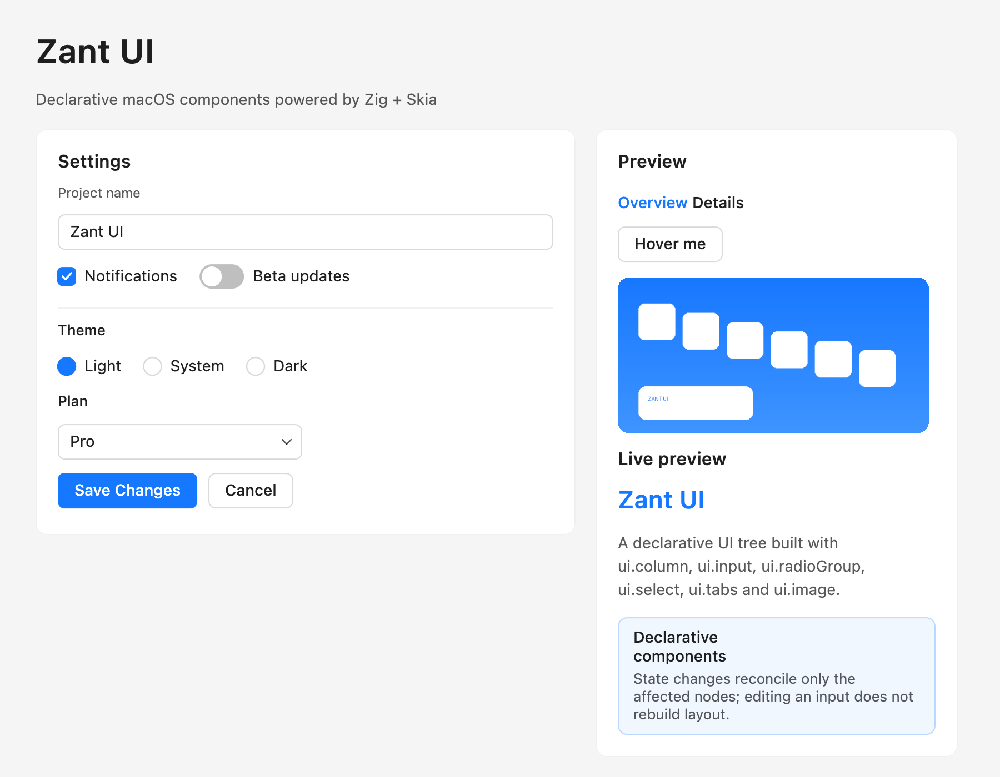 | 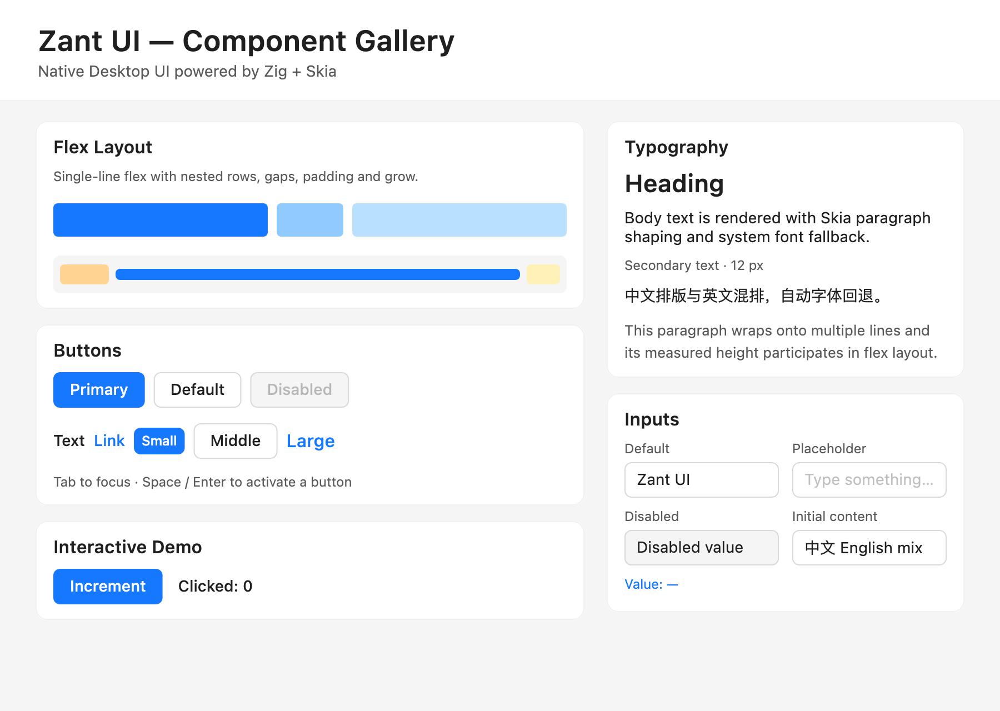 |

### Markdown（`zant-markdown`）

提示块、列表、任务、行内公式、带复制 / 下载操作的表格、代码高亮与 Mermaid 图：

| 浅色 | 深色 |
|---|---|
| 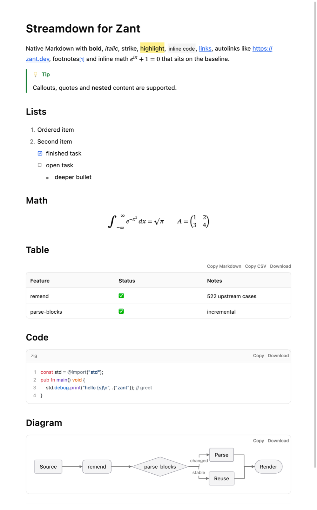 | 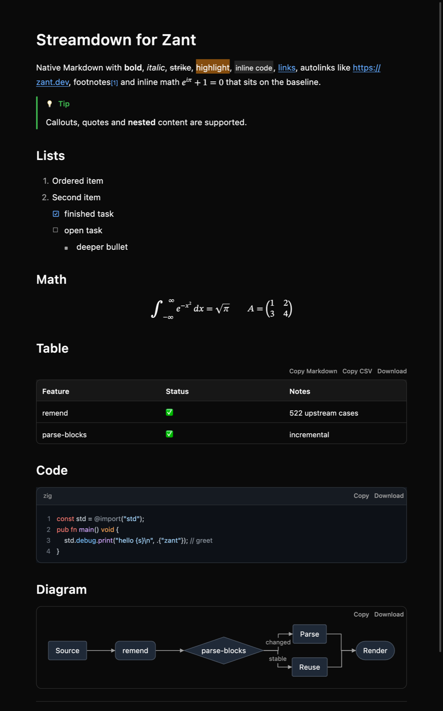 |

### 流式对话与公式（`zant-md-stream`、`zant-math`）

| 流式 Markdown | 数学与化学式 |
|---|---|
| 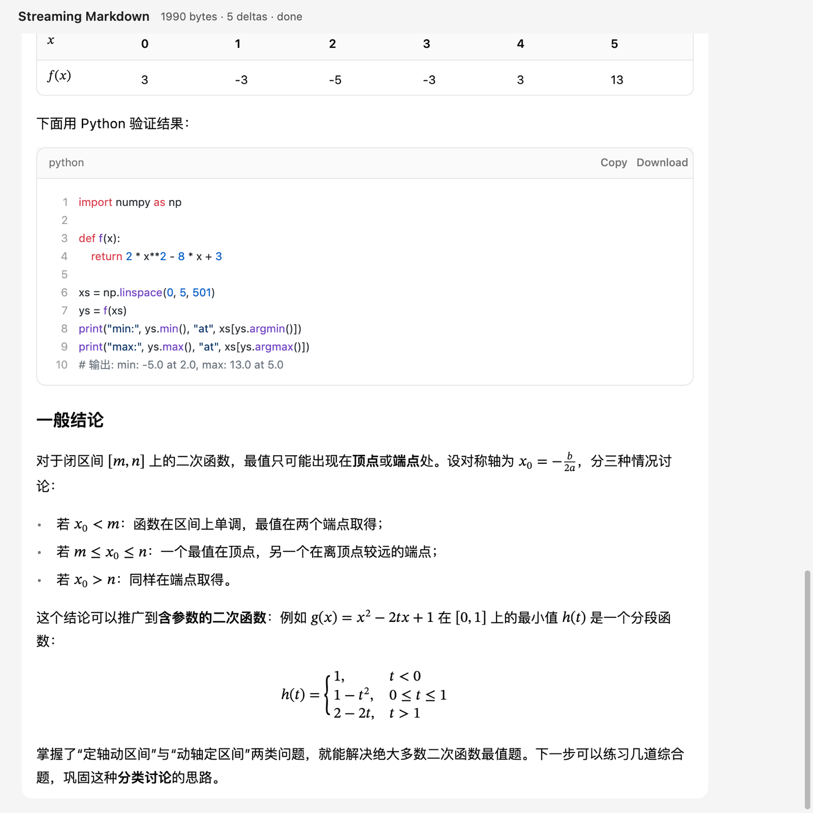 |  |

### PDF 阅读器（`zant-pdf`）

连续滚动、缩放、搜索、选择与批注：

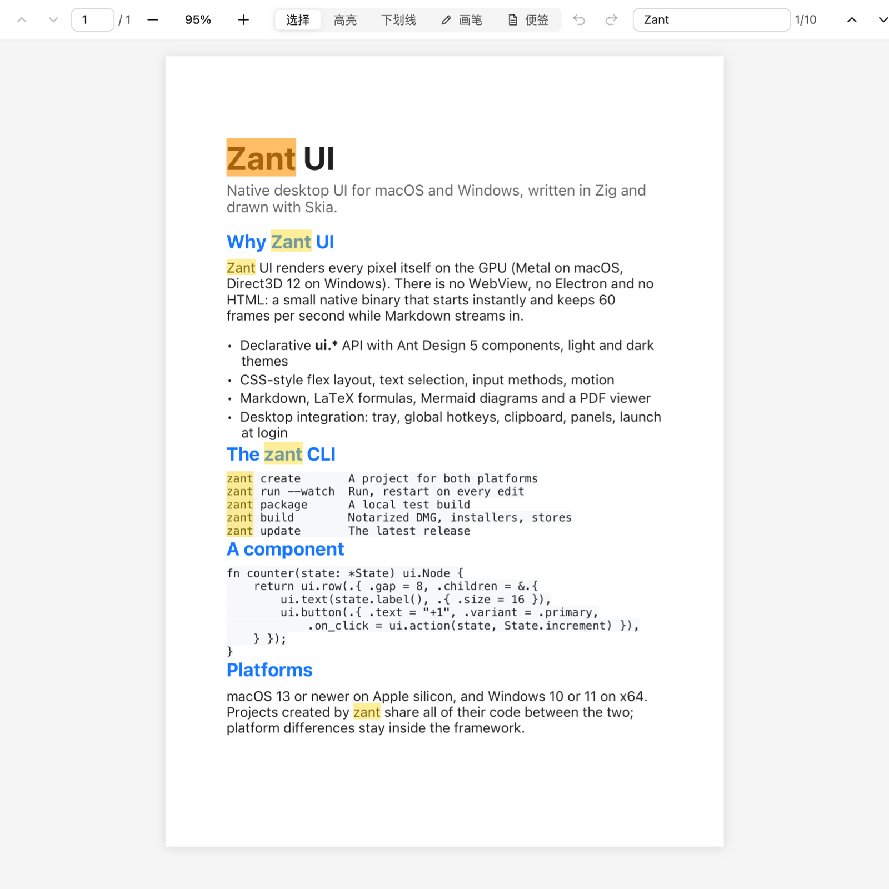

### 生成的 TSX 应用

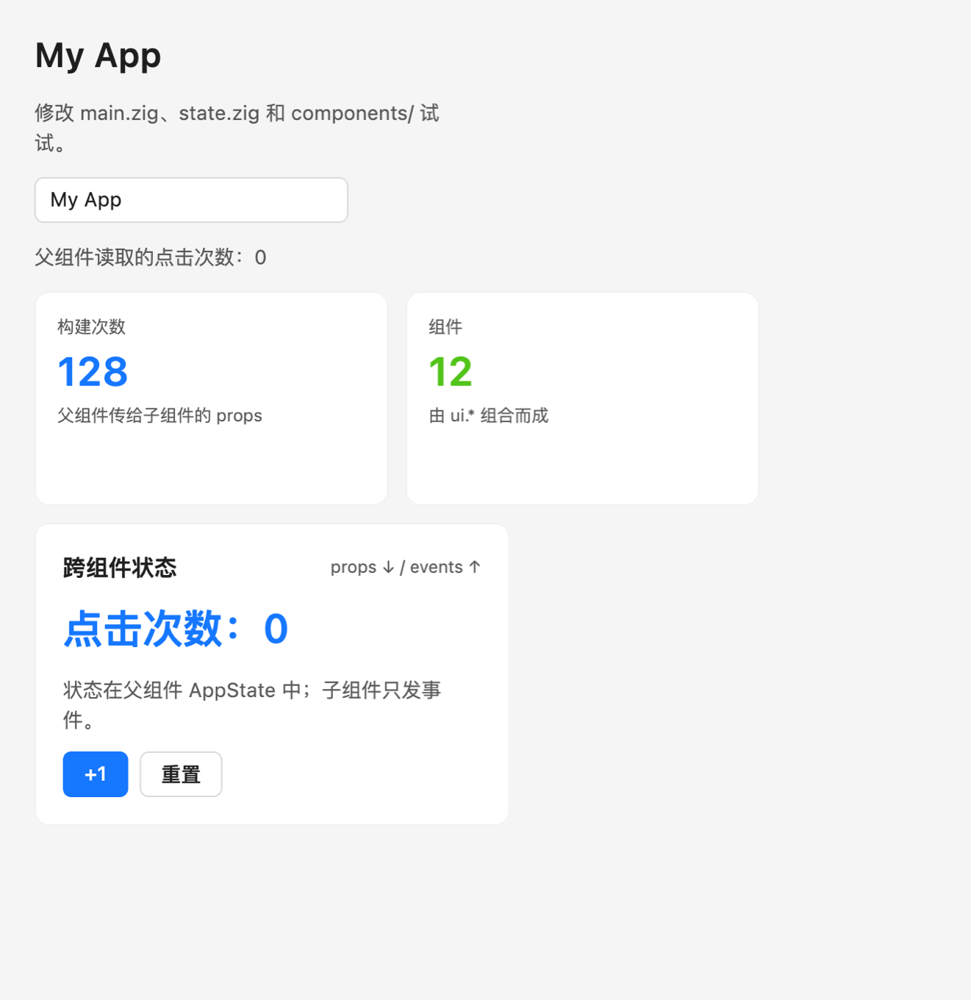

### 用 Zant UI 写的应用

**still.** 是一个 Markdown 写作应用，支持编辑 / 分栏 / 预览、查找替换、大纲、HTML 导出、专注模式和浅 / 深色主题。预览展示了 [docs/showcase.md](docs/showcase.md) 中的 Markdown 与数学渲染：

| 预览，上半部分 | 预览，下半部分 |
|---|---|
| 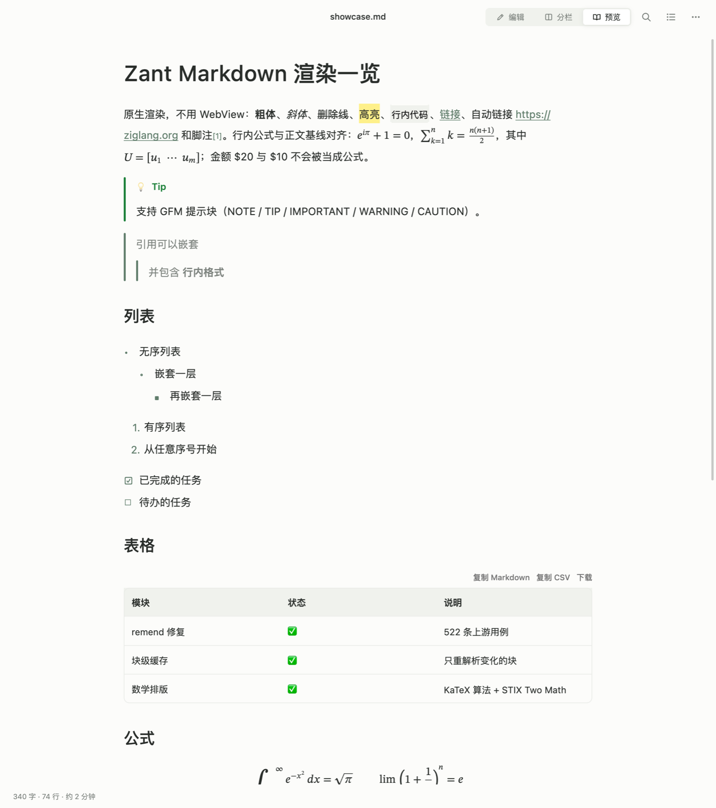 | 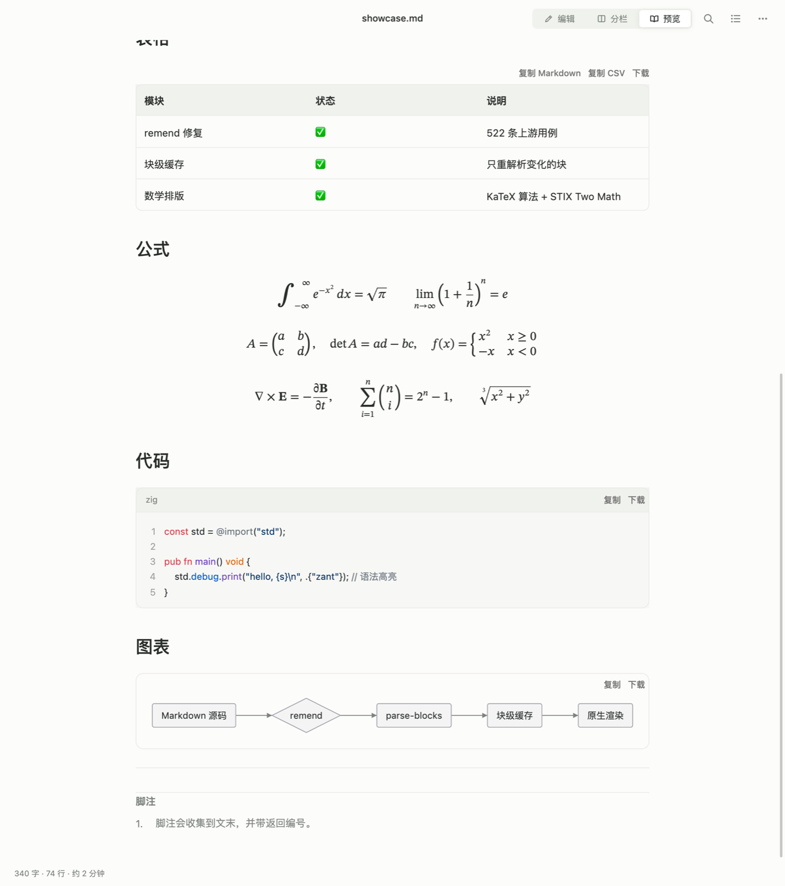 |

深色分栏编辑：

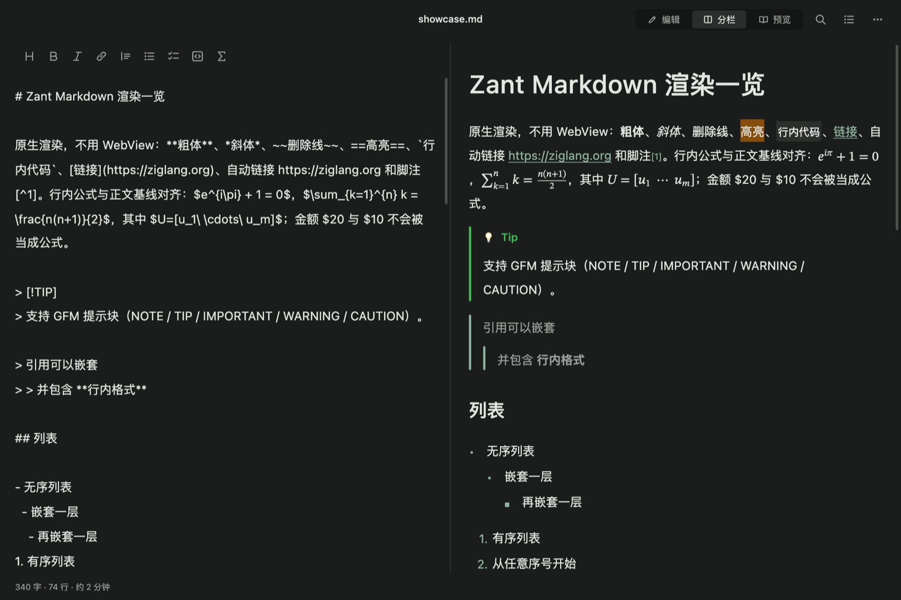

## License

[MIT](LICENSE)。Skia 及其依赖、PDFium、Streamdown、KaTeX / mhchem、EmbedPDF、STIX Two Math 的第三方许可与署名见 [THIRD_PARTY_NOTICES.md](THIRD_PARTY_NOTICES.md)。
