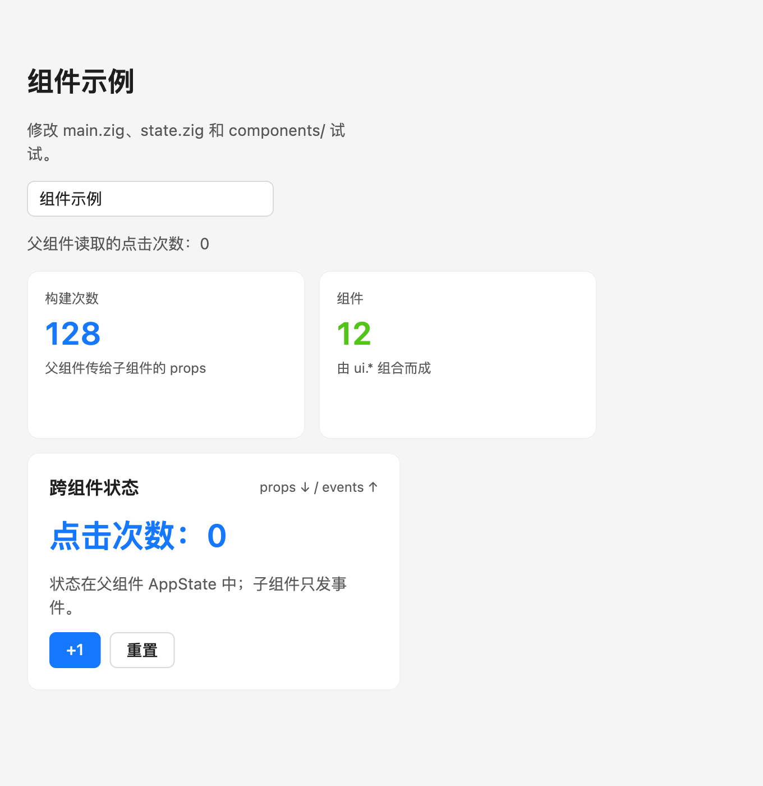

# 脚手架



脚手架是一个编译后的 `zant` 工具。发布构建（`zant build`）的平台步骤调用 Zant UI 自带的打包脚本
（`crates/zant-cli/src/distribute.rs` 与 `scripts/`），项目里不需要自己写脚本。

## 安装

```bash
# macOS（Apple 芯片）
curl -fsSL https://raw.githubusercontent.com/racall/zant-ui/main/install.sh | bash
```

```powershell
# Windows x64（PowerShell）
irm https://raw.githubusercontent.com/racall/zant-ui/main/install.ps1 | iex
```

安装脚本第一步检查 Rust（没有 rustup 就装 rustup，并安装 Zant UI 固定的工具链），然后下载最新的发布包：
编译好的 `zant`、Zant UI 框架（`zant-ui/`，Rust workspace）和预编译依赖（Skia；Windows 还有 PDFium），
放到 `~/.zant`（Windows `%LOCALAPPDATA%\zant`）并加到 PATH。不需要克隆源码，也不需要编译框架；
Windows 需要 Visual Studio 2022+ / Build Tools 的 C++ 工作负载（链接 Skia），macOS 需要 Xcode 命令行工具。
详细说明和环境变量见 README「安装」。

用源码开发 Zant UI 本身时，在源码目录运行 `scripts/fetch_skia.sh`（Windows
`scripts/fetch_skia_windows.ps1`，并需要 Visual Studio 的 C++ 工作负载）和
`cargo build -p zant-cli`，再把 `target/debug/zant` 放到 PATH（沙箱里用 `./scripts/cargo.sh`）。

macOS 与 Windows 用法相同。`zant create` 只问两端通用的设置，生成的项目在两端都能直接 `zant run`。平台专属的设置和文件
由 `zant run` / `build` / `package` 在当前平台按需补充：macOS 上补 `app.config.json` 的
`macos` 段（沙盒、签名账号）并生成 Info.plist、entitlements；Windows 暂无专属设置。

## 创建项目

```bash
cd /path/to/work
zant create my-app
```

会询问（都是两端通用的）：

1. 应用标题
2. 窗口风格：原生标题栏 / 隐藏标题栏 / 无边框
3. 应用标识（反向域名，如 `com.xx.test`）：macOS 的 Bundle ID，也是 Windows 上
   `zant::core::paths::app_data_dir` 的数据目录名（`%APPDATA%\<id>`）

应用标识同时符合苹果与微软的规范，不合规就不能创建项目：

- 只能有英文字母、数字、`-`、`.`（苹果 Bundle ID）；至少两段，没有空段，第一个字符是字母，
  每段不以 `-` 开头或结尾；`com.apple` 开头的是苹果保留的
- 3～50 个字符（微软 MSIX 包名）；任何一段不能是 CON、PRN、AUX、NUL、COM1～9、LPT1～9
  （Windows 保留名，也不能做文件夹名）

输错会说明原因并重新询问，连续 3 次不合规则退出、不创建任何文件；`--bundle-id` 不合规直接报错；
项目名生成的默认标识不合规时（如项目名 `con`）不提供默认值。`--force` 覆盖时，旧目录在全部
检查通过后才删除。`zant run` / `build` / `package` 每次都会检查 `app.config.json` 里的
`bundle_id`，手改成不合规的值会报错并停止。

macOS 专属设置不在创建时询问：在 Mac 上第一次 `zant run` / `zant compile` / `zant build` / `zant sync` 时写入
`"macos": { "sandbox": false }`；第一次 `zant package` 时列出本机 codesign 身份让你选择
（0 = ad-hoc；非交互终端直接用 ad-hoc），写入 `macos.signing_identity`。
Windows 的命令行窗口（包括代码页 936 的中文系统）中文显示与输入正常。

生成过程会逐步输出状态。目标目录已存在时加 `--force` 覆盖。

非交互：

```bash
/path/to/zant/target/debug/zant create my-app \
  --yes \
  --title "My App" \
  --style hidden-titlebar \
  --bundle-id com.acme.myapp \
  --sandbox true \
  --sign "Developer ID Application: Your Name (TEAMID)"
```

`--sandbox`、`--sign` 可选：给出时直接写入 `macos` 段。

生成的是 TSX 应用：一个 Rust Cargo package，TSX 在编译期（`native/build.rs` 调用
`zant_build::tsx_app()`）转成 Rust，没有 JS 运行时：

```text
src/App.tsx                 根组件（默认导出），界面和业务逻辑都用 TSX
src/components/*.tsx        业务组件
native/main.rs              一行 zant::app!();，生成入口与注册
native/<名字>.ts            原生模块的规范（类型 + export declare function）
native/<名字>.rs            原生模块的 Rust 实现
native/build.rs             一行 fn main() { zant_build::tsx_app(); }
Cargo.toml                  单个 Cargo package；zant / zant-build 是相对路径依赖
rust-toolchain.toml         stable 工具链
assets/icons/               默认图标
zant.d.ts / tsconfig.json   import … from "zant" 的类型与补全
```

`zant create` 把 `Cargo.toml` 里的 `__ZANT_PATH__` 换成项目到 Zant UI 的相对路径，
所以项目可以放在任意目录。项目和 Zant UI 不在同一个盘时（Windows），`zant create`
用目录联接 `.zant/zant-ui` 引用 Zant UI，依赖路径变成 `.zant/zant-ui`。
模板带一个示例原生模块 `native/system`（平台、CPU 核数、Rust 版本）。
`zant.d.ts` 由框架的标签表生成（`zant-tsx-dts`），`zant create` 复制到项目里。

## 运行

```bash
cd my-app
/path/to/zant/target/debug/zant run
```

`zant run` 读取配置，调用 `cargo build`，然后启动应用。无需手动执行 `cargo build`。

常用命令：

```bash
zant run
zant run              # 热刷新：保存后界面原地刷新，窗口不关闭
zant run --watch      # 旧的重启模式
zant run --no-hot     # 编译并运行一次
zant run --release
zant compile          # 只编译（--release 用 release profile）
zant package          # 本机测试用的 .app / 程序目录
zant build            # 发布构建：签名、DMG、公证、安装包或提交商店，见「发布构建」
zant sync             # 只重新生成 Info.plist（沙盒或设了 macos.entitlements 时还有 app.entitlements）
zant update           # 安装版：更新到最新发布包；源码版：git pull（工作区干净且有远程分支时）、
                      # 检查依赖和 Rust 工具链、重新编译 zant
```

`zant run` / `zant compile` 默认 Debug 构建（Windows 上是控制台程序）；`--release`、`zant package` 与 `zant build`
用 release profile（`zant package` / `zant build` 在 Windows 上为 GUI 子系统），产物在
`target/{debug,release}/<应用名>`。

## 热更新

```bash
zant run              # TSX 项目默认原地热刷新
zant run --watch      # 重编译并重启，重建窗口与内存状态
zant run --no-hot     # 编译并运行一次（普通静态链接程序）
```

`zant run` 按改动文件决定行为：

| 改动 | 行为 |
| --- | --- |
| `src/` 任意深度的 `.tsx` / `.ts`、`native/` 任意深度的 `.rs` / `.ts`（除 `native/build.rs`）、TSX 导入的资源（除下列重启或忽略项） | 原地热刷新 |
| `Cargo.toml`、`Cargo.lock`、`app.config.json`、`native/build.rs`、`rust-toolchain.toml`、`assets/icons/` 下的文件（除下列忽略项） | `zant run` 重启自身 |
| `tsconfig.json`、`README.md`、`docs/`、`.git/`、`target/`、点开头的文件 / 目录、编辑器临时 / 备份文件（`~`、`.swp`、`.swo`、`.tmp`、`.bak` 后缀）及其他未匹配文件 | 忽略 |

重启时终端会提示改动的文件，通过 `target/zant-hot/restart-state.json` 一次性传递状态，状态尽量保留。
原地热刷新只构建应用的 UI 动态库，宿主进程持有同一个原生窗口；框架通过 `zant-dylib`
共享，首次构建后，TSX 编辑不会重新构建框架或加载另一份框架 / Rust 标准库。
内容没有变化的保存不触发构建；构建中的多次保存会合并为下一次构建，最终显示最后保存的内容。

根组件 `useState` 按字段名恢复，支持的子组件本地状态按组件实例恢复；新增字段用初始值，
不兼容的类型只重置对应字段。带稳定 `key` 的滚动容器、虚拟列表、焦点、输入光标与文本选区会恢复；
改 key 或移除组件会失去对应视图状态。`createStore`、任意 Rust 全局变量、后台线程和外部资源不会自动序列化。
手写 Rust 应用可实现 `App::hot_save` / `hot_load`；自定义状态类型可实现 `tsx::hot::Hot`。

TSX 语法错误与 `native/` Rust 编译错误显示在仍运行的 UI 上，保留文件、行、列；修复后自动移除错误面板并刷新。
库在后台线程加载，状态保存、销毁与恢复在 UI 线程执行；Cargo 以较低优先级运行。
关闭窗口结束会话；Ctrl+C 结束 CLI，宿主在标准输入关闭时退出。

热刷新使用开发宿主，不经过 App Sandbox / 发布签名流程；调试沙盒权限请用 `--no-hot`。
`--watch` 保留旧模式：macOS 编译失败时保留旧窗口（沙盒下不支持自动重启），Windows 先结束旧 exe，
编译失败再打开上一个版本。非 TSX 项目仍编译并运行一次。

内部文件位于 `target/zant-hot/`：隐藏 crate 的 `lib.rs` 只有 `zant::hot_app!();`，
构建脚本调用 `zant_build::hot_app(app_root)`，与普通应用使用同一份 `OUT_DIR/zant_app.rs` / `zant_hot.rs`。
隐藏 crate 和 `zant-dylib` 都使用 Rust `dylib`；隐藏 crate 以 `zant` 为依赖名引用 `zant-dylib`
重导出的框架 API 和宏，
并保留应用的其他依赖。macOS 在 UI 库中写入依赖目录与工具链标准库目录的 rpath；Windows
将工具链 DLL 放到构建产物的 `deps/`，宿主在加载前用 `AddDllDirectory` 注册该目录。
这些开发库必须由同一 Rust 工具链构建；普通编译、打包与发布不使用这条动态链接路径。
框架编成只加载一次的共享库（`zant-dylib`），每次热刷新只加载应用自己的小库；新版本启动成功后，
框架释放旧版本留下的回调、定时器、窗口等引用并卸载旧库，长时间反复刷新内存不累积。
应用在 `native/` 里自己开的线程须在退出钩子里停止，否则卸载后仍会执行已释放的代码。
热刷新 UI crate 默认使用较少调试信息，应用清单中 `[profile.dev.package.<包名>-hot]` 可覆盖。

自动截图、分阶段计时与无桌面回放见 [开发指南](development.md#热刷新验证)。

## 打包与签名

```bash
zant package
```

总是用 release profile 编译。

Windows：生成 `target/<应用标题>/` 目录（`<应用标题>.exe`、`pdfium.dll`、
MSVC 运行库 `vcruntime140*.dll` / `msvcp140.dll`），GUI 子系统，压缩即可分发；不签名。
exe 内带应用图标（`assets/icons/app-windows.png`）。项目和 Zant UI 不在同一个盘时，`zant create`
用目录联接 `.zant/zant-ui` 引用 Zant UI（`Cargo.toml` 的 path 依赖只接受相对路径）。

macOS：生成 `target/<应用标题>.app`：

- 读取应用标识（Bundle ID）、版本、窗口配置；缺少签名账号时先询问
- 用 `assets/icons/app-macos.png` 生成 `AppIcon.icns`（见「图标」）
- 生成 Info.plist
- 沙盒开启时写入 entitlements
- 使用配置中的 Developer ID 签名
- 无开发者账号时使用 ad-hoc 签名

沙盒应用 `zant run` 也会先打包，再用 `open -n -W` 启动。

## 发布构建

`zant package` 只做本机测试用的版本。要发给别人用 `zant build`：macOS 用 Developer ID 签名、
打包 DMG 并公证，或打包 .pkg 提交 App Store Connect；Windows 打包成签名的安装包，或 MSIX
提交 Microsoft Store。设置放在独立的 `build.config.json`（`zant build <配置文件>` 可以指定别的），
缺的设置在终端里询问并可保存；CI 上用 `zant build --yes` 不提问，密钥从环境变量读取。
详见 [发布构建](build.md)。

## 图标

`zant create` 在 `assets/icons/` 放一套默认图标（PNG + 可编辑的 SVG 源文件），分别符合两端规范。
换成自己的图标：替换同名 PNG（尺寸不变），SVG 只是方便修改的源文件。

| 文件 | 用途与规范 |
|---|---|
| `app-macos.png` | macOS 应用图标，1024×1024；苹果图标网格：主体 824×824 居中（四周留 100 px）、连续圆角、底部投影。`zant package` 生成 10 种尺寸的 `AppIcon.icns`；`zant run` 开发运行时显示在程序坞 |
| `app-windows.png` | Windows 应用图标，256×256（正方形，至少 256）；铺满画布、不加投影、笔画加粗。编译时 `zant_build` 自动生成含 16、20、24、32、40、48、64、256 的 `.ico` 编进 exe（资源管理器图标、窗口与任务栏图标） |
| `tray-dark.png` / `tray-light.png` | Windows 通知区域（托盘）图标，64×64，单色（白色给深色任务栏、黑色给浅色任务栏），同 Windows 11 系统托盘图标；按系统小图标尺寸缩放（100% 时 16 px，125–200% 时 20/24/32），任务栏切换深浅色时框架自动换图；实心形状、标志镂空，16 px 下依然清楚 |
| `statusbar.png` | macOS 菜单栏（状态栏）图标，36×36（18 pt @2x），图形约 15 pt、线宽 1.5 pt（与菜单栏里的 SF Symbols 一致）；模板图：只用黑色 + 透明度，系统按深浅色菜单栏和高亮状态着色 |

应用里引用图标有两条路：Rust（原生模块）用 `include_bytes!`，TSX 用 `import`（编译期嵌入，得到
`Uint8Array`）：

```rust
const TRAY_DARK: &[u8] = include_bytes!("../assets/icons/tray-dark.png");
```

```tsx
import trayIcon from "../assets/icons/tray-dark.png";
```

路径相对引用它的源文件（图标因此编进可执行文件，不依赖运行时文件）。Windows 的
`.ico` 由 `zant_build` 在编译时生成，macOS 的 `.icns` 由 `zant package` 生成。

PNG 要求 8 位、非隔行扫描（常见导出工具的默认格式）。

## 组件与状态示例

生成的项目是一个可以直接运行的完整示例，覆盖桌面应用最常用的几种写法：

```text
src/App.tsx                       主窗口：持有点击次数，提供「打开设置窗口」按钮
src/components/Dashboard.tsx      父组件：组合子组件，读取原生模块
src/components/StatCard.tsx       展示组件（props）
src/components/CounterCard.tsx    子组件（props + 事件回调）
src/components/ProfilePreview.tsx 读取共享 store 的组件（不经过 props）
src/stores/profile.ts             共享 store（createStore）
src/windows/SettingsWindow.tsx    第二个窗口（createWindow），修改共享 store
native/system.ts                  原生模块规范（平台、CPU、Rust 版本）
native/system.rs                  原生模块的 Rust 实现（impl SystemSpec for Native）
native/main.rs / native/build.rs  各一行，入口与构建都由框架生成
```

**父子组件通信**：props 向下、事件向上。

```text
App.tsx 持有 useState 状态
  → Dashboard 读取 count
  → CounterCard 接收 count / onIncrement / onReset
  → 子组件按钮触发回调
  → App 的状态更新，读取该状态的组件重绘
```

**跨组件共享状态**：`src/stores/profile.ts` 用 `createStore` 定义资料；主窗口的输入框写入，
`ProfilePreview` 和设置窗口用 `useStore` 读取，互相不需要传 props，见 [状态管理](state.md)。

**打开新窗口**：主窗口的「打开设置窗口」按钮调用 `settingsWindow.activate()`，首次打开、之后前置同一个窗口；
在设置窗口改名称，主窗口实时更新；关闭设置窗口只隐藏它，应用继续运行。

**标准程序配置**：`app.config.json` 带上描述、公司、版权、macOS 分类与「记住窗口位置」
（`zant create` 从应用标识推出公司名并写入当前年份），写入 macOS 的 Info.plist 与 Windows exe 的文件属性；
macOS 自动带标准菜单栏（关于、隐藏、退出，编辑菜单的撤销 / 剪切 / 拷贝 / 粘贴 / 全选，全屏，窗口菜单），
字段说明见 [窗口配置](window-config.md)。

## AI Coding Agent 文件

生成项目还包含：

- `DESIGN.md`：UI/UX 设计指导原则（与框架同一份），**优先级最高**：所有界面与交互的设计、
  实现和评审都必须遵循它，与其他约定冲突时以它为准。
- `AGENTS.md`：开头声明 DESIGN.md 的最高优先级；之后是项目介绍、目录、命令、状态与组件
  规范（通用组件用框架组件，应用只写业务组件）、原生模块、沙盒/签名规则。
- `CLAUDE.md`：Claude Code 入口，同样先声明 DESIGN.md，再引用 `AGENTS.md`。

这些文件让 Codex / Claude Code 在修改项目前先理解约定，减少误改。

应用的 `src/` 只放 `.tsx` / `.ts`，所有 Rust 文件都在 `native/`。
`Cargo.toml` 设置 `build = "native/build.rs"` 和 `[[bin]] path = "native/main.rs"`。
构建器在 `$OUT_DIR/zant_app.rs` 生成配置、原生模块树、规范类型与注册、TSX 模块声明；
`zant_main.rs` 启动应用，`zant_hot.rs` 提供热重载入口（`zant::hot_app!()`）。
新增原生能力只需 `native/<名字>.ts` + `native/<名字>.rs`；顶层无规范的 `.rs` 是内部模块，
自动声明但不注册，子目录由普通 `mod` 引入。生成代码不写回项目目录。
