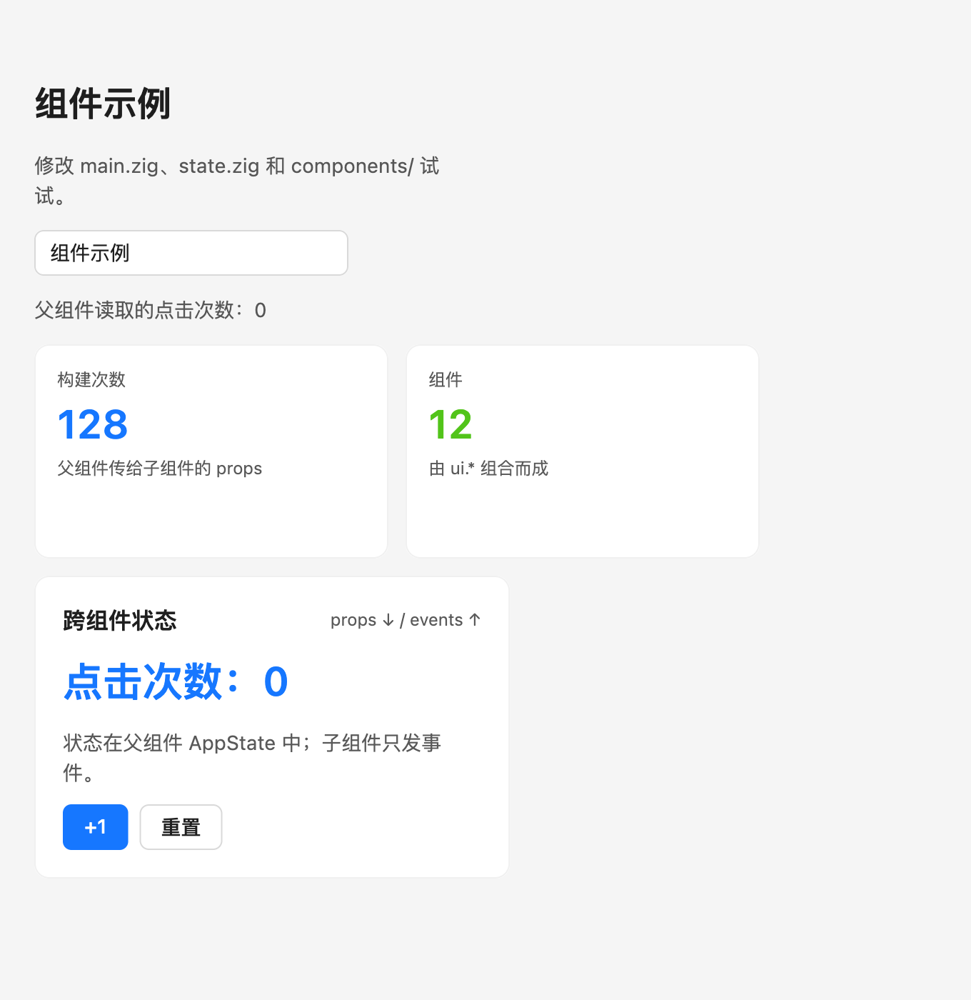

# 脚手架



脚手架是一个编译后的 `zant` 工具，不使用 shell 脚本。

先构建框架：

```bash
cd /path/to/zant-ui
zig build
```

macOS 与 Windows 用法相同。Windows 上先运行一次
`powershell -ExecutionPolicy Bypass -File scripts/fetch_skia_windows.ps1`，并把 Zig 和
`<zant-ui>\zig-out\bin` 加入 PATH；需要 Visual Studio 2022+ / Build Tools 的 C++ 工作负载。
`zant create` 只问两端通用的设置，生成的项目在两端都能直接 `zant run`。平台专属的设置和文件
由 `zant run` / `build` / `package` 在当前平台按需补充：macOS 上补 `app.config.json` 的
`macos` 段（沙盒、签名账号）并生成 Info.plist、entitlements；Windows 暂无专属设置。

## 创建项目

```bash
cd /path/to/work
/path/to/zant-ui/zig-out/bin/zant create my-app
```

会询问（都是两端通用的）：

1. 应用标题
2. 窗口风格：原生标题栏 / 隐藏标题栏 / 无边框
3. 应用标识（反向域名，如 `com.xx.test`）：macOS 的 Bundle ID，也是 Windows 上
   `zant.paths.appDataDir` 的数据目录名（`%APPDATA%\<id>`）

应用标识同时符合苹果与微软的规范，不合规就不能创建项目：

- 只能有英文字母、数字、`-`、`.`（苹果 Bundle ID）；至少两段，没有空段，第一个字符是字母，
  每段不以 `-` 开头或结尾；`com.apple` 开头的是苹果保留的
- 3～50 个字符（微软 MSIX 包名）；任何一段不能是 CON、PRN、AUX、NUL、COM1～9、LPT1～9
  （Windows 保留名，也不能做文件夹名）

输错会说明原因并重新询问，连续 3 次不合规则退出、不创建任何文件；`--bundle-id` 不合规直接报错；
项目名生成的默认标识不合规时（如项目名 `con`）不提供默认值。`--force` 覆盖时，旧目录在全部
检查通过后才删除。`zant run` / `build` / `package` 每次都会检查 `app.config.json` 里的
`bundle_id`，手改成不合规的值会报错并停止。

macOS 专属设置不在创建时询问：在 Mac 上第一次 `zant run` / `zant build` 时写入
`"macos": { "sandbox": false }`；第一次 `zant package` 时列出本机 codesign 身份让你选择
（0 = ad-hoc；非交互终端直接用 ad-hoc），写入 `macos.signing_identity`。
Windows 的命令行窗口（包括代码页 936 的中文系统）中文显示与输入正常。

生成过程会逐步输出状态。目标目录已存在时加 `--force` 覆盖。

非交互：

```bash
/path/to/zant-ui/zig-out/bin/zant create my-app \
  --yes \
  --title "My App" \
  --style hidden-titlebar \
  --bundle-id com.acme.myapp \
  --sandbox true \
  --sign "Developer ID Application: Your Name (TEAMID)"
```

`--sandbox`、`--sign` 可选：给出时直接写入 `macos` 段。

## 运行

```bash
cd my-app
/path/to/zant-ui/zig-out/bin/zant run
```

`zant run` 会读取 `app.config.json`、生成 `src/app_config.zig`、
调用 `zig build`，然后启动应用。无需手动执行 `zig build`。

常用命令：

```bash
zant run
zant run --watch      # 热更新：改动后自动重编译并重启（重启式）
zant run --release
zant build
zant build --release
zant package
zant sync             # 只重新生成 src/app_config.zig、Info.plist（沙盒时还有 app.entitlements）
zant update           # 框架更新后重编译全局 zant CLI（Windows 上先把运行中的 zant.exe 改名为 zant.old.exe）
```

`zant run` / `zant build` 默认 Debug 构建（Windows 上是控制台程序）；`--release` 与 `zant package`
用 ReleaseFast（Windows 为 GUI 子系统）。

## 热更新

```bash
zant run --watch
```

监听：

- `src/` 下所有 `.zig`（任意深度）
- `app.config.json`
- `build.zig`、`build.zig.zon`

文件变化后自动重新编译并重启应用。当前是**重启式热更新**：

- 会重新创建窗口和状态
- macOS：编译失败时保留当前窗口，继续等待下一次改动；App Sandbox 模式暂不支持
  （需要 LaunchServices 启动，无法可靠重启）
- Windows：运行中的 exe 不能被覆盖，所以先结束旧进程再编译；编译失败时重新打开上一次的版本

## 打包与签名

```bash
zant package
```

总是用 ReleaseFast 编译。

Windows：生成 `zig-out/<应用标题>/` 目录（`<应用标题>.exe`、`zant_skia.dll`、`pdfium.dll`、
MSVC 运行库 `vcruntime140*.dll` / `msvcp140.dll`），GUI 子系统，压缩即可分发；不签名。
exe 内带应用图标（`assets/icons/app-windows.png`）。项目和 Zant UI 不在同一个盘时，`zant create`
用目录联接 `.zant/zant-ui` 引用 Zant UI（`build.zig.zon` 只接受相对路径）。

macOS：生成 `zig-out/<应用标题>.app`：

- 读取应用标识（Bundle ID）、版本、窗口配置；缺少签名账号时先询问
- 用 `assets/icons/app-macos.png` 生成 `AppIcon.icns`（见「图标」）
- 生成 Info.plist
- 沙盒开启时写入 entitlements
- 使用配置中的 Developer ID 签名
- 无开发者账号时使用 ad-hoc 签名

未自动做 notarization。沙盒应用 `zant run` 也会先打包，再用 `open -n -W` 启动。

## 图标

`zant create` 在 `assets/icons/` 放一套默认图标（PNG + 可编辑的 SVG 源文件），分别符合两端规范。
换成自己的图标：替换同名 PNG（尺寸不变），SVG 只是方便修改的源文件。

| 文件 | 用途与规范 |
|---|---|
| `app-macos.png` | macOS 应用图标，1024×1024；苹果图标网格：主体 824×824 居中（四周留 100 px）、连续圆角、底部投影。`zant package` 生成 10 种尺寸的 `AppIcon.icns`；`zant run` 开发运行时显示在程序坞 |
| `app-windows.png` | Windows 应用图标，256×256（正方形，至少 256）；铺满画布、不加投影、笔画加粗。编译时自动生成含 16、20、24、32、40、48、64、256 的 `.ico` 编进 exe（资管器图标、窗口与任务栏图标） |
| `tray-dark.png` / `tray-light.png` | Windows 通知区域（托盘）图标，64×64，单色（白色给深色任务栏、黑色给浅色任务栏），同 Windows 11 系统托盘图标；按系统小图标尺寸缩放（100% 时 16 px，125–200% 时 20/24/32），任务栏切换深浅色时框架自动换图；实心形状、标志镂空，16 px 下依然清楚 |
| `statusbar.png` | macOS 菜单栏（状态栏）图标，36×36（18 pt @2x），图形约 15 pt、线宽 1.5 pt（与菜单栏里的 SF Symbols 一致）；模板图：只用黑色 + 透明度，系统按深浅色菜单栏和高亮状态着色 |

代码里用 `@embedFile` 按名字引用（不依赖运行时文件，打包后也可用）：
`icon_app_macos`、`icon_app_windows`、`icon_tray_dark`、`icon_tray_light`、`icon_statusbar`，例如
`zant.desktop.setTray(.{ .icon = if (zant.keys.is_macos) @embedFile("icon_statusbar") else @embedFile("icon_tray_dark"), .icon_light = if (zant.keys.is_macos) null else @embedFile("icon_tray_light"), .template = zant.keys.is_macos })`。
这些由 Zant UI 的 `configureApp`（模板 `build.zig` 已调用）在文件存在时加入，测试代码也能引用。
PNG 要求 8 位、非隔行扫描（常见导出工具的默认格式）。

## 组件与状态示例

生成项目包含完整的最小示例：

```text
src/state.zig                   共享状态 AppState 与动作
src/components/stat_card.zig    自定义展示组件（props）
src/components/counter_card.zig 自定义子组件（props + 事件回调）
src/components/dashboard.zig    自定义父组件（组合子组件）
src/main.zig                    持有状态并渲染 dashboard
```

数据流：

```text
main 持有 AppState
  → dashboard 读取 state.clicks
  → counter_card 接收 count / on_increment / on_reset
  → 子组件按钮触发回调
  → AppState 修改
  → Runtime 重绘所有读取该状态的组件
```

这是最简单的跨组件状态和事件传递方式。需要全局或异步状态时，再使用
`zant.store.Store(T)`，见 [状态管理](state.md)。

## AI Coding Agent 文件

生成项目还包含：

- `DESIGN.md`：UI/UX 设计指导原则（与框架同一份），**优先级最高**：所有界面与交互的设计、
  实现和评审都必须遵循它，与其他约定冲突时以它为准。
- `AGENTS.md`：开头声明 DESIGN.md 的最高优先级；之后是项目介绍、目录、命令、状态与组件
  规范（通用组件用框架 `ui.*`，应用只写业务组件）、沙盒/签名规则。
- `CLAUDE.md`：Claude Code 入口，同样先声明 DESIGN.md，再引用 `AGENTS.md`。

这些文件让 Codex / Claude Code 在修改项目前先理解约定，减少误改。
