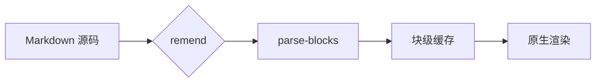

# Zant Markdown 渲染一览

原生渲染，不用 WebView：**粗体**、*斜体*、~~删除线~~、==高亮==、`行内代码`、[链接](https://ziglang.org)、自动链接 https://ziglang.org 和脚注[^1]。行内公式与正文基线对齐：$e^{i\pi} + 1 = 0$，$\sum_{k=1}^{n} k = \frac{n(n+1)}{2}$，其中 $U=[u_1\ \cdots\ u_m]$；金额 $20 与 $10 不会被当成公式。

> [!TIP]
> 支持 GFM 提示块（NOTE / TIP / IMPORTANT / WARNING / CAUTION）。

> 引用可以嵌套
> > 并包含 **行内格式**

## 列表

- 无序列表
  - 嵌套一层
    - 再嵌套一层
1. 有序列表
2. 从任意序号开始
- [x] 已完成的任务
- [ ] 待办的任务

## 表格

| 模块 | 状态 | 说明 |
|:--|:--:|--:|
| remend 修复 | ✅ | 522 条上游用例 |
| 块级缓存 | ✅ | 只重解析变化的块 |
| 数学排版 | ✅ | KaTeX 算法 + STIX Two Math |

## 公式

$$
\int_{-\infty}^{\infty} e^{-x^2}\,dx = \sqrt{\pi}
\qquad
\lim_{n\to\infty}\left(1+\frac{1}{n}\right)^{n} = e
$$

$$
A = \begin{pmatrix} a & b \\ c & d \end{pmatrix},\quad
\det A = ad - bc,\quad
f(x) = \begin{cases} x^2 & x \ge 0 \\ -x & x < 0 \end{cases}
$$

$$
\nabla \times \mathbf{E} = -\frac{\partial \mathbf{B}}{\partial t},
\qquad
\sum_{i=1}^{n} \binom{n}{i} = 2^{n} - 1,
\qquad
\sqrt[3]{x^{2} + y^{2}}
$$

## 代码

```zig
const std = @import("std");

pub fn main() void {
    std.debug.print("hello, {s}\n", .{"zant"}); // 语法高亮
}
```

## 图表



---

[^1]: 脚注会收集到文末，并带返回编号。
